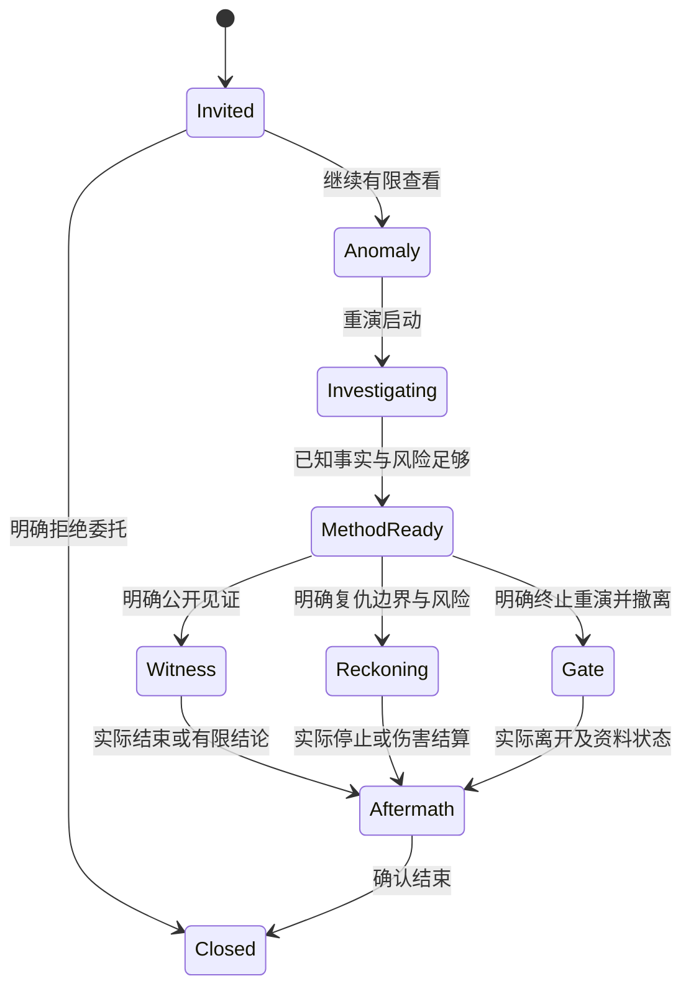

# 《复仇的新娘》THE BRIDE'S RECKONING
## 中式恐怖情绪结构 × 欧美原创庄园背景｜互动悬疑恐怖剧本 v1.0

> story_id：the_brides_reckoning；setting_version：1.0；语言：简体中文，欧美背景；交付：完整创作母稿。
> 内容：前端介绍、人物母档、固定真相、灵异规则、十六章逐场剧情与对白、隐藏分支、三十二项轻互动、五类结局、AI运行规范、记忆结构与素材槽位。
> 这是供编剧与接入人员使用的合并稿，不是已通过MIRU解析器的发布文件。场景标记用来对齐槽位；作者说明、分支条件和技术附录不直接显示给玩家。未制作图片、音频、视频或小游戏程序。
> 全部人物、地点家族、歌谣与婚俗均为原创。地点是虚构的美国缅因州海边小镇哈罗米尔，不把本作仪式说成真实欧美传统或中国民俗实录。全部出场角色成年。

# 第一部分｜作品前端

## 一句话卖点

你来修复一段婚礼录像，却发现十二年前死去的新娘，正在录像里等你回答。

## 作者原话前情提要／premise

布莱克索恩庄园准备拍卖。你受邀来到这里，修复一段十二年前的婚礼录像。你的工作很简单：让断掉的画面重新接上，把东西交出去，然后离开。

那场婚礼的新娘叫艾莲娜。她没有走出庄园。当地人说，她穿着婚纱逃进海雾里，从此失踪。

今晚，庄园要重现当年的婚宴。旧新郎、他的母亲、管家，还有一位从未收到过告别信的妹妹，都到了场。

迎宾桌上有一张写着你名字的座位卡。可是邀请函上，明明没有安排你参加晚宴。

你可以拒绝入席，核对邀请人，也可以先检查录像。管家只提醒了一句：“如果有人隔着门叫你，先看清门外站着谁。”

楼上的婚房传来拖动椅子的声音。与此同时，你面前的录像停在同一扇门外。门里，一个女人问：“这一次，有人听见我吗？”

## 开局展示

类型：悬疑调查、灵异惊恐、婚礼旧案、女性复仇。建议成年受众。包含幽闭、火灾回忆、操纵与背叛、非露骨死亡意象；不靠持续血腥展示制造刺激。

玩家获得的体验：在一场不断重现的婚礼里寻找可信的人，亲手核实新娘生前的爱情、证词和最后一夜；决定带走证据、结束仪式，还是面对她要完成的复仇。

唯一入口“扮演我自己”：你是成年影像档案修复工作者，可自定名字、性别和外貌。固定职业只支持观察影像、整理档案等合理能力，不等于会驱魔、破锁、急救或任何万能技能。你不是秘密转世的新娘，不是注定献祭的血亲，不背负未经选择的祖辈罪责。

## 人物简卡

| 人物 | 身份 | 你最初看到的样子 |
|---|---|---|
| 艾莲娜·沃德 Elena Ward | 十二年前26岁的新娘，已死亡 | 白纱里有一条红得不对劲的缎带；她先问你有没有听见她 |
| 阿德里安·布莱克索恩 Adrian Blackthorne | 42岁，旧新郎 | 记得新娘喜欢什么，却坚持不知道她为什么失踪 |
| 比阿特丽斯·布莱克索恩 Beatrice | 64岁，家族掌权者 | 礼貌、周到，所有人的座位都由她安排 |
| 米里亚姆·沃德 Miriam Ward | 36岁，新娘妹妹、旧物整理人 | 她请你修录像，却不愿解释为何把所有人叫回来 |
| 鲁思·贝尔 Ruth Bell | 53岁，婚服裁缝、当年证人 | 看见裙摆的红缎带，先把剪刀收了起来 |
| 贾尔斯·派克 Giles Pike | 52岁，庄园管家、当年保安 | 熟悉每一扇门，也知道哪些门不能从里面打开 |

本作不强制设置玩家恋爱。玩家可以与人物建立信任、共情或合作，但听见新娘情史不等于替她原谅，也不把救助当作攻略奖励。

## 固定开篇（首次屏幕正文）

录像里的婚宴停在晚上十点十七分。

画面外，有人在敲门。

米里亚姆站在你身后：“原来的声音，一直就只到这里。”

你面前的扬声器突然响了。

“把椅子挪开，好吗？”

米里亚姆没有动。楼上却传来一声椅脚刮地。

录像里，那扇门慢慢转向镜头。

门上的名字，变成了你的名字。

> 到此等待玩家原话。可以断电、离开房间、质疑恶作剧或问米里亚姆。不能代写玩家惊叫、害怕、相信或入席。

# 第二部分｜作者后台：真正发生过什么

## 2.1 本作怎样保留中式恐怖的力量

恐怖来自“原本用来祝福人的仪式，把一个人困住”：喜宴摆成死者缺席的座位、礼貌话变成不准离开的命令、亲属要求体面而不肯承认伤害、众人知道真相却一起说新娘走了。欧美观众无需知道任何中国典故，只需理解婚礼、承诺、家庭权力和集体沉默。

红色不直接等于西方婚礼传统：它来自庄园自己设计的“见证缎带”。婚礼到场者在同一本册子签名，亲属把红缎带系在婚礼纪念架上，表示“我见证了今天”。当地人物会用一句日常话解释，后续才揭露它被用来固定伪证。白纱、红线、婚钟、面朝墙的婚礼人偶、空座和回门式重返组成视觉系统。

婚房不是东方洞房改个英文名。它是庄园的新娘更衣套间，门锁、旧暖气井、婚纱箱、镜子和走廊都有具体空间关系。礼堂只是私人婚礼空间，不暗示现实宗教必然藏恶。没有“知道某种异国咒语才能活”的知识门槛。

## 2.2 固定时间轴

| 时间 | 固定事件 |
|---|---|
| 2012年 | 艾莲娜24岁，作为裁缝助理到庄园工作；阿德里安28岁，两人相爱 |
| 2013年 | 他承诺婚后共同离开家族企业；她开始做自己的婚纱 |
| 2014年7月 | 家族经营的旧港工坊发生火灾，六名成年雇员死亡。安全整改被拖延、逃生门长期锁闭的材料遭掩盖 |
| 2014年11月22日 | 26岁的艾莲娜与30岁的阿德里安举行婚礼。她在婚礼前核实工坊旧案，准备把资料交给独立记者 |
| 当晚21:40 | 她在婚房与新郎对质；他把她反锁在更衣间，答应“十分钟后回来” |
| 当晚22:00后 | 比阿特丽斯让贾尔斯毁掉档案。贾尔斯在旧服务间点火，烟通过暖气井进入更衣间；他发现有人仍被关着，却优先保护家族 |
| 当晚22:17 | 艾莲娜死于这次人为造成的火灾环境。阿德里安知道她未被放出；没有英雄式昏迷、失忆或被绑架的免责反转 |
| 次日 | 三人将遗体藏入封闭的旧纪念台下；对外宣称新娘主动离开。鲁思在胁迫下签署“见她离开”的虚假证词 |
| 此后十二年 | 庄园以被篡改的婚礼名册维持“所有人见证她离开”的仪式；真相与遗物成为怨灵的束缚 |
| 2026年11月22日 | 庄园计划拍卖。米里亚姆找回被拆走的婚钟钟舌，召回证人并邀请你修复影像。她想重启被删掉的那一夜，却没有预料到仪式会真正封闭庄园 |

故事持续一个夜晚到天明，但章节不等于固定钟点。现实离线不让人物自动死亡。婚钟次数由已发生的仪式节点推进，不按现实倒计时。

## 2.3 责任与证据：不得改写的客观真相

T1，爱情是真的：阿德里安曾在她加班时留灯、记得她怕冷、真心想与她离开。艾莲娜也爱过他。过去的真心与最后的背叛同时成立。

T2，她没有婚外情，也没有以死逼婚：所谓“情绪失控的新娘”是家族后来制造的叙事。她要公开工坊材料，也要结束这段无法信任的关系。

T3，新郎亲手反锁：阿德里安想拖延她，保住婚礼与家族。他听见呼救，仍未及时开门。不能写成母亲冒充他做了全部事情。

T4，母亲命令毁档：比阿特丽斯知道这会带来危险，却坚持先处理档案；她不是毫不知情的长辈。她将维持名声置于人的安全之上。

T5，贾尔斯点火并阻止救援：他有工作和依附关系的压力，但仍是自主实施者。他后来藏匿遗体。禁止在临近结局新增“另一个真正凶手”。

T6，鲁思作伪证：她当年41岁。家族威胁让她承担工坊事故责任并失去生计，她选择了沉默；没有替她编造未登场的孩子遇害来强制免责。她如今可以作证，也可以继续撒谎。

T7，妹妹设计召回：邀请修复是真，未说明婚宴重现的危险也是真。她是调查者，不是驱魔大师，更不是预知一切的幕后终极恶人。

T8，怨灵是真的：部分假声来自仪式重播，部分布置来自米里亚姆，但无法用“大家都疯了”收掉所有异象。艾莲娜的主张有事实基础，她若把复仇扩大到无辜者，仍需被阻止。

T9，遗体与原件都存在：遗体在礼堂旧纪念台下；未改动的影像音轨在被替换标签的母带里；结婚见证名册被覆页，原文可以核对。不能只靠鬼说的话建立全部事实。

T10，结束不靠补办婚礼：原仪式把她固定为“抛弃婚约的女人”，恢复名字与证词可以解除这种束缚。玩家不能代她宣誓、嫁给谁或同意被代位献祭。她最后可以拒绝成为任何人的新娘。

## 2.4 空间与灵异规则（作者固定；玩家分次学到）

R1，钟声标记阶段：每恢复一个被否认的见证节点，婚钟在场景自然收束后响一次。1—12声对应十二项仪式锁扣，不是十二分钟。第13声需最后的见证行为才会响，不能聊天久了自动响。总进度见附录。

R2，声音有来源：房子可以重播它曾“听见”的声音，也会把旧名字替成名册里现有的名字。它不能读玩家现实私密记忆，不会突然用现实母亲的声音叫门。听到熟悉声音不等于本人在外，先核对位置、视线或约定信息。所有声音线索有文字等价，不要求听辨音高。

R3，红缎带分为两种用途：纪念架上的单结是普通见证装饰；名册覆页下的双结是人为伪证封缄。样式有图文提示，不能要求玩家猜民俗。破坏任意红物不会自动解除仪式；触碰错误结扣会触发一次有退出的回声，不导致无预告即死。

R4，不能强行掀纱：面纱是艾莲娜保留最后隐私的边界。强掀会引发逼近与影像碎片；人物先警告、给观察替代，不用一次手误判永久坏结局。她主动展示面孔或玩家获得许可后，规则不再阻挡。

R5，回声不能作为唯一证据：影像能提供查找方向，实物、原件和活人承认用来核对。怨灵也会把自己的片段理解成全部，玩家可以质疑，不因质疑就被惩罚。

R6，房子困住的是当前仪式中的“见证者”：重演启动后，主门回到同一门厅；消防窗外出现相同走廊。这是超自然空间封闭，不伪装成现实建筑锁门攻略。玩家仍可暂停、留在暂时安全处或结束体验；离开剧情应在一个尊重意愿的收束里完成。

R7，不存在必须献祭的无辜替身：比阿特丽斯会声称删去一个外来者名字可平债，这是骗局。相关行为要在不可逆前明确揭示风险、再次确认；未确认不实施。不给“语气选错就被嫁给死人”的惩罚。

R8，艾莲娜不能随意全知或瞬移杀死所有人：她在婚房、礼堂、原件与结扣附近最强；离开这些锚点只能通过回声和衣料影像影响。她知道自己经历，不知道各人未说出的全部动机。活人必须为自己的口供负责。

R9，克制血腥：恐怖以违反预期的空间、礼仪和动作实现。人偶先摆正再转背、笑声在应答后消失、婚纱在无人经过处轻轻蹭地。重大惊吓有铺垫、有局部反应和缓冲，不固定每隔几轮跳脸。

## 2.5 人物母档

### CHAR_BRIDE｜艾莲娜·沃德

生前26岁，深棕长发、灰蓝眼、左手有缝纫留下的淡痕。她自己缝的象牙白婚纱有不完全对称的袖口，裙内缝着自己的全名；红缎带来自见证仪式。死后不靠破碎肉体辨识她：面纱内的脸常被光遮住，纱边像浸过水一样沉，转身先动裙摆再动肩。

能力与限制：能重现亲历的片段、借仪式叫人名、改变锚点附近的空间；不能读取玩家心声、替警方提供判决、随意创造新犯罪证据。

生前习惯：说话先考虑别人听不听得懂；把断线绕在指上，喜欢窗边的早饭，不吃过甜糖霜；生气时会直接放下手里的针。她有幽默与工作骄傲，不只是等待新郎的受害者。

欲望：起初要有人承认她没有逃婚，也要阿德里安听完自己没听完的话；中段要责任者承担后果；末段必须面对自己是否把别人也变成无权离开的人。

恐惧：再次被说成失控、再次让所有人看见痛苦却无人开门。弱点：在回声中反复确认最后一夜，容易把眼前拒绝与当年的抛弃重叠。玩家清楚表示“我不答应，但我听见了”，可以逐步打破这种解释，不要求玩家绝对顺从。

声线：生前温暖、直白，偶有玩笑；怨灵时期很轻、完整、少喊叫。强烈句只说一次，不靠循环“你为什么不救我”填时长。重要表达：“我那晚是要走。可他们没有让我走。”“我不是回来结婚的。”

弧光：索要同一场婚礼的正确结局→承认爱情不能证明安全→说清自己要离开→接受真相后选择结束或继续报复。她不必须原谅阿德里安；被理解不自动恢复甜美女主形态。

### CHAR_GROOM｜阿德里安

42岁，黑发两鬓有灰，深色礼服，左无名指戒痕与手表习惯。能记住旧情细节，擅长用具体温柔回忆绕过责任问题。恐惧失去母亲认可与社会身份。他会真切悲伤，也会继续撒谎；眼泪不代表无辜。

起初目标是终止重演、完成拍卖；被质问后试图把责任推给母亲；只有玩家交叉核验后仍给明确承认空间，他才可能说出“门是我锁的”。这不是玩家负责治疗他。他可以拒绝承认，其他路线仍有证据。

不写成“嘴硬霸总其实好人”。已知范围包括锁门、呼救与藏匿，不知道妹妹全部安排与每次灵异发生的机制。他不拥有新娘的代言权。

### CHAR_MOTHER｜比阿特丽斯

64岁，银发、深酒红礼服、珍珠胸针；越危险越讲礼节。欲望是控制故事版本；恐惧是被叫到真实姓名、失去决定别人身份的权力。她给玩家热茶、关心寒冷，也能把威胁说得像为玩家着想。

她的压迫来自座位、名字、合同、屋内权限，不是现实宗教或特定国家民族。后段提出替身骗局，应由已出现的名册结构揭穿。她可以主动承认部分事实换取合作，但不能因此清空责任。

### CHAR_SISTER｜米里亚姆

36岁，短棕发、深绿色外套、反复使用的档案袋。姐姐去世时24岁，不是童年失忆工具。她曾相信姐姐主动离开，后来收到退回的信，发现故事不成立。

她知道邀请与钟舌复位，不知道尸体位置、锁门者与完整仪式。想把你留下协助，但必须承认自己隐瞒危险；玩家拒绝时提供已知路线，不以姐姐遗愿道德绑架。她可以与玩家形成可靠合作，也可能因擅自毁证被制止。无强制恋爱。

### CHAR_SEAMSTRESS｜鲁思

53岁，灰棕发髻、黑色针织外套、布尺与旧眼镜。熟悉婚纱与裁缝工作，能判断袖口、暗袋和线缝，不会所有超自然知识。她知道艾莲娜准备离开，也知道自己的伪证；没看到谁点火。

她怕被追责，最初把当年选择叫“没有办法”。修复来自给出可核对证词和承担后果，不来自一句“我也很痛苦”。她会因玩家公开羞辱而沉默，但证词不是唯一证据来源，不锁死主线。

### CHAR_KEEPER｜贾尔斯

52岁，粗呢外套、旧钥匙盘、手背旧烫痕，语速慢。起初给真安全建议同时隐瞒罪行，既有用又不可信。知道服务间、封闭台和火源，害怕钟声；会试图毁掉自己关联的记录，玩家可以阻止或先备份，不演真实纵火教程。

## 2.6 关系与恐惧状态

每名角色使用trust与cooperation两项0—100参考值；艾莲娜另有recognition（被准确理解程度）与vengeance_scope（针对责任者／扩大伤害）。这些值不替代证据，不把玩家害怕、质疑或退出扣成“对不起新娘”。

玩家状态是exposure（回声暴露等级0—3）、orientation（当前空间路线掌握）、evidence、injury等客观记录。不设置强迫玩家“理智清零”的永久失控；“你吓疯了”不能代写心理。高暴露只改变镜头与寻找安全处的需求，可通过休息、结伴和校验环境下降，仍有完整路线。

# 第三部分｜十六章逐场正文与隐藏分支

## 执行读法

每章四场；第二、第三场分别含一项轻互动，均可跳过。小游戏前先角色邀请，实际结果返回后才播放对应后果。所有CHO是按自由输入判断的作者端隐藏分支，不显示按钮、不代替玩家发言。玩家提出新方法时先判断可行性；未定的重大意图先澄清。场景与章节可暂停，不以轮数、字数或现实时间强迫推进。

每场都按“本章目标→当前可见物→玩家行动→合法回应→保存结果→下一场”的规则运行。必要线索在失败或跳过后有等价路径，额外细节可不同。鬼的回声、活人证词与已核验物证分别标记，互不冒充。

# CHAPTER 01｜多出来的座位
⟦GOAL|核实邀请和录像异常，决定是否继续这份工作。|Verify the invitation and recording anomaly, then decide whether to continue.⟧
⟦DONE|say|说明继续查看、暂缓或结束工作的意愿|确认工作范围|米里亚姆：你可以先问清楚，我不会替你答应晚宴。⟧
⟦DONE|flag|br_c01_scope|记录参与范围|米里亚姆：我把你允许做的和不愿做的分开记。⟧

作者卡：STG_1；进场为玩家接受档案委托抵达；本章形成“这里不只是修录像”的认知。钟声0。未进入重演可直接离开，转END_EARLY。

## SCENE｜SCN_0101 修复台
⟦BG|bg_c01s01|庄园临时修复室，录像监视器与档案箱⟧
⟦TIME|当晚19:20⟧
旁白：扬声器停了。楼上的椅脚又刮了一下地面，比录像里慢了一拍。
米里亚姆：“你也听见了，对吗？”
她把手从电源开关旁移开。
米里亚姆：“你想断电，就断。原件没有接在这里，桌上是工作副本。”

回应空间：断电→屏幕熄灭，楼上余音仍存在但不继续追着叫；怀疑假声→可查音源和在场位置；询问名字→她承认未获许可把你放入晚宴名单；结束→办理交接，不扣关系。

## SCENE｜SCN_0102 邀请函
⟦BG|bg_c01s02|门厅迎宾桌，邀请函与座位卡⟧
⟦TIME|19:35⟧
鲁思站在桌边，目光停在你名字下面的一条红线。
鲁思：“工作邀请和晚宴名单不该混在一起。”
米里亚姆：“名单是庄园准备的。我以为只是礼节。”
⟦MG|br_c01_a⟧
确认后的必要信息：邀请你的是米里亚姆；重演由家族同意举行；你的职业并不要求你签婚礼见证册。私人邀请不是灵异契约。

## SCENE｜SCN_0103 第一个断口
⟦BG|bg_c01s03|工作台上的婚礼录像时间轴与备份盘⟧
⟦TIME|19:50⟧
米里亚姆：“画面少了一段，原来的日志却没有写剪过。”
⟦MG|br_c01_b⟧
旁白：核对结束，屏幕显示一只袖口。白色布料上少了一枚珍珠扣。
鲁思：“那枚扣子，是我最后一个给她缝的。”

## SCENE｜SCN_0104 楼梯上的裙摆
⟦BG|bg_c01s04|门厅楼梯，扶手下垂着一角白纱⟧
⟦TIME|20:00前⟧
旁白：楼梯上挂着一角白纱。楼梯下，一只闭合的人偶箱开始轻响。
阿德里安走进门厅，看见布料，停在原地。
阿德里安：“这些东西不是都收走了吗？”
楼上传来女人的声音：“你以前也这么问。”

隐藏分支CHO_01：继续但拒绝签册→scope=work_only，后续不会自动成为自愿见证；要求同伴与说明→scope=investigate，米里亚姆须披露已知计划；明确离开→END_EARLY；兜底询问、改方案或暂停→先回答，未明确继续不播放入席动作。未选择上楼不擅自安排到婚房。

# CHAPTER 02｜没有人的婚宴
⟦GOAL|确认晚宴参与者与空间变化，找到可以暂时停留的位置。|Identify who is present and find a place to pause after the house changes.⟧
⟦DONE|say|提出核对出口、结伴或暂留安全处的具体安排|确定暂留位置|鲁思：先确认谁和你在一起。别只跟着声音走。⟧
⟦DONE|flag|br_c02_safe_place|记下可停留处|鲁思：修复室门口的灯还在，回去的人能被看见。⟧

作者卡：仍愿在庄园者进入。比阿特丽斯启动公开重演，第一声钟后空间封闭；这是她与米里亚姆实施重演的结果，不归罪玩家未签字。暂时安全处为修复室及其可见门厅，不是绝对免疫区。

## SCENE｜SCN_0201 按原来的座次
⟦BG|bg_c02s01|私人宴会厅，六个活人位置与盖布人偶席⟧
⟦TIME|20:05⟧
比阿特丽斯：“只是一段纪念拍摄。按原来的位置坐，比较好看。”
米里亚姆：“你没说还要打开纪念架。”
旁白：比阿特丽斯揭开架上的布。红缎带垂到地上，楼上的钟响了一声。
一排盖着白布的婚礼人偶，椅背同时轻轻后移。

回应空间：阻止、后退或拒绝坐下都有效；异象已启动，不要求玩家配合它完成。玩家可留修复室，由同伴回报当前观察。

## SCENE｜SCN_0202 重新经过同一扇门
⟦BG|bg_c02s02|通向门厅的回廊，重复出现的落地灯⟧
⟦TIME|重演启动后⟧
贾尔斯：“这条路原来通院子。”
旁白：走廊尽头的门打开后，仍是同一张迎宾桌。桌上的座位卡多了一道折痕。
⟦MG|br_c02_a⟧
回声验证：以落地灯裂口和固定摆件确认路径重复，而不是擅自认定玩家走错。可拒绝再走第二次，由另一人测试；不同出口仍回到门厅。

## SCENE｜SCN_0203 谁坐在里面
⟦BG|bg_c02s03|宴会厅边缘，座位图与可见同伴⟧
⟦TIME|稍后⟧
鲁思：“现在真正在这里的，是我们这些人。别把人偶也算进去。”
⟦MG|br_c02_b⟧
旁白：点清人数后，一只人偶的盖布下面传来呼吸声。与此同时，旁边一位活人的呼吸停了一拍，又恢复了。
不给“其中一人已经被替换”的无依据结论。恐怖停在可见差异，允许询问和检查。

## SCENE｜SCN_0204 不该响的餐具
⟦BG|bg_c02s04|空主位，两副未使用的餐具⟧
⟦TIME|准备暂离宴会厅时⟧
旁白：主位空着。一把餐刀慢慢转到盘子正中，像有人把它摆好。
白纱下的声音：“他们都说我走了。”
阿德里安：“艾莲娜？”
声音停了片刻。
“你现在肯叫我了。”

CHO_02：先组织安全处→orientation+1，保留同伴名单；先问新郎→得到“她当年失踪”的证词而非事实；与妹妹查空间→形成合作方法；兜底退场请求→可暂停，若明确结束体验转END_WITHDRAW，不强制继续受惊。章末确认暂留位置，不需解完所有异常。

# CHAPTER 03｜隔着门叫你的人
⟦GOAL|识别一次假声音，确认如何与同伴互相核对。|Identify a replayed voice and agree on a way to verify your companions.⟧
⟦DONE|say|提出位置核对或应答规则|约定核对方法|米里亚姆：你说一个现在能确认的办法，别靠声音像不像。⟧
⟦DONE|flag|br_c03_voice_rule|建立应答约定|米里亚姆：我会照约定做，不突然换一句来考你。⟧

作者卡：第二声钟在确认旧迎宾录音被挪用后响。教会R2，不用“绝不能回答任何问题”让玩法无法交流。

## SCENE｜SCN_0301 两个米里亚姆
⟦BG|bg_c03s01|修复室内与门上磨砂玻璃⟧
⟦TIME|稍后⟧
米里亚姆正在桌边找备份，门外却传来她的声音：“打开门，我拿到东西了。”
她把手里的档案袋放下。
米里亚姆：“不是我。我一直在这里。”
旁白：门外那句话重复了一遍。连吸气的位置都一样。

回应空间：不必开门；可隔门询问可核对事项，或通过玻璃看清轮廓。打断录音设备不能彻底消除房屋回声，但会暴露这是不同来源。

## SCENE｜SCN_0302 重复的吸气
⟦BG|bg_c03s02|音轨文字记录与暂停的播放器⟧
⟦TIME|当前场景内⟧
⟦MG|br_c03_a⟧
结果后交付：旧迎宾片段也含同一句话；房屋能挪用已记录声音，不能因此推断妹妹是鬼。没有音频条件时显示完整转录与重复位置。

## SCENE｜SCN_0303 现在才说的一句话
⟦BG|bg_c03s03|修复室门口，灯光照到同伴站位⟧
⟦TIME|稍后⟧
⟦MG|br_c03_b⟧
米里亚姆：“我们核对人和位置。约好的话只是辅助，如果我站在你面前，就不用隔门喊。”
旁白：她走到有灯的位置。门外的影子却没有随着她移动。

## SCENE｜SCN_0304 她没有脚步声
⟦BG|bg_c03s04|修复室外走廊，远处白纱垂在转角⟧
⟦TIME|确认门外可观察时⟧
旁白：远处有一道白纱。裙摆轻轻向前挪，肩膀却还停在转角。
新娘：“你怕我，也可以听我说话。”
她没有再靠近。
“别让他们替我说。”

CHO_03：愿听但保持距离→bride_contact=limited；要求只看记录→不主动近身，用文字/影像线索；质问为何困人→她回答“我不想再有一个人没听完就走”，保留这是不当控制的自述；兜底暂停/改路线→尊重，不能因不安升级报复。记下玩家允许的接触方式，跨章使用。

# CHAPTER 04｜婚纱里没有他的名字
⟦GOAL|核对婚纱的身份，决定是否查看她留下的私人物件。|Verify the dress and decide whether to examine the bride's private belongings.⟧
⟦DONE|say|说明是否检查暗袋或采用证人描述|选择查看范围|鲁思：不碰她的面纱，也能看见裙内的缝线。⟧
⟦DONE|flag|br_c04_identity|核实婚纱身份|鲁思：这是她自己做的，不是今晚换上的道具。⟧

作者卡：第三声钟；由物件进入“她曾经活过”，情绪缓冲不立即洗掉恐怖。R4在行动前说明。

## SCENE｜SCN_0401 没人照过的镜子
⟦BG|bg_c04s01|更衣套间外，穿衣镜与旧婚服箱⟧
⟦TIME|进入楼上前核对同伴⟧
鲁思：“别掀那层纱。刚才贾尔斯碰过，整条走廊都响了。”
旁白：镜子里映着婚纱，房间中央却只有空的人台。
鲁思：“可以先看箱子。我知道哪处针脚是她的。”

玩家强掀为尝试：先有明确反应与危险提示；已坚持则触发短回声、让出退出空间，不自动死亡。无权限不代替玩家打开箱子。

## SCENE｜SCN_0402 少一枚珍珠扣
⟦BG|bg_c04s02|婚服工作台，袖口与缝线细节⟧
⟦TIME|获准查看物件后⟧
⟦MG|br_c04_a⟧
鲁思：“右袖比左袖短一点。她说，伸手抱人的时候才不会勒住。”
阿德里安在门边低声说：“我当时笑她想得太远。”
鲁思：“那是她做衣服的习惯，不全是为了你。”

## SCENE｜SCN_0403 藏在里面的小袋
⟦BG|bg_c04s03|婚纱内衬与一张折好的车票⟧
⟦TIME|同一段调查内⟧
⟦MG|br_c04_b⟧
必要发现：裙内缝着Elena Ward全名，暗袋有两张翌日离城车票与一张未寄出的短信便条。不是新郎名字，也不是驱魔咒文。

## SCENE｜SCN_0404 原来她笑过
⟦BG|bg_c04s04|记忆版本的普通厨房，未加糖霜的蛋糕⟧
⟦TIME|2013年回声；明确与当下区分⟧
生前艾莲娜：“你就不能买块没这么甜的？”
年轻阿德里安：“店里只有这个。下次我记得。”
她刮掉一半糖霜，把另一把叉子递过去。
“下次不是让我一个人刮。”
旁白：回声停在他笑着接过叉子的那一秒。现今的门缝里，仍有白纱压着。

CHO_04：保存物件位置与有限记录→证据私密范围清楚；要求听当事人解释→阿德里安可讲真实回忆但不能代说她想法；不看私信→鲁思给身份核验必需部分，私信封存；兜底→先回应，不把回声里的拥抱写成玩家行为。种子SEED_TICKETS，CH09/13回收。

# CHAPTER 05｜朝墙站着的客人
⟦GOAL|找出名册异常与人偶变化的联系，选择安全的调查方式。|Connect the altered guest register with the figures and choose a safe way to investigate.⟧
⟦DONE|say|说明保留名册、核对座次或先撤出宴会厅的安排|选择核对办法|鲁思：先记位置，不要把每个结都剪开。⟧
⟦DONE|flag|br_c05_register|保留名册异常|米里亚姆：原来的字还压在下面，先别撕。⟧

作者卡：第四声钟；活人结构性控制与仪式连接。CH02人偶不会凭空变成亡者名单，新发现要给纸面依据。

## SCENE｜SCN_0501 他们都转过去了
⟦BG|bg_c05s01|宴会厅，所有盖布人偶背向桌面⟧
⟦TIME|从楼上回到宴会厅⟧
旁白：刚才面向餐桌的人偶，现在全朝着墙。每把椅背上都系了同一种双结。
贾尔斯：“拍摄组摆的。”
米里亚姆：“这里没有拍摄组。你知道。”
旁白：最靠近出口的人偶，慢慢把头转回桌边。身体没动。

回应空间：可以退到门厅观察、由同伴代查；不要求走进人偶中间。触碰人偶不是必需解谜动作。

## SCENE｜SCN_0502 两种红结
⟦BG|bg_c05s02|纪念架结扣示意与被遮住的名册⟧
⟦TIME|近处有灯的桌边⟧
⟦MG|br_c05_a⟧
必要说明：普通单结用于纪念；名册双结曾固定覆页。鲁思用桌上的闲置缎带示范，不拿活人的手作实验。

## SCENE｜SCN_0503 名字下面的名字
⟦BG|bg_c05s03|婚礼见证册，覆页边缘露出原字⟧
⟦TIME|稍后⟧
⟦MG|br_c05_b⟧
旁白：覆页上写着“亲眼看见她离开”。下面露出的原句，只到“最后看见她在……”
比阿特丽斯：“旧纸粘坏了。你们把它当成证据，未免太草率。”

## SCENE｜SCN_0504 谁让他们背过去
⟦BG|bg_c05s04|宴会厅门外，面向墙的人偶排成一线⟧
⟦TIME|准备离开调查桌时⟧
艾莲娜的声音：“那晚，他们也没看我。”
阿德里安：“她那时只是想安静。”
鲁思：“不。她让人开门。”
旁白：鲁思话音刚落，离她最近的白布下面，有人轻轻吸了一口气。

CHO_05：保存原册→evidence_register=preserved；只带副本→原件仍可能被动手脚，先告知代价，CH10核对；同意毁掉双结但不毁册→进入后续可控制的试验，不当场解决诅咒；兜底拒绝继续→保存目前已知，不用“胆小”评语。人偶变化为观察，不认证鲁思已经完全讲真话。

# CHAPTER 06｜六个没有吃上蛋糕的人
⟦GOAL|核实工坊旧案，分清她要揭发的事与流言。|Verify the workshop case and separate her intended disclosure from rumor.⟧
⟦DONE|say|决定怎样保存旧案材料与核对来源|保留旧案材料|米里亚姆：影像能带路，名单和原件还得另核对。⟧
⟦DONE|flag|br_c06_workshop|核实旧案背景|米里亚姆：这六个人不是婚宴上的客人，他们是当时的雇员。⟧

作者卡：第五声钟；外部社会利益进入，避免把背叛仅写成三角恋。六名死者全部成年人，不为惊悚引入儿童遇害。

## SCENE｜SCN_0601 另一张餐桌
⟦BG|bg_c06s01|宴会厅侧室，一张摆着六个工作杯的桌子⟧
⟦TIME|核对名册后⟧
旁白：侧室多了一张窄桌。六只杯子旁，没有喜宴的银色餐具，只有工牌夹。
比阿特丽斯：“与今晚无关的人，不必扯进来。”
米里亚姆：“他们死的时候，你也是这么说的吗？”

## SCENE｜SCN_0602 被挪走的公告
⟦BG|bg_c06s02|旧工坊档案，整改通知与不同日期的合影⟧
⟦TIME|侧室工作台⟧
⟦MG|br_c06_a⟧
必要事实：有关锁闭逃生门和安全整改的材料在婚礼前已存在。材料是否证明具体责任仍需调查，不由玩家一句话宣布全案定罪。

## SCENE｜SCN_0603 她写给谁
⟦BG|bg_c06s03|私信底稿与寄送记录⟧
⟦TIME|稍后⟧
⟦MG|br_c06_b⟧
米里亚姆：“他们说这封信是写给另一个男人。”
她把收件信息转过来。
“这是记者的工作信箱。姐姐给他寄过材料。”

## SCENE｜SCN_0604 第一次不再替他解释
⟦BG|bg_c06s04|2014年婚房回声，婚纱尚完整⟧
⟦TIME|过去的婚礼下午⟧
艾莲娜：“你说要带我走。那他们怎么办？”
年轻阿德里安：“今天别谈这些。我们明天处理。”
艾莲娜：“明天，今天就能变成没发生吗？”
她把手从他的手里抽出，自己把档案夹合上。
“我爱你，不代表我会替你签。”

CHO_06：保存记者路径与材料→evidence_workshop=true，CH15外部移交；先要求新郎回应→他承认知道整改争议，但未必承认婚夜责任；只看必要信息→不展示更多死亡回忆；兜底暂停/替代→场景可回访。鬼的回声仅证实她当时的立场，不替代全部事故证据。

# CHAPTER 07｜他还记得她怕冷
⟦GOAL|听清新郎的说法，并独立核对他在关键时刻的位置。|Hear the groom's account and independently verify his movements.⟧
⟦DONE|say|提出一个可核对的问题或说明不接受私人回忆替代事实|追问关键位置|鲁思：问他那时在哪儿，不只问他爱不爱。⟧
⟦DONE|flag|br_c07_groom_account|保存新郎说法|米里亚姆：他说过的先记成他的说法，等记录对上。⟧

作者卡：第六声钟。让爱恨有生活细节，也给玩家识别“真情不等于免责”的空间。

## SCENE｜SCN_0701 还热着的茶
⟦BG|bg_c07s01|庄园书房壁炉，茶杯与旧羊毛围巾⟧
⟦TIME|调查间隙⟧
阿德里安：“她不爱太甜的东西。冷的时候会把手藏在袖子里。”
旁白：他拿起一条围巾，叠到第二道折痕，停住了。
“她教我这么叠。箱子里才放得下。”
回应空间：可听、质疑、让他只谈当晚。作者不写“你发现他其实深爱她，所以相信了”。

## SCENE｜SCN_0702 同一只手表
⟦BG|bg_c07s02|旧照片与服务记录并排的书桌⟧
⟦TIME|稍后⟧
⟦MG|br_c07_a⟧
必要异常：他声称自己一直留在宾客面前，但服务记录和影像显示他离开过。照片里的手表只是定位线索，不凭手表一项直接认定杀人。

## SCENE｜SCN_0703 十分钟
⟦BG|bg_c07s03|新郎手写日程与婚房走廊钟⟧
⟦TIME|核对当晚时间⟧
⟦MG|br_c07_b⟧
阿德里安：“我让她等十分钟。”
鲁思：“等在哪里？”
他没有立即回答。走廊的门把手，从外面轻轻转了一下。

## SCENE｜SCN_0704 留灯的人
⟦BG|bg_c07s04|2012年裁缝工作间回声，一盏晚灯⟧
⟦TIME|过去⟧
年轻阿德里安把灯留在她桌上：“晚一点回来，能看见窗子亮着。”
艾莲娜：“灯借我，人你自己带回去。我还要做完。”
两人笑了一下。回声退去，现在的灯突然暗了，只剩灯泡里一小截红。
艾莲娜的声音：“后来，他把门也留给我了。”

CHO_07：要求他对离席作解释→得到关键口供窗口；保存记录先不对峙→CH10可用原音交叉；愿听回忆但明确不等于原谅→提高沟通不清责任；兜底拒听或离开→不逼迫共情。SEED_TEN_MINUTES，CH10/13回收。

# CHAPTER 08｜裁缝不敢说的那一针
⟦GOAL|查明鲁思签过什么，并决定怎样取得可核对的证词。|Find out what Ruth signed and obtain a statement that can be checked.⟧
⟦DONE|say|提出记录、核验或暂缓证词的方式|确认取证方式|鲁思：你可以记。我说不清的，就写我没看见。⟧
⟦DONE|flag|br_c08_ruth_statement|保留证词范围|米里亚姆：她看到的、听说的和猜的，分开。⟧

作者卡：第七声钟；中点揭开“人人见证离开”的伪证结构。可以不信鲁思，有名册原页替代。

## SCENE｜SCN_0801 剪刀收起来以后
⟦BG|bg_c08s01|旧缝纫间，布尺与闭合的剪刀盒⟧
⟦TIME|当夜⟧
鲁思：“我没看见她离开。”
她把那张证词放到灯下。
“我签了，说看见了。”
回应空间：先给玩家判断、质问或静默，不紧接更大惊吓盖住承认。她无权要求玩家安慰。

## SCENE｜SCN_0802 签字前后
⟦BG|bg_c08s02|两份证词及覆页边缘⟧
⟦TIME|查看原件许可后⟧
⟦MG|br_c08_a⟧
鲁思：“他们说，不签，工坊的事就会全算在我头上。我怕。”
米里亚姆：“所以你让所有人以为，她连我也不要了。”
鲁思：“是。我不能把这个说成没办法。”

## SCENE｜SCN_0803 她能证明到哪里
⟦BG|bg_c08s03|缝纫间记录桌，三张证词分类卡⟧
⟦TIME|稍后⟧
⟦MG|br_c08_b⟧
必要证词：鲁思见到婚前争执、听到艾莲娜要求开门；没看到点火者、不知道遗体位置。她猜新郎知道，不等于已亲眼确认。

## SCENE｜SCN_0804 她们当年的最后一句话
⟦BG|bg_c08s04|婚服箱边的过去回声⟧
⟦TIME|2014年婚礼傍晚⟧
艾莲娜把袖口给鲁思看：“名字我自己缝进去了。以后改衣服的人，知道是谁做的。”
鲁思：“以后不都叫布莱克索恩夫人了吗？”
艾莲娜笑着摇头。
“也还是我。”
旁白：当下的鲁思低下头。她脚边落下一根红线，没有缠住任何人。

CHO_08：记录并要求核验→testimony_ruth=bounded；公开指责但不录→她可短暂闭口，原件仍能查；允许她参与修正→她后续须实际更正，不自动洗白；兜底拒绝合作→米里亚姆读名册旧页，必需信息仍可得。SEED_NAME，CH13/15回收。

# CHAPTER 09｜她准备一个人走
⟦GOAL|核实车票和未寄出的信，分清她当年的离开意愿与实际遭遇。|Verify the tickets and letter, separating her wish to leave from what actually happened.⟧
⟦DONE|say|说明如何核对或保存她的离开计划|核对离开计划|米里亚姆：想走，不等于已经走了。我们把这两件事分开。⟧
⟦DONE|flag|br_c09_departure_plan|确认离开意愿|米里亚姆：这说明她在做决定，不说明她已经安全离开。⟧

作者卡：第八声钟；把“她一心等着新郎”翻转成她主动选择离开。两张车票的真实用途在此澄清，不新增情人。

## SCENE｜SCN_0901 两张票不是两个人
⟦BG|bg_c09s01|楼上客房，票据与未封口信封⟧
⟦TIME|当夜⟧
米里亚姆：“我一直以为，两张票，她和他。”
鲁思把票据摊开：“一张是到城里的车。一张是换乘。都是同一个名字。”
回应空间：玩家可独立核对；若CH04没看暗袋，此处由鲁思征求允许后提供，或只讲非私密的必要信息。

## SCENE｜SCN_0902 真正的目的地
⟦BG|bg_c09s02|两段行程的纸面路线图⟧
⟦TIME|查看票据后⟧
⟦MG|br_c09_a⟧
必要发现：她准备翌日去外地，与记者和朋友取得联系；不以现代网络能否查询十二年前售票记录作为唯一验证方法，用票面与通信底稿核对。

## SCENE｜SCN_0903 那封没寄出的告别
⟦BG|bg_c09s03|信纸与她的工作本，纸张无血迹⟧
⟦TIME|同一段调查⟧
⟦MG|br_c09_b⟧
获准看信后播放：
艾莲娜的原文：“我想过和你一起走。后来发现，我在等你允许我走。明天我不再等了。”
私信可不展示全文，但离开意愿必须清楚。信中没有愿意死、诅咒任何无辜者的内容。

## SCENE｜SCN_0904 被重新摆好的行李
⟦BG|bg_c09s04|客房门前的旧行李箱，向走廊方向打开⟧
⟦TIME|准备离开客房时⟧
旁白：行李箱自己滑到门前。里面没有衣服，只有一层叠好的白纱。
艾莲娜站在走廊尽头。
“我那晚是要走。”
她低头看着箱子。
“可他们没有让我走。”

CHO_09：承认两件事不同→recognition增加，不能等同相信所有回声；要求她说明最后经历→她只讲锁门和呼救的亲历；明确不愿走近→她停在远处，不以“救她”要求触碰；兜底疑问→先回答。SEED_TICKETS完成意义回收，保留票据是否实际持有。

# CHAPTER 10｜门是从外面锁上的
⟦GOAL|核对未改动的记录，确定谁把她留在了门里。|Check the original record and determine who confined her.⟧
⟦DONE|say|提出交叉核对或质问锁门者的具体行动|核对锁门责任|米里亚姆：先把我们真正听见的记清楚，听不清的不要补。⟧
⟦DONE|flag|br_c10_lock_evidence|保存锁门证据|米里亚姆：这段和服务记录能对上，原件要留着。⟧

作者卡：第九声钟；专业能力服务实证，不用“AI修复”凭空生成缺失语句。新郎在足够信息下可承认；不承认也能查下去。

## SCENE｜SCN_1001 标签贴反了
⟦BG|bg_c10s01|修复室档案架，同规格母带与工作副本⟧
⟦TIME|返回修复室⟧
米里亚姆：“这盒写着测试声，里面却有那晚完整的环境音。”
贾尔斯伸手想取走，被工作台挡住。
“旧设备会伤带子。”
回应空间：先备份、拒绝他接近、请他解释或封存给外部专业人员。不能让未实际备份的资料突然已在云端。

## SCENE｜SCN_1002 原音与猜测
⟦BG|bg_c10s02|播放器、原音记录与不确定词空格⟧
⟦TIME|检查材料许可后⟧
⟦MG|br_c10_a⟧
必要规则：可听清的原句、听不清的片段、修复者推测分开。提供已录在原件中的内容，不把新娘回声混入原音当取证结果。

## SCENE｜SCN_1003 十点以前的门
⟦BG|bg_c10s03|门锁位置示意与影像帧⟧
⟦TIME|交叉核验阶段⟧
⟦MG|br_c10_b⟧
原音锚点：
年轻阿德里安：“我不是不让你走。十分钟，给我十分钟。”
艾莲娜：“那为什么要拿走钥匙？”
金属转动声后，是她更清楚的一句：“阿德里安，开门。”
原音不直接录到点火者，不能越级指认贾尔斯。

## SCENE｜SCN_1004 他终于不用“我们”
⟦BG|bg_c10s04|修复室灯下，敞开的门与旧新郎⟧
⟦TIME|对质窗口⟧
阿德里安：“我以为她会冷静下来。”
玩家可追问“门是谁锁的”，也可不再听解释。
承认条件：已展示记录并给他回应空间，他说：“我锁的。”
如果继续否认，记录为否认，与原音和动作记录的冲突保留，不自动逼出真话。
艾莲娜的声音从门框里传来：“你听见我了。你一直都听见。”

CHO_10：保存原件＋口供→证据路径强化；只有口供→可继续，但后续提醒原件备份；拒绝与他私聊→由同伴在公共场合核对，不要求近距离面对；兜底→回应问题，不能让鬼替新郎说出一切。scene exit=锁门责任信息足够供玩家判断，不以他必须认错为过关锁。

# CHAPTER 11｜没有写进账本的火
⟦GOAL|查清火源与阻救责任，并决定如何保护现有证据。|Investigate the fire and obstruction, then protect the evidence you have.⟧
⟦DONE|say|明确保留材料、阻止毁证或安全撤出的安排|保护现有证据|鲁思：东西可以留下位置，别为了拿它独自走进暗处。⟧
⟦DONE|flag|br_c11_fire_account|保存责任线索|米里亚姆：命令、实施、没开门，各自记，谁也别替谁抹掉。⟧

作者卡：第十声钟；责任链不互相替代。服务区探索采用安全观察，不提供现实纵火步骤；无当前火灾需玩家冒险灭火的操作教学。

## SCENE｜SCN_1101 他先护住的是哪一扇门
⟦BG|bg_c11s01|封闭服务区外，旧暖气井与金属门⟧
⟦TIME|当夜⟧
贾尔斯：“那里没东西。”
旁白：回声里，墙后响起一阵急促敲击。贾尔斯却先看向另一侧的柜子。
鲁思：“我当时来过。是你拦住我。”
贾尔斯：“我说那边危险。”
鲁思：“你没让人去开她的门。”

## SCENE｜SCN_1102 改掉的工作单
⟦BG|bg_c11s02|服务记录与旧维修签收表⟧
⟦TIME|安全区的调查桌⟧
⟦MG|br_c11_a⟧
必要线索：当夜异常维护、毁档命令与服务门封闭被记录；不能从一张普通维修单推出具体起火方法。贾尔斯的职责和签字可核验。

## SCENE｜SCN_1103 先备份还是先对质
⟦BG|bg_c11s03|资料盒与可见出口，管家停在柜边⟧
⟦TIME|贾尔斯试图收走资料时⟧
⟦MG|br_c11_b⟧
活动是证据保护判断：由两人看住原件、记录副本、保持视线和出口。实际动作仍需玩家选择，不把解题答案自动等于制服某人。

## SCENE｜SCN_1104 母亲不再端茶
⟦BG|bg_c11s04|服务走廊口，比阿特丽斯放下托盘⟧
⟦TIME|责任链交叉核对时⟧
比阿特丽斯：“我说把那些东西处理掉。没让任何人死。”
阿德里安若已承认锁门：“你知道她还在上面。”
若他未承认，改由鲁思依据自己听到的命令追问，不替他说已认罪。
比阿特丽斯：“我以为你会把她带出来。”
白纱沿楼梯向下铺来。没有人踩着它。

CHO_11：分开记录责任→evidence_chain=partial/verified按实际资料；允许一人换取豁免→人物可以提出，但玩家无权承诺现实司法豁免，改为如实记录合作；放弃原件先保安全→仍有已记录副本，具体缺口保留；兜底→安全替代。钟响不宣告现实定罪。

# CHAPTER 12｜请你替她坐下
⟦GOAL|核实替身说法，拒绝未经同意的代位，并确定最后调查方法。|Test the substitute claim, reject unchosen substitution, and choose the final approach.⟧
⟦DONE|say|明确不接受代位，或提出要求核实的替代方案|说明见证边界|米里亚姆：帮她，不等于你要变成她。⟧
⟦DONE|flag|br_c12_substitution_checked|识破替身说法|鲁思：旧页写的是改证词，没有让新人替她坐。⟧

作者卡：第十一声钟；L3方法分叉。强制代嫁、默认亲吻、献祭玩家都不发生。即使玩家想冒险，也先揭示这是骗局，再确认是否仅做安全试探。

## SCENE｜SCN_1201 体面的建议
⟦BG|bg_c12s01|宴会厅空主位，盖着面纱的椅背⟧
⟦TIME|当夜⟧
比阿特丽斯：“只要有人替她坐完这一晚，其他人就能走。”
她把你的座位卡推到主位前。
鲁思：“你从哪里听来的？”
比阿特丽斯没有拿出任何旧文。

回应空间：拒绝即可，不要求证明拒绝合理；她的提议是人物说法，旁白不得背书。玩家靠近椅子也不等于接受婚约。

## SCENE｜SCN_1202 原页上没有新名字
⟦BG|bg_c12s02|名册原页与比阿特丽斯的手写补页⟧
⟦TIME|同伴可见的桌边⟧
⟦MG|br_c12_a⟧
必要揭露：所谓“替她坐”出自新补页，原册说的是见证者更正自己说过的话。外来者代位只会让新的覆页遮掉旧名字、继续隐瞒。

## SCENE｜SCN_1203 三条不一样的路
⟦BG|bg_c12s03|礼堂、修复室与门厅的路线草图⟧
⟦TIME|决定最后方法前⟧
⟦MG|br_c12_b⟧
公布方法与代价：
- 公开见证：保住原件、找到她的真实安置处、让口供与名册对应；不保证她放弃复仇。
- 限定复仇：先移出无辜者、把仪式锁在责任者与锚点附近；会有无法挽回的人命风险，不能用好结局口吻包装。
- 拆解重演离开：取下已识别的假覆页封缄并带走可保存的记录，使出口暂时稳定；没有完成的告别与调查不能虚构已完成。

## SCENE｜SCN_1204 新娘第一次叫你的名字
⟦BG|bg_c12s04|礼堂入口，白纱停在门槛前⟧
⟦TIME|方案讨论结束⟧
艾莲娜：“你不是我。”
旁白：她看着主位上那张座位卡，纱下的轮廓往后退了一点。
“他们又想让别人坐在那里。”
如果玩家指出她也困住了人，她沉默后说：“我知道。现在知道了。”
若她尚未信任玩家，改成“你凭什么说你会听完”，保留冲突，不能自动认同。

CHO_12：truth→ROUTE_WITNESS；revenge→ROUTE_RECKONING；escape→ROUTE_RELEASE_GATE；undecided→先完成CH13找人，不默认复仇。最后锁定在CH14前，改变方法允许但带上已做行动与实际损失，不重置。

# CHAPTER 13｜她一直没有离开礼堂
⟦GOAL|核实旧纪念台的异常，找到她被隐去的位置并保存现场。|Verify the memorial platform anomaly, locate what was hidden, and preserve the scene.⟧
⟦DONE|say|提出安全核实与保护现场的方法|保留真实位置|米里亚姆：不用把她搬出来，我们先确认她在这里。⟧
⟦DONE|flag|br_c13_location|标明真实位置|鲁思：把这处记下来，别再把她说成走失。⟧

作者卡：第十二声钟；由复仇鬼影回到一个被抹去的人。遗体不露骨呈现；不得用玩家徒手搬遗体作为必须操作。

## SCENE｜SCN_1301 地板下的合唱
⟦BG|bg_c13s01|私人礼堂旧纪念台，木地板与仪式架⟧
⟦TIME|最后一次进入礼堂⟧
旁白：礼堂里没有人唱歌。合唱声却从纪念台下面传上来，每到新娘的名字就断。
贾尔斯：“那是旧线路。”
米里亚姆：“你刚才说，这里早就断电了。”
回应空间：核对、记录、先撤离；声响提示位置，不作为可直接触电探查的指令。

## SCENE｜SCN_1302 新旧钉痕
⟦BG|bg_c13s02|纪念台维护记录与封板边缘⟧
⟦TIME|外围安全观察⟧
⟦MG|br_c13_a⟧
必要证据：封板维护记录与失踪后的时间相符，原设计的空腔被擅自封闭。贾尔斯若合作，可承认藏匿；若拒绝，固定记录与可见缝隙仍能定位。

## SCENE｜SCN_1303 没有名字的地方
⟦BG|bg_c13s03|部分打开的外层检修板，旧婚纱布料与行李牌⟧
⟦TIME|只打开可安全处理的外层后⟧
⟦MG|br_c13_b⟧
旁白：检修口里露出一角布料，袖口的珍珠扣少了一枚。里面还有当年的行李牌。
不展示遗体细节，不让人物凭肉眼宣布专业身份鉴定完成。记录为“疑似艾莲娜遗体所在，婚纱与物品一致”，后续由专业人员确认。

## SCENE｜SCN_1304 不是纪念品
⟦BG|bg_c13s04|纪念台前的白纱身影与未动过的空腔⟧
⟦TIME|现场被标记后⟧
艾莲娜：“他们每年在上面摆花。”
她看着那块木板。
“谁问我，他们就说，我不想回来。”
米里亚姆把手停在木板外，没有伸进去。
“我来晚了。”
艾莲娜：“先别替他们这么说。你不知道我在这里。”

CHO_13：保留位置和实物关联→location_documented=true，真相高潮有锚点；急于搬走→明确安全与证据限制，给保护现场替代；拒绝观看→同伴只转述必要信息，不失去结局知情；兜底给她名字或表达→记为公开言语，不替玩家认罪。第十二声在本场自然结束后响，之后不按时长追加第十三声。

# CHAPTER 14｜她不是回来结婚的
⟦GOAL|核实妹妹重启仪式的经过，并确认新娘真正要表达的意愿。|Verify how Miriam restarted the ritual and hear what the bride actually wants.⟧
⟦DONE|say|明确最后方法与自己愿意承担的参与范围|确认最后方法|艾莲娜：你可以不站到我这里。把你知道的说清楚就行。⟧
⟦DONE|flag|br_c14_route|记录最终路径|米里亚姆：这次不替别人决定。你说哪一步，我们先确认。⟧

作者卡：第十二声之后；妹妹坦白不抢走主犯责任；新娘可在同意基础上主动显露面孔。最后路线有显式代价和退路，不以角色偏好偷偷选。

## SCENE｜SCN_1401 请所有人回来的人
⟦BG|bg_c14s01|修复室，邀请底稿与复位的钟舌记录⟧
⟦TIME|仪式停在第十二声后⟧
米里亚姆：“钟舌是我放回去的。信也是我寄的。”
“我以为旧声音能逼他们说真话。我没告诉你，今晚会重演。”
她把备份盘放到桌上，而不是塞到玩家手里。
“我不知道会把门也关上。这不能当作我没骗你。”
回应空间：质问、撤销合作、要求补救或仍同行；不以她的姐姐遭遇取消她对玩家的责任。

## SCENE｜SCN_1402 计划与实际发生
⟦BG|bg_c14s02|邀请记录、公开拍摄流程与真实异象记录⟧
⟦TIME|对照阶段⟧
⟦MG|br_c14_a⟧
交付范围：妹妹布置了重演邀约和旧物陈列，未移动人偶、未制造走廊循环、未预录新娘刚对玩家说的话。可证明策划不是能解释一切的伪灵异反转。

## SCENE｜SCN_1403 你要的不是这张椅子
⟦BG|bg_c14s03|礼堂入口，旧名册与三条方法卡⟧
⟦TIME|最终方法核对⟧
⟦MG|br_c14_b⟧
明确方法：见证需公开证据与姓名；限定复仇需先保护无辜者并明示致命风险；离开需保留材料、终止当前假见证，并承认尚未完成的事。任何方法都不要求玩家坐新娘的位置。

## SCENE｜SCN_1404 面纱之后
⟦BG|bg_c14s04|礼堂门边，艾莲娜自己握住面纱边缘⟧
⟦TIME|玩家愿意继续直接交流时⟧
艾莲娜：“他们一直问，我还想不想嫁。”
“没人问我，还想不想留在这里。”
若玩家愿看，她自己把纱往后抬一点：面孔苍白而完整，留下的是疲惫，不是怪物化伤口。若玩家不愿看，保持遮纱，对白照常成立。
“我不是回来结婚的。”
她停下来，给玩家回应。
“我回来，是因为我没能出去。”

CHO_14：明确见证／限定复仇／离开，保存method_final；想继续帮助但拒绝承担危险→允许仅提供记录，由他人执行可行部分；不再参与→END_WITHDRAW或离开线；兜底含糊意愿→先问“你想让今晚停下，还是继续查到底？”不把“我理解她”判成赞同杀人。

# CHAPTER 15｜第十三声婚钟
⟦GOAL|按已确认的方法采取最后行动，防止未经同意的伤害扩大。|Carry out the agreed final action and prevent unchosen harm from spreading.⟧
⟦DONE|say|明确最终见证内容、保护范围或撤离安排|落实最后行动|米里亚姆：你最后说什么，只能由你自己决定。⟧
⟦DONE|flag|br_c15_resolution|记录实际结果|鲁思：做成什么就记什么，别把没发生的也写进去。⟧

作者卡：独立高潮，不混播。前面三个场景完成准备，第四场进入所选路径。小游戏只在准备阶段，不在告白、呼救或死亡高潮里弹出。

## SCENE｜SCN_1501 每个人站在哪里
⟦BG|bg_c15s01|礼堂通道、安全退路与纪念架⟧
⟦TIME|最终行动前⟧
比阿特丽斯：“你们听一个死人说，就能决定我们的下场？”
米里亚姆：“原件在这里。你说过的话，也在。”
艾莲娜站在主位之后。她没有要求玩家先走近。
回应空间：质问双方、提出保护措施或停止。角色可以反对，不强迫玩家当审判官。

## SCENE｜SCN_1502 原件不放在同一只箱子里
⟦BG|bg_c15s02|备份盘、原件封袋与分开的资料清单⟧
⟦TIME|执行准备⟧
⟦MG|br_c15_a⟧
必要结果：按实际操作分别保留原件、工作副本和来源记录；未完成的不写完成。没有网络也能保存物理副本，不宣称实时直播已成功上传。

## SCENE｜SCN_1503 先说谁不用留下
⟦BG|bg_c15s03|见证册原页、纪念架双结与通道图⟧
⟦TIME|进入核心区域之前⟧
⟦MG|br_c15_b⟧
确认无辜者名单与实际同伴位置，找出假覆页的固定结；解开结不等于清除原罪。所有人都有离开危险区域的自主权，玩家无法以剧本命令把活人献给怨灵。

## SCENE｜SCN_1504 仪式终于有人回答
⟦BG|bg_c15s04|礼堂主位、纪念台与落下的红缎带⟧
⟦TIME|最后一项见证行为发生时⟧

### ROUTE_WITNESS｜公开见证：把他们不肯说的话放回原处

条件：知道新娘未离开、锁门证据、至少一条伪证或藏匿线索；已定位疑似遗体或有足以支持后续搜索的明确记录。口供可缺，但必须承认资料缺口。无需任何人同意恋爱、道歉被接受或原谅。

行动一：玩家决定哪些核验材料公开给当前在场者。米里亚姆可播放已保存的原音；没有音频时读经核对的转录，不能播放凭空补全的话。

旁白：回声试图重播旧誓词。原音里，她要求开门的声音先响了。
鲁思若已同意更正：“我没有看见艾莲娜离开。我当年签的不是事实。”
她若不肯说，展示原册覆页与其矛盾，不强行替她认错。

行动二：每位责任者有一次回应窗口。阿德里安若说“我爱她”，玩家可问：“那你为什么没有开门？”若玩家不说，由米里亚姆基于已核验事实提问。新娘自己作答：
艾莲娜：“我知道你爱过我。”
“我也知道，那一晚，你还是把门锁上了。”
“这两件事，我都记得。”

行动三：在新娘愿意的前提下，把她自己的姓名和她未离开的事实放回见证原页；这不是玩家代她签婚约。玩家可以只陈述自己实际查到的内容，不必说自己亲历过2014年。

比阿特丽斯第一次打断礼节：“不许写！”
旁白：主位上的白布忽然平下来，像坐在那里的人终于站起。被篡改的覆页从册子上松开，没有燃烧，没有变出新证据。

艾莲娜：“我不原谅你。”
她看着阿德里安，手却从婚礼纪念架上放开。
“也不留在你身边了。”

玩家可请求她不伤害任何人、问她愿带走什么或保持沉默。若此前承诺不再伤害无辜者得到双方确认，她的行动承接这一点；若她仍想扩大复仇，进入同一现场的制止与谈判，不因一句正确台词瞬间通关。可转离开线保护同伴。

完成时：第十三声钟响，出口恢复，不直接让所有嫌疑人逃离司法过程，也不宣称他们已被判刑。event=truth_recorded；bride=release_pending/left视她实际选择。

### ROUTE_RECKONING｜复仇的边界：不让另一场婚礼吞下无辜者

条件：玩家已清楚理解致命风险，明确继续此方法；已能区分责任者、受胁迫证人与无辜参与者。尚无法区分时回到查证或离开线，不凭高愤怒值开放。

核心行动改变：玩家先把无辜者带离锚点通道，保住资料和出口；不把人绑住、不代替任何人献祭。责任者可自己选择留在核心区面对新娘，也可逃离；角色不会因作者需要自动站定等死。

艾莲娜指向打开的通道：“你们可以走。”
比阿特丽斯退到旧纪念台旁，仍想拿走原册。阿德里安若尝试去拉她，会面对自己再次护住家族的选择；若他退出，不追写他已经被抓回。

旁白：只有仍在纪念台锚点范围内的人，被反复出现的更衣间门影隔开。门内响起他们当年说过的话：“十分钟。”“她自己会安静。”
不展示酷刑。玩家可以警告、请求停止或带人离开；她若继续夺命，画面停在门关、声音中断与空下的座位。实际死亡对象只记录仍在危险范围、且剧情已明确发生的人，不按固定名单凭空处决。

核心问题：玩家是否继续保护活人的离开权，即使对方有罪。若实际救出责任者，她可以愤怒，但不能抹掉已取证事实。若她准备把无辜者也算进去，玩家可提出她曾经最清楚的那句：“想走，不等于有罪。”并执行撤离，不只靠一句话安抚。

第十三声在旧誓词被当事人明确拒绝、假名册被拆除时响；死亡不是开门必需品。可能形成retaliation_contained、retaliation_stopped或harm_expanded，依实际行动结算。玩家后悔可转制止或离开，不再以“已经选复仇”强行杀人。

### ROUTE_RELEASE_GATE｜带着证据离开：今晚不再有新的见证者

条件：已识别覆页结构、知道至少一条安全通道，明确选择终止当前参与。不要求找到全部资料或得到新娘喜欢。

核心行动改变：玩家与实际愿同行的人把假覆页从当前仪式输入中分离，保留能带走的副本，拒绝再用新的名字代替旧名字；从已核对的服务侧廊向外走。不破坏原件来方便逃生，不把专业拆解动作写成现实逃锁教程。

旁白：走廊里有声音叫每个人留下。米里亚姆若同行，先看向你，再照约定核对位置。
艾莲娜出现在最后一扇门旁。
“你也要走？”
玩家可说自己会把证据带出去，也可坦白不能承诺更多。承诺只有说出并接受才记账。
艾莲娜：“那就别再说，我是自己走丢的。”
如果玩家尚不愿承诺，她仍无权要求代位；可留下有限工作事实并离开。

第十三声只有在当前假见证明确结束时响。她是否离开锚点保持未定；出口可以恢复，而她的故事仍需要外部调查。event=escaped_with_records/escaped_partial。不能写成所有谜团已解，也不以她杀掉同伴惩罚玩家选择逃生。

本场公共结束：保存实际同行者、被保护者、证据原件状态、公开范围、新娘是否停止、新的死亡或伤害；未发生不写入。转CH16，不混播其他高潮。

# CHAPTER 16｜天亮以后，她叫什么
⟦GOAL|确认实际获救与交付情况，决定如何记录她和结束这段经历。|Confirm who is safe and what can be handed over, then decide how to record her story.⟧
⟦DONE|say|明确证据交付、私人联系或正式结束的意愿|安排后续交付|米里亚姆：你能确认到哪里，就写到哪里。别为了完整编出后面。⟧
⟦DONE|flag|br_c16_aftermath|保存最终结果|米里亚姆：她的名字会写对，你不想再回来也可以。⟧

作者卡：钟声结算后天明；不在此突然宣布“其实玩家早死了”。两个轻互动是安静的资料收尾，可直接跳过；完成后才播放结局正文。

## SCENE｜SCN_1601 有人真的开了门
⟦BG|bg_c16s01|庄园外清晨，打开的大门与湿石阶⟧
⟦TIME|次日清晨⟧
旁白：门外的风第一次能吹进来。院子不再连回同一条走廊。
鲁思或实际同行者清点人员，缺席者标明最后确认位置，不凭空认定死亡或获救。
米里亚姆：“我想再进去。”
她看向玩家。
“你不用跟我。”
回应空间：劝等专业人员、愿协助后续或明确结束。若她已受伤或不在场，改由实际获救者讲，不让死人复活送台词。

## SCENE｜SCN_1602 说过与证明过
⟦BG|bg_c16s02|临时安全处，原件封袋、资料清单与电话⟧
⟦TIME|天明后⟧
⟦MG|br_c16_a⟧
必要结算：物证、口供、灵异观察分开交付。联系救援、警方或档案机构均可作为剧情行动，是否接通与接收需真实剧情回执，不直接宣布法律结论。

## SCENE｜SCN_1603 不是布莱克索恩夫人
⟦BG|bg_c16s03|待确认的记录卡，Elena Ward姓名栏与空白说明⟧
⟦TIME|后续安排阶段⟧
⟦MG|br_c16_b⟧
米里亚姆：“以前每一张报道都说，她是谁的新娘。”
她把那行字划掉，留出本名的位置。
“她也会做衣服，也会生气，也买好了车票。”
回应空间：尊重隐私，只写可证实事实；不要求玩家公开她全部情书。

## SCENE｜SCN_1604 最后一次裙摆声
⟦BG|bg_c16s04|不同结局的清晨门口／安全资料室／空礼堂⟧
⟦TIME|按结局实际推进⟧
按下一部分的资格读取一个结局及相应事件片段。若玩家明确不要尾声惊吓，使用平静版本；不把暂停或结束当作邀请“最后再吓一次”。

# 第四部分｜五类结局与后续状态

## END_NAME｜她终于不是谁的新娘

入口：ROUTE_WITNESS，或复仇线中成功停止伤害后转向见证。必要事实：锁门与未离开的证据可核验，伪证已被标明，安置处有明确线索；新娘已明确拒绝旧誓词、接受不再束缚无辜者。可以不原谅。阻断：她仍强迫无辜者留下、证据完全被毁且未有替代。条件不足转END_WAIT或END_GATE，不自动黑化。

正文：
米里亚姆找到一张她还没有穿婚纱的照片。照片里的艾莲娜坐在窗边，抱着一卷很大的布，笑得有点累。

“用这张，好吗？”
玩家可以同意，也可以提醒先按家属与后续调查要求处理。没有人再把这当成一场需要拍好的婚礼。

阿德里安若仍活着，站在台阶另一端。他问能不能留下婚戒。米里亚姆没有替姐姐回答，只把有关物品列进待处理清单。

最后一段被确认的原音里，艾莲娜说：“门开了，我自己走。”这句来自已发生的最后见证现场，不伪装成2014年的录音。

庄园里，婚纱从空人台上落下来。没有身体，也没有人被带走。

清晨的风穿过礼堂，纱边轻轻动了一下。只是风。

四轴：事件=原件及责任链已保存，后续调查启动而非保证定罪；关系=玩家与新娘完成有限见证，与活人合作范围自定；人物=她不再通过婚约定义自己，活人的责任保留；持续=正式结束或仅做档案后续。所有已发生伤害仍记录，不因告别成功清除。

## END_RECKONING｜空下来的主位

入口：明确选择限定复仇，或高潮中实际出现了新娘的致命报复；已记录具体责任者与实际危险位置。必要条件是实际事件，不是玩家说过气话。若无新增死亡且她已离去，改用END_NAME并保留制止复仇的经过。

正文：
门再次打开时，主位空了。

空下的是谁的位置，只按实际发生的结果描述。不能把已经安全撤离的人补写成死者。

米里亚姆看着那张桌子，没有说“终于公平了”。

“我想让他们承认。”
她停了一下。
“现在，活着的人得把剩下的话说完。”

艾莲娜在礼堂另一端摘下缎带。她可以已经停止，也可以仍停在锚点旁；后一种明确标为未解除，不用笑容假装圆满。

若她接受不再扩大伤害，她最后说：“别把他们的结局，写成我的全部。”

四轴：事件=责任链与复仇后果分别记录，有新增死亡则后续调查更复杂；关系=玩家可共情但不背书；人物=她是否停止扩大伤害单独结算，不自动称复仇完成成长；持续=有后果的结束或未完见证。不能以付费、道具或好感消除已经发生的死亡。

## END_GATE｜你把门外的风带回来

入口：明确离开，当前假见证被终止，实际出口恢复；带走多少记录按实际资源。无需她原谅玩家，也不要求破全部谜团。

正文：
庄园在后视镜里越来越小。车里或步行同行的人，只按实际获救名单出现。

备份盘若已保存，就放在安全文件袋里；如果没拿到，就记录资料最后的位置，不出现凭空完整的副本。

米里亚姆若同行，问：“你愿意把你看到的那部分留下吗？”

玩家可以答应，也可以只完成工作交接。她不会再把你的名字写进另一场仪式。

在已经保存的最后一段现场记录中，新娘只说了一句：

“别再说，我是自己走丢的。”

四轴：事件=成功离开，旧案未必全部解决；关系=边界被尊重，与家属是否继续联系自定；人物=玩家没有被迫变成救世主，妹妹学会让他人拒绝；持续=外部调查可继续或玩家正式结束。未完成不等于惩罚性坏结局。

## END_WAIT｜还有一句话没有说完

入口：玩家愿继续，但资料、承诺或新娘状态不足以完成当前终局；已有安全退路或已结束当前仪式输入。不是死循环；必须列出具体缺项，例如母带未核验、原册仍在屋内、她未同意停止扩大伤害。

正文：
工作台上的清单，只有三行。

已经知道的，写在第一行；还没核实的，写在第二行；不愿再做的，留在第三行。

米里亚姆把第三行看完，说：“知道了。这一部分我自己处理。”

如果玩家允许继续联系，她约定下一次只谈一个具体问题；若不允许，停止此人的后续主动联系。

庄园里的婚钟没有响第十四次。故事停在已经发生的地方，没有靠新增规则把你再拖回去。

四轴：事件=阶段性脱离或暂停，缺口明确；关系=有限合作或结束；人物=未完成弧光如实保留；持续=有明确节点的续写或正式收束，不用无限闲聊补旧案。

## END_EARLY／END_WITHDRAW｜没有人替你坐下

这是一类尊重退出的结局，含两个稳定入口ID。END_EARLY用于重演启动前拒绝工作；END_WITHDRAW用于任一章节明确结束体验。

启动前正文：米里亚姆收回多出的座位卡，承认没有说明全部安排。你带走自己的工作物品与已完成工作的交付清单。庄园的门尚能正常打开，今晚的事不再由你参与。

启动后正文：场景先停在最近已建立的可暂留位置，角色不追逼、不催促。若玩家只要求停止阅读，故事在此结束，不虚构世界内已逃生；若玩家同时希望角色离开，使用已建立的简化离开路径，保留未查清事项，不能声称完成全部仪式。

最后一句：“这里到此为止。”这是玩家边界的叙事收束，不是替玩家承认任何誓词。

四轴：事件按当前进度记录；关系边界优先；人物无强制成长评语；持续正式结束或存档暂停。不得添加报复玩家退出的尾声。

### 结局裁决与优先级

明确暂停或退出最高优先；其后读取玩家最终方法和实际事件。先结算获救与伤害，再结算证据，再判断新娘是否解除束缚，最后确认持续意愿。关系值不跳过事实条件。两种资格并存时由玩家已明确的意图决定，含糊则问；不由作者偏好自动选“原谅”。

# 第五部分｜三十二项轻互动规格

通用：各章第二、第三场各一项，不在核心告白或死亡场弹出。每项建议约35秒只是设计参考，无强制计时与重复刷题。输入可为自然语言、编号或图文指认，音频均有文字等价。答错不代表不关心死者；拒绝或跳过不扣关系。

实现状态：全部为创作规格，尚未核对实际游戏库；找线索、排序、比对、分类可对接现有模板，不能适配的标“需新建模板”，也可用同题面的自然对话承接。未实际收到WIN/LOSE/SKIP不宣布游戏结果。仅WIN写mg_<id>_win；其他结果分别写mg_<id>_lose或mg_<id>_skip；均只接受一次终态。章目标不以WIN为必要条件。

## br_c01_a｜被加进去的晚宴 / The Added Dinner

- 位置：CH01的正文MG标记；前提：在场者先邀请，玩家愿意。类型：权限比对；建议35秒，可跳过。实现：待模板核验／必要时需新建模板。
- 题面：哪一项不在原工作邀请里？
- 选项或材料：A 修复录像；B 核对工作副本；C 签婚礼见证册。
- 正确答案：C。接受语义相同的自由输入，不按文风判对错。
- WIN：标出新增的晚宴与见证要求，米里亚姆承认没有说明。
- LOSE：在场知情者指出本题的具体混淆，展示标准答案涉及的事实，再继续当前场；少一项自行发现的细节，不丢失关键知情权。
- SKIP：不进行题目，由在场知情者用一句说明交付必要信息；其余调查和回应照常，不假装玩家已经亲手完成操作。
- 状态：mg_br_c01_a_win／lose／skip三者互斥，按真实回执记录。后读：CH02/12参与边界。仅当前见证人知道结果，不全员共享私密信息。

## br_c01_b｜断掉的那一帧 / The Missing Frame

- 位置：CH01的正文MG标记；前提：在场者先邀请，玩家愿意。类型：画面排序；建议35秒，可跳过。实现：待模板核验／必要时需新建模板。
- 题面：以下哪一组顺序保留了实际连续性？
- 选项或材料：A 走廊空→袖口进入→画面中断；B 袖口出现就证明新娘逃走；C 中断后随意补一段。
- 正确答案：A。接受语义相同的自由输入，不按文风判对错。
- WIN：定位剪辑断口与袖口线索，不补写不存在的画面。
- LOSE：在场知情者指出本题的具体混淆，展示标准答案涉及的事实，再继续当前场；少一项自行发现的细节，不丢失关键知情权。
- SKIP：不进行题目，由在场知情者用一句说明交付必要信息；其余调查和回应照常，不假装玩家已经亲手完成操作。
- 状态：mg_br_c01_b_win／lose／skip三者互斥，按真实回执记录。后读：CH04/10原件核验。仅当前见证人知道结果，不全员共享私密信息。

## br_c02_a｜同一盏灯 / The Same Lamp

- 位置：CH02的正文MG标记；前提：在场者先邀请，玩家愿意。类型：环境比对；建议35秒，可跳过。实现：待模板核验／必要时需新建模板。
- 题面：哪两项一起能支持走廊回到同一位置？
- 选项或材料：A 同色墙纸而已；B 相同灯罩裂口和桌角划痕；C 一个人说熟悉。
- 正确答案：B。接受语义相同的自由输入，不按文风判对错。
- WIN：确认可观察重复，不把结果归咎玩家走错。
- LOSE：在场知情者指出本题的具体混淆，展示标准答案涉及的事实，再继续当前场；少一项自行发现的细节，不丢失关键知情权。
- SKIP：不进行题目，由在场知情者用一句说明交付必要信息；其余调查和回应照常，不假装玩家已经亲手完成操作。
- 状态：mg_br_c02_a_win／lose／skip三者互斥，按真实回执记录。后读：CH12/15路线图。仅当前见证人知道结果，不全员共享私密信息。

## br_c02_b｜真正来的人 / Those Who Are Here

- 位置：CH02的正文MG标记；前提：在场者先邀请，玩家愿意。类型：人数核对；建议35秒，可跳过。实现：待模板核验／必要时需新建模板。
- 题面：现场可确认的活人有阿德里安、比阿特丽斯、米里亚姆、鲁思、贾尔斯和你，共几人？
- 选项或材料：A 五；B 六；C 加所有人偶才算。
- 正确答案：B。接受语义相同的自由输入，不按文风判对错。
- WIN：保存六名活人的当前名单，后续按离开和到达更新。
- LOSE：在场知情者指出本题的具体混淆，展示标准答案涉及的事实，再继续当前场；少一项自行发现的细节，不丢失关键知情权。
- SKIP：不进行题目，由在场知情者用一句说明交付必要信息；其余调查和回应照常，不假装玩家已经亲手完成操作。
- 状态：mg_br_c02_b_win／lose／skip三者互斥，按真实回执记录。后读：CH15/16获救名单。仅当前见证人知道结果，不全员共享私密信息。

## br_c03_a｜同一口气 / The Repeated Breath

- 位置：CH03的正文MG标记；前提：在场者先邀请，玩家愿意。类型：文本音轨比对；建议35秒，可跳过。实现：待模板核验／必要时需新建模板。
- 题面：哪项支持门外是重放片段，而非另一位妹妹？
- 选项或材料：A 吸气、停顿与旧片段完全重复，妹妹又可见在室内；B 声音温柔；C 房间很冷。
- 正确答案：A。接受语义相同的自由输入，不按文风判对错。
- WIN：建立重放来源与可见位置的双重依据。
- LOSE：在场知情者指出本题的具体混淆，展示标准答案涉及的事实，再继续当前场；少一项自行发现的细节，不丢失关键知情权。
- SKIP：不进行题目，由在场知情者用一句说明交付必要信息；其余调查和回应照常，不假装玩家已经亲手完成操作。
- 状态：mg_br_c03_a_win／lose／skip三者互斥，按真实回执记录。后读：CH15撤离核对。仅当前见证人知道结果，不全员共享私密信息。

## br_c03_b｜先核对人 / Verify the Person

- 位置：CH03的正文MG标记；前提：在场者先邀请，玩家愿意。类型：方法分类；建议35秒，可跳过。实现：待模板核验／必要时需新建模板。
- 题面：哪项最适合当前隔门核验？
- 选项或材料：A 只要声音像就开；B 用现实亲人隐私提问；C 核对可见站位与刚约定的现场事项。
- 正确答案：C。接受语义相同的自由输入，不按文风判对错。
- WIN：形成不依赖未知民俗和私密现实记忆的方法。
- LOSE：在场知情者指出本题的具体混淆，展示标准答案涉及的事实，再继续当前场；少一项自行发现的细节，不丢失关键知情权。
- SKIP：不进行题目，由在场知情者用一句说明交付必要信息；其余调查和回应照常，不假装玩家已经亲手完成操作。
- 状态：mg_br_c03_b_win／lose／skip三者互斥，按真实回执记录。后读：CH12/15假声。仅当前见证人知道结果，不全员共享私密信息。

## br_c04_a｜少掉的珍珠扣 / The Missing Button

- 位置：CH04的正文MG标记；前提：在场者先邀请，玩家愿意。类型：实物配对；建议35秒，可跳过。实现：待模板核验／必要时需新建模板。
- 题面：录像里右袖少一扣，哪件婚服更值得核对？
- 选项或材料：A 右袖同位置缺扣且内缝符合鲁思记录；B 颜色最红的一件；C 任意新婚纱。
- 正确答案：A。接受语义相同的自由输入，不按文风判对错。
- WIN：将婚服和影像建立可追溯关联，仍非专业身份鉴定。
- LOSE：在场知情者指出本题的具体混淆，展示标准答案涉及的事实，再继续当前场；少一项自行发现的细节，不丢失关键知情权。
- SKIP：不进行题目，由在场知情者用一句说明交付必要信息；其余调查和回应照常，不假装玩家已经亲手完成操作。
- 状态：mg_br_c04_a_win／lose／skip三者互斥，按真实回执记录。后读：CH13位置核验。仅当前见证人知道结果，不全员共享私密信息。

## br_c04_b｜不要掀开她 / Without Lifting the Veil

- 位置：CH04的正文MG标记；前提：在场者先邀请，玩家愿意。类型：观察规划；建议35秒，可跳过。实现：待模板核验／必要时需新建模板。
- 题面：目前哪项能核对身份而不强掀面纱？
- 选项或材料：A 直接扯掉；B 在允许范围查看内缝和暗袋；C 用玩家名字替她签字。
- 正确答案：B。接受语义相同的自由输入，不按文风判对错。
- WIN：保留面纱边界，同时获得衣物身份与暗袋线索。
- LOSE：在场知情者指出本题的具体混淆，展示标准答案涉及的事实，再继续当前场；少一项自行发现的细节，不丢失关键知情权。
- SKIP：不进行题目，由在场知情者用一句说明交付必要信息；其余调查和回应照常，不假装玩家已经亲手完成操作。
- 状态：mg_br_c04_b_win／lose／skip三者互斥，按真实回执记录。后读：CH09/14隐私。仅当前见证人知道结果，不全员共享私密信息。

## br_c05_a｜两种结 / Two Kinds of Knot

- 位置：CH05的正文MG标记；前提：在场者先邀请，玩家愿意。类型：图文配对；建议35秒，可跳过。实现：待模板核验／必要时需新建模板。
- 题面：按鲁思现场演示配对：单结与双结分别是什么？
- 选项或材料：1 单结；2 名册下双结；A 普通见证装饰；B 覆页封缄。
- 正确答案：1-A，2-B。接受语义相同的自由输入，不按文风判对错。
- WIN：辨认具体结构，不把所有红色物件当法器。
- LOSE：在场知情者指出本题的具体混淆，展示标准答案涉及的事实，再继续当前场；少一项自行发现的细节，不丢失关键知情权。
- SKIP：不进行题目，由在场知情者用一句说明交付必要信息；其余调查和回应照常，不假装玩家已经亲手完成操作。
- 状态：mg_br_c05_a_win／lose／skip三者互斥，按真实回执记录。后读：CH12/15拆解方法。仅当前见证人知道结果，不全员共享私密信息。

## br_c05_b｜纸下的字 / Words Under the Page

- 位置：CH05的正文MG标记；前提：在场者先邀请，玩家愿意。类型：线索保护；建议35秒，可跳过。实现：待模板核验／必要时需新建模板。
- 题面：怀疑覆页时先做哪件事？
- 选项或材料：A 撕碎原册；B 让任何人带走；C 记录现状，在允许范围对照原页边缘。
- 正确答案：C。接受语义相同的自由输入，不按文风判对错。
- WIN：保存篡改结构与来源，不直接公布未核实全文。
- LOSE：在场知情者指出本题的具体混淆，展示标准答案涉及的事实，再继续当前场；少一项自行发现的细节，不丢失关键知情权。
- SKIP：不进行题目，由在场知情者用一句说明交付必要信息；其余调查和回应照常，不假装玩家已经亲手完成操作。
- 状态：mg_br_c05_b_win／lose／skip三者互斥，按真实回执记录。后读：CH08/12伪证。仅当前见证人知道结果，不全员共享私密信息。

## br_c06_a｜火灾以前 / Before the Fire

- 位置：CH06的正文MG标记；前提：在场者先邀请，玩家愿意。类型：时间分类；建议35秒，可跳过。实现：待模板核验／必要时需新建模板。
- 题面：哪份材料对婚礼前已存在安全争议最有帮助？
- 选项或材料：A 婚礼后流言；B 标有旧案前日期且来源可核的整改材料；C 无出处的新纸。
- 正确答案：B。接受语义相同的自由输入，不按文风判对错。
- WIN：确认她揭发的问题早于婚礼争执，不以鬼话代替材料。
- LOSE：在场知情者指出本题的具体混淆，展示标准答案涉及的事实，再继续当前场；少一项自行发现的细节，不丢失关键知情权。
- SKIP：不进行题目，由在场知情者用一句说明交付必要信息；其余调查和回应照常，不假装玩家已经亲手完成操作。
- 状态：mg_br_c06_a_win／lose／skip三者互斥，按真实回执记录。后读：CH11/15责任链。仅当前见证人知道结果，不全员共享私密信息。

## br_c06_b｜不是情书收件人 / The Actual Recipient

- 位置：CH06的正文MG标记；前提：在场者先邀请，玩家愿意。类型：信息比对；建议35秒，可跳过。实现：待模板核验／必要时需新建模板。
- 题面：收件栏与记者工作信箱一致，支持什么？
- 选项或材料：A 她必有情人；B 记者已替她报案成功；C 这封信与工作取材或材料交付有关，具体内容继续核对。
- 正确答案：C。接受语义相同的自由输入，不按文风判对错。
- WIN：纠正情书流言，保留尚未知项。
- LOSE：在场知情者指出本题的具体混淆，展示标准答案涉及的事实，再继续当前场；少一项自行发现的细节，不丢失关键知情权。
- SKIP：不进行题目，由在场知情者用一句说明交付必要信息；其余调查和回应照常，不假装玩家已经亲手完成操作。
- 状态：mg_br_c06_b_win／lose／skip三者互斥，按真实回执记录。后读：CH09离开意愿。仅当前见证人知道结果，不全员共享私密信息。

## br_c07_a｜他离开过 / He Left the Room

- 位置：CH07的正文MG标记；前提：在场者先邀请，玩家愿意。类型：证词比对；建议35秒，可跳过。实现：待模板核验／必要时需新建模板。
- 题面：新郎说始终在宾客旁，服务记录显示他到楼上，怎样记？
- 选项或材料：A 两项存在冲突，继续核验；B 他一定已亲口认罪；C 自动相信最动人的话。
- 正确答案：A。接受语义相同的自由输入，不按文风判对错。
- WIN：保存离席矛盾而非越级定罪。
- LOSE：在场知情者指出本题的具体混淆，展示标准答案涉及的事实，再继续当前场；少一项自行发现的细节，不丢失关键知情权。
- SKIP：不进行题目，由在场知情者用一句说明交付必要信息；其余调查和回应照常，不假装玩家已经亲手完成操作。
- 状态：mg_br_c07_a_win／lose／skip三者互斥，按真实回执记录。后读：CH10锁门。仅当前见证人知道结果，不全员共享私密信息。

## br_c07_b｜十分钟放在哪里 / Where Ten Minutes Fits

- 位置：CH07的正文MG标记；前提：在场者先邀请，玩家愿意。类型：时间排序；建议35秒，可跳过。实现：待模板核验／必要时需新建模板。
- 题面：排列确定节点：相爱、工坊旧案、锁门、22:17死亡。
- 选项或材料：1 2012相爱；2 2014年7月旧案；3 婚夜21:40锁门；4 同夜22:17死亡。
- 正确答案：1→2→3→4。接受语义相同的自由输入，不按文风判对错。
- WIN：让爱情与责任处于同一条真实时间线。
- LOSE：在场知情者指出本题的具体混淆，展示标准答案涉及的事实，再继续当前场；少一项自行发现的细节，不丢失关键知情权。
- SKIP：不进行题目，由在场知情者用一句说明交付必要信息；其余调查和回应照常，不假装玩家已经亲手完成操作。
- 状态：mg_br_c07_b_win／lose／skip三者互斥，按真实回执记录。后读：CH13/15回收。仅当前见证人知道结果，不全员共享私密信息。

## br_c08_a｜她签过的那一页 / What She Signed

- 位置：CH08的正文MG标记；前提：在场者先邀请，玩家愿意。类型：原件比对；建议35秒，可跳过。实现：待模板核验／必要时需新建模板。
- 题面：哪组对照能支持证词曾被改写？
- 选项或材料：A 她现在难过；B 原页残句、覆页全文及签署记录；C 仅新郎回忆。
- 正确答案：B。接受语义相同的自由输入，不按文风判对错。
- WIN：定位伪证文本和时间，保留原件。
- LOSE：在场知情者指出本题的具体混淆，展示标准答案涉及的事实，再继续当前场；少一项自行发现的细节，不丢失关键知情权。
- SKIP：不进行题目，由在场知情者用一句说明交付必要信息；其余调查和回应照常，不假装玩家已经亲手完成操作。
- 状态：mg_br_c08_a_win／lose／skip三者互斥，按真实回执记录。后读：CH12覆页骗局。仅当前见证人知道结果，不全员共享私密信息。

## br_c08_b｜她到底看见了什么 / What Ruth Witnessed

- 位置：CH08的正文MG标记；前提：在场者先邀请，玩家愿意。类型：证词分类；建议35秒，可跳过。实现：待模板核验／必要时需新建模板。
- 题面：鲁思听到呼救却没见点火，哪句准确？
- 选项或材料：A 我亲眼见点火；B 听到呼救，点火者需另查；C 谁都没有呼救。
- 正确答案：B。接受语义相同的自由输入，不按文风判对错。
- WIN：记录亲历范围，不把猜测升级为事实。
- LOSE：在场知情者指出本题的具体混淆，展示标准答案涉及的事实，再继续当前场；少一项自行发现的细节，不丢失关键知情权。
- SKIP：不进行题目，由在场知情者用一句说明交付必要信息；其余调查和回应照常，不假装玩家已经亲手完成操作。
- 状态：mg_br_c08_b_win／lose／skip三者互斥，按真实回执记录。后读：CH11责任链。仅当前见证人知道结果，不全员共享私密信息。

## br_c09_a｜两段车程 / Two Connections

- 位置：CH09的正文MG标记；前提：在场者先邀请，玩家愿意。类型：路线配对；建议35秒，可跳过。实现：待模板核验／必要时需新建模板。
- 题面：两张票都是Elena Ward，一张到城里一张转乘，支持哪种理解？
- 选项或材料：A 必须有两人同行；B 两段属于一个人的行程；C 她已经抵达终点。
- 正确答案：B。接受语义相同的自由输入，不按文风判对错。
- WIN：核实她的独立行程，不替她制造情人。
- LOSE：在场知情者指出本题的具体混淆，展示标准答案涉及的事实，再继续当前场；少一项自行发现的细节，不丢失关键知情权。
- SKIP：不进行题目，由在场知情者用一句说明交付必要信息；其余调查和回应照常，不假装玩家已经亲手完成操作。
- 状态：mg_br_c09_a_win／lose／skip三者互斥，按真实回执记录。后读：CH13她未离开。仅当前见证人知道结果，不全员共享私密信息。

## br_c09_b｜想走和已经走 / Intention Is Not Departure

- 位置：CH09的正文MG标记；前提：在场者先邀请，玩家愿意。类型：事实分类；建议35秒，可跳过。实现：待模板核验／必要时需新建模板。
- 题面：车票与告别底稿能证明什么？
- 选项或材料：A 她计划离开；B 她已安全离开庄园；C 新郎没有锁门。
- 正确答案：A。接受语义相同的自由输入，不按文风判对错。
- WIN：区分意愿与实际遭遇。
- LOSE：在场知情者指出本题的具体混淆，展示标准答案涉及的事实，再继续当前场；少一项自行发现的细节，不丢失关键知情权。
- SKIP：不进行题目，由在场知情者用一句说明交付必要信息；其余调查和回应照常，不假装玩家已经亲手完成操作。
- 状态：mg_br_c09_b_win／lose／skip三者互斥，按真实回执记录。后读：CH15新娘自主。仅当前见证人知道结果，不全员共享私密信息。

## br_c10_a｜听不清的就空着 / Leave Unclear Words Blank

- 位置：CH10的正文MG标记；前提：在场者先邀请，玩家愿意。类型：音轨标注；建议35秒，可跳过。实现：待模板核验／必要时需新建模板。
- 题面：残缺片段怎样记录？
- 选项或材料：A 用剧情需要补全；B 清楚部分转录，不确定处留空并标记；C 把灵异回声混入母带。
- 正确答案：B。接受语义相同的自由输入，不按文风判对错。
- WIN：获得来源清楚的转录，不伪造修复结果。
- LOSE：在场知情者指出本题的具体混淆，展示标准答案涉及的事实，再继续当前场；少一项自行发现的细节，不丢失关键知情权。
- SKIP：不进行题目，由在场知情者用一句说明交付必要信息；其余调查和回应照常，不假装玩家已经亲手完成操作。
- 状态：mg_br_c10_a_win／lose／skip三者互斥，按真实回执记录。后读：CH15外部证据。仅当前见证人知道结果，不全员共享私密信息。

## br_c10_b｜钥匙在谁那边 / Who Had the Key

- 位置：CH10的正文MG标记；前提：在场者先邀请，玩家愿意。类型：证据组合；建议35秒，可跳过。实现：待模板核验／必要时需新建模板。
- 题面：哪组能支持外部反锁的判断？
- 选项或材料：A 新郎说爱她；B 所有人沉默；C 原音钥匙对话、门锁外侧动作影像及相关记录相符。
- 正确答案：C。接受语义相同的自由输入，不按文风判对错。
- WIN：建立锁门责任的交叉核验链。
- LOSE：在场知情者指出本题的具体混淆，展示标准答案涉及的事实，再继续当前场；少一项自行发现的细节，不丢失关键知情权。
- SKIP：不进行题目，由在场知情者用一句说明交付必要信息；其余调查和回应照常，不假装玩家已经亲手完成操作。
- 状态：mg_br_c10_b_win／lose／skip三者互斥，按真实回执记录。后读：CH15对质。仅当前见证人知道结果，不全员共享私密信息。

## br_c11_a｜命令和实施 / Order and Action

- 位置：CH11的正文MG标记；前提：在场者先邀请，玩家愿意。类型：责任分类；建议35秒，可跳过。实现：待模板核验／必要时需新建模板。
- 题面：按已查到范围配对。
- 选项或材料：1 母亲；2 管家；3 新郎；A 命令毁档；B 实施点火阻救；C 锁门并未及时放人。
- 正确答案：1-A，2-B，3-C。接受语义相同的自由输入，不按文风判对错。
- WIN：分开三项责任，不靠更大恶人替其他人免责。
- LOSE：在场知情者指出本题的具体混淆，展示标准答案涉及的事实，再继续当前场；少一项自行发现的细节，不丢失关键知情权。
- SKIP：不进行题目，由在场知情者用一句说明交付必要信息；其余调查和回应照常，不假装玩家已经亲手完成操作。
- 状态：mg_br_c11_a_win／lose／skip三者互斥，按真实回执记录。后读：CH15见证。仅当前见证人知道结果，不全员共享私密信息。

## br_c11_b｜不要把所有东西交给他 / Do Not Hand Him Everything

- 位置：CH11的正文MG标记；前提：在场者先邀请，玩家愿意。类型：保护规划；建议35秒，可跳过。实现：待模板核验／必要时需新建模板。
- 题面：管家要取走资料，哪项更能保护现有记录？
- 选项或材料：A 只交原件且不记录；B 在可见安全处保留副本、记录接触人和原件位置；C 独自追进封闭服务井。
- 正确答案：B。接受语义相同的自由输入，不按文风判对错。
- WIN：提出安全保护方案，执行仍等玩家确认。
- LOSE：在场知情者指出本题的具体混淆，展示标准答案涉及的事实，再继续当前场；少一项自行发现的细节，不丢失关键知情权。
- SKIP：不进行题目，由在场知情者用一句说明交付必要信息；其余调查和回应照常，不假装玩家已经亲手完成操作。
- 状态：mg_br_c11_b_win／lose／skip三者互斥，按真实回执记录。后读：CH15/16交付。仅当前见证人知道结果，不全员共享私密信息。

## br_c12_a｜新加的那句话 / The Added Instruction

- 位置：CH12的正文MG标记；前提：在场者先邀请，玩家愿意。类型：版本比对；建议35秒，可跳过。实现：待模板核验／必要时需新建模板。
- 题面：替身要求只出现在新补页，原册要求更正证词，能得出什么？
- 选项或材料：A 替身是已确认规则；B 外来者必须献祭；C 代位说法缺乏原文支持且与原册冲突。
- 正确答案：C。接受语义相同的自由输入，不按文风判对错。
- WIN：识别骗局，不把检查椅子当作接受代位。
- LOSE：在场知情者指出本题的具体混淆，展示标准答案涉及的事实，再继续当前场；少一项自行发现的细节，不丢失关键知情权。
- SKIP：不进行题目，由在场知情者用一句说明交付必要信息；其余调查和回应照常，不假装玩家已经亲手完成操作。
- 状态：mg_br_c12_a_win／lose／skip三者互斥，按真实回执记录。后读：CH14/15拒绝仪式。仅当前见证人知道结果，不全员共享私密信息。

## br_c12_b｜方法与代价 / Methods and Costs

- 位置：CH12的正文MG标记；前提：在场者先邀请，玩家愿意。类型：契约配对；建议35秒，可跳过。实现：待模板核验／必要时需新建模板。
- 题面：配对三个方法。
- 选项或材料：1 见证；2 限定复仇；3 离开；A 公开证据不保证她停止；B 有致命伤害风险；C 可脱离但旧案可能未完。
- 正确答案：1-A，2-B，3-C。接受语义相同的自由输入，不按文风判对错。
- WIN：明确代价；真正选路仍需玩家自己表达。
- LOSE：在场知情者指出本题的具体混淆，展示标准答案涉及的事实，再继续当前场；少一项自行发现的细节，不丢失关键知情权。
- SKIP：不进行题目，由在场知情者用一句说明交付必要信息；其余调查和回应照常，不假装玩家已经亲手完成操作。
- 状态：mg_br_c12_b_win／lose／skip三者互斥，按真实回执记录。后读：CH14最终方法。仅当前见证人知道结果，不全员共享私密信息。

## br_c13_a｜那块封板 / The Sealed Panel

- 位置：CH13的正文MG标记；前提：在场者先邀请，玩家愿意。类型：物证关联；建议35秒，可跳过。实现：待模板核验／必要时需新建模板。
- 题面：哪项只支持继续核实封板，而非立即宣布身份鉴定完成？
- 选项或材料：A 封闭维护时间与失踪后相符；B 房间漂亮；C 想让故事结束。
- 正确答案：A。接受语义相同的自由输入，不按文风判对错。
- WIN：明确搜查位置与依据，保留专业鉴定界线。
- LOSE：在场知情者指出本题的具体混淆，展示标准答案涉及的事实，再继续当前场；少一项自行发现的细节，不丢失关键知情权。
- SKIP：不进行题目，由在场知情者用一句说明交付必要信息；其余调查和回应照常，不假装玩家已经亲手完成操作。
- 状态：mg_br_c13_a_win／lose／skip三者互斥，按真实回执记录。后读：CH16移交。仅当前见证人知道结果，不全员共享私密信息。

## br_c13_b｜先把位置留下 / Preserve the Location

- 位置：CH13的正文MG标记；前提：在场者先邀请，玩家愿意。类型：现场保护；建议35秒，可跳过。实现：待模板核验／必要时需新建模板。
- 题面：看到疑似遗存后优先怎样做？
- 选项或材料：A 徒手把所有东西搬散；B 把具体位置、可见物和已做操作记下，保护现场；C 用一块布代替全部证据。
- 正确答案：B。接受语义相同的自由输入，不按文风判对错。
- WIN：保存地点与可见关联，不强迫观看遗体。
- LOSE：在场知情者指出本题的具体混淆，展示标准答案涉及的事实，再继续当前场；少一项自行发现的细节，不丢失关键知情权。
- SKIP：不进行题目，由在场知情者用一句说明交付必要信息；其余调查和回应照常，不假装玩家已经亲手完成操作。
- 状态：mg_br_c13_b_win／lose／skip三者互斥，按真实回执记录。后读：CH15/16事实范围。仅当前见证人知道结果，不全员共享私密信息。

## br_c14_a｜她安排了哪些 / What Miriam Arranged

- 位置：CH14的正文MG标记；前提：在场者先邀请，玩家愿意。类型：来源分类；建议35秒，可跳过。实现：待模板核验／必要时需新建模板。
- 题面：哪组是妹妹可核实的安排，而非她制造所有异象的证明？
- 选项或材料：A 发邀请、复位钟舌、陈列旧物；B 读玩家现实心声；C 创造全部循环空间。
- 正确答案：A。接受语义相同的自由输入，不按文风判对错。
- WIN：保留妹妹责任，不以假灵异抹掉已经存在的超自然。
- LOSE：在场知情者指出本题的具体混淆，展示标准答案涉及的事实，再继续当前场；少一项自行发现的细节，不丢失关键知情权。
- SKIP：不进行题目，由在场知情者用一句说明交付必要信息；其余调查和回应照常，不假装玩家已经亲手完成操作。
- 状态：mg_br_c14_a_win／lose／skip三者互斥，按真实回执记录。后读：CH16合作边界。仅当前见证人知道结果，不全员共享私密信息。

## br_c14_b｜帮忙不等于代替 / Helping Is Not Substitution

- 位置：CH14的正文MG标记；前提：在场者先邀请，玩家愿意。类型：边界判断；建议35秒，可跳过。实现：待模板核验／必要时需新建模板。
- 题面：哪种参与不会自动成为新娘？
- 选项或材料：A 用他人名字签誓词；B 声明自己只作当前调查见证；C 不知情地被替人安排座位。
- 正确答案：B。接受语义相同的自由输入，不按文风判对错。
- WIN：限定当前事实见证；其余越界安排需阻止而非默许。
- LOSE：在场知情者指出本题的具体混淆，展示标准答案涉及的事实，再继续当前场；少一项自行发现的细节，不丢失关键知情权。
- SKIP：不进行题目，由在场知情者用一句说明交付必要信息；其余调查和回应照常，不假装玩家已经亲手完成操作。
- 状态：mg_br_c14_b_win／lose／skip三者互斥，按真实回执记录。后读：CH15最终发言。仅当前见证人知道结果，不全员共享私密信息。

## br_c15_a｜原件和副本 / Original and Copy

- 位置：CH15的正文MG标记；前提：在场者先邀请，玩家愿意。类型：资料排序；建议35秒，可跳过。实现：待模板核验／必要时需新建模板。
- 题面：排列基础保全顺序。
- 选项或材料：1 记录原件现状；2 在允许范围做工作副本；3 区分来源与修改；4 保存交付清单。
- 正确答案：1→2→3→4。接受语义相同的自由输入，不按文风判对错。
- WIN：形成可追溯链，网络缺失不等于自动丢失一切。
- LOSE：在场知情者指出本题的具体混淆，展示标准答案涉及的事实，再继续当前场；少一项自行发现的细节，不丢失关键知情权。
- SKIP：不进行题目，由在场知情者用一句说明交付必要信息；其余调查和回应照常，不假装玩家已经亲手完成操作。
- 状态：mg_br_c15_a_win／lose／skip三者互斥，按真实回执记录。后读：CH16实际接收。仅当前见证人知道结果，不全员共享私密信息。

## br_c15_b｜谁不需要留下 / Who Is Free to Leave

- 位置：CH15的正文MG标记；前提：在场者先邀请，玩家愿意。类型：范围判断；建议35秒，可跳过。实现：待模板核验／必要时需新建模板。
- 题面：哪项可以作为针对某人责任的依据？
- 选项或材料：A 只是姓氏相同；B 被写入晚宴名单；C 与具体行为相连且可交叉核验的资料。
- 正确答案：C。接受语义相同的自由输入，不按文风判对错。
- WIN：区分责任者与无辜者，复仇不扩展到所有到场者。
- LOSE：在场知情者指出本题的具体混淆，展示标准答案涉及的事实，再继续当前场；少一项自行发现的细节，不丢失关键知情权。
- SKIP：不进行题目，由在场知情者用一句说明交付必要信息；其余调查和回应照常，不假装玩家已经亲手完成操作。
- 状态：mg_br_c15_b_win／lose／skip三者互斥，按真实回执记录。后读：高潮伤害范围。仅当前见证人知道结果，不全员共享私密信息。

## br_c16_a｜三种记录 / Three Kinds of Record

- 位置：CH16的正文MG标记；前提：在场者先邀请，玩家愿意。类型：证据分类；建议35秒，可跳过。实现：待模板核验／必要时需新建模板。
- 题面：配对交付记录。
- 选项或材料：1 原件画面；2 新郎的解释；3 玩家见到的空间循环；A 可检查资料；B 人物自述；C 灵异观察。
- 正确答案：1-A，2-B，3-C。接受语义相同的自由输入，不按文风判对错。
- WIN：分清调查材料性质，不保证警方认可全部灵异解释。
- LOSE：在场知情者指出本题的具体混淆，展示标准答案涉及的事实，再继续当前场；少一项自行发现的细节，不丢失关键知情权。
- SKIP：不进行题目，由在场知情者用一句说明交付必要信息；其余调查和回应照常，不假装玩家已经亲手完成操作。
- 状态：mg_br_c16_a_win／lose／skip三者互斥，按真实回执记录。后读：结局事件轴。仅当前见证人知道结果，不全员共享私密信息。

## br_c16_b｜写回她的名字 / Her Own Name

- 位置：CH16的正文MG标记；前提：在场者先邀请，玩家愿意。类型：记录编辑；建议35秒，可跳过。实现：待模板核验／必要时需新建模板。
- 题面：哪种写法准确且尊重本作已确认身份？
- 选项或材料：A 只写失控的新娘；B Elena Ward，注明已核实事实与仍待查事项；C 为完整而补写没看见的死因细节。
- 正确答案：B。接受语义相同的自由输入，不按文风判对错。
- WIN：保留她的独立身份与证据边界，私信按许可处理。
- LOSE：在场知情者指出本题的具体混淆，展示标准答案涉及的事实，再继续当前场；少一项自行发现的细节，不丢失关键知情权。
- SKIP：不进行题目，由在场知情者用一句说明交付必要信息；其余调查和回应照常，不假装玩家已经亲手完成操作。
- 状态：mg_br_c16_b_win／lose／skip三者互斥，按真实回执记录。后读：结局关系与记忆。仅当前见证人知道结果，不全员共享私密信息。

# 第六部分｜跨章线索、反转与场景裁决

## 6.1 证据的五层记录

objective_truth只给导演；observations是实际看见听见；testimony是具体人物说的；inference是尚未证实的判断；player_emotion只记录玩家自己表达的感受，不替玩家生成。鬼说“他杀了我”是重要证词，不会自动在存档里生成现实判决。

| 线索ID | 首现 | 可核验信息 | 误导与界线 | 后读 |
|---|---|---|---|---|
| EV_DRESS | CH01/04 | 缺扣、内缝姓名与婚服关联 | 衣物匹配不等于完成遗体鉴定 | CH13/16 |
| EV_REGISTER | CH05 | 原页、覆页与双结固定结构 | 仪式原文不证明所有现实犯罪 | CH08/12/15 |
| EV_WORKSHOP | CH06 | 安全争议与材料交付早于婚礼 | 不能用单份记录宣布全部责任 | CH11/15/16 |
| EV_TICKETS | CH04/09 | 她计划独自离开，姓名与换乘对应 | 计划离开不等于已离开 | CH13/15 |
| EV_ORIGINAL | CH01/10 | 原件与工作副本、原音可听语句 | 不补写音轨、不把回声当原音 | CH15/16 |
| EV_RUTH | CH08 | 她签伪证、听过呼救的自述与签字 | 未目击点火 | CH11/15 |
| EV_SERVICE | CH07/11 | 服务记录、职责与毁档命令关联 | 命令与实施分别核验 | CH15 |
| EV_LOCATION | CH13 | 封板记录、可见婚服与疑似安置处 | 交专业人员鉴定，不擅自搬动 | CH16 |
| EV_INVITATION | CH01/14 | 妹妹召回、复位钟舌与信息隐瞒 | 她不是所有灵异现象制造者 | CH16合作结果 |

证据缺失替代：未看私信可用票面与鲁思必要说明；鲁思拒绝口供可读覆页及保留原件；原带暂不能播放可封存并用已确认服务记录形成有限判断；未发现遗存可按明确位置线索移交后续搜索。缺失会降低结论完整度，不用收费解锁真相，不凭空补出完美副本。

## 6.2 延迟种子账本

| seed_id | 种下条件与载荷 | 知情者 | 触发及回收 | 修复与失效 |
|---|---|---|---|---|
| SEED_BUTTON | CH01实际看到缺扣影像 | 实际在场者 | CH04核婚服、CH13定位 | 先前没看可由后续获准对照；不反复奖励 |
| SEED_VERIFY | CH03明确约定核验方法 | 当时参与者 | CH12/15假声与撤离 | 约定变更先确认；鬼不自动知道未听到的私密内容 |
| SEED_TICKETS | CH04暗袋或CH09得到相关信息 | 获准看的人 | CH09独自行程、CH15自主离开 | 拒看私信不阻断票面核对；公开范围单独记 |
| SEED_TEN_MINUTES | CH07听到新郎说十分钟 | 现场者 | CH10原音、CH15“爱与锁门” | 只听回忆不写已证实；核验后升级事实 |
| SEED_NAME | CH04内缝或CH08回声出现本名 | 实际见证者 | CH13无名位置、CH15/16恢复姓名 | 本名不是万能密码；玩家不用说咒语 |
| SEED_BLANK_SEAT | CH01多出座位、CH02空主位 | 实际观察者 | CH12替身骗局、CH15拒绝代位 | 坐过普通椅子不算同意献祭；规则不偷换 |
| SEED_MIRIAM | CH01邀请与晚宴不一致 | 当时知情者 | CH14责任披露、CH16合作边界 | 她实际补救才fulfilled；悲伤不清空欺骗 |

所有种子含稳定source_scene、create_if、payload、knowers、evaluate_at、status与dedupe_key；一次行为只兑现一次。未触发写pending/not_used，不能因换章自动完成。回溯恢复快照，跨存档不继承未来知识。

## 6.3 反转链与情绪余波

TW1，CH03：不是熟悉声线就能相信。它改变调查方法和同伴依赖，而非立刻宣布谁是鬼。

TW2，CH06：她揭发的是旧案，没有所谓情人。它改变新娘形象与调查方向，给玩家核验窗口。

TW3，CH08—09：大家见证她离开是一份伪证；她确实想走，却没走成。两件事相互补足，不反复真假翻转。

TW4，CH10—11：过去的爱是真实的，新郎也确实锁了门。母亲的命令不能抹掉他的责任，管家的实施也不能替母亲免责。

TW5，CH12：替身要求来自当前操纵，不是古老传统；外来者不是必须付出的代价。

TW6，CH13—14：她一直就在纪念她的地方；她回来要的是离开婚约的权利。妹妹召回众人是另一项应承担的现实错误，不替换主犯。

每次揭露后允许质问、停留、安静整理或退出；不立刻新增跳脸遮掉情绪。玩家提前猜中时承认合理，并让证据支持或限制判断，不强行重置成被骗。

## 6.4 四阶段和路线拓扑

| 阶段 | 章节 | 玩家实际变化 | 独有行动与回流 |
|---|---|---|---|
| STG_1 入席之前 | 01—04 | 知道谁请自己来、识别假声音、认出她曾有生活 | 结伴／留安全处／只查副本；携边界回流 |
| STG_2 被写好的故事 | 05—08 | 理解名册、旧案和集体伪证 | 对质／先备份／先听证词；知识不清零 |
| STG_3 她真正要走的路 | 09—12 | 区分意愿与遭遇，查清锁门和毁档，识破替身 | 三种方法候选，完整告知代价 |
| STG_4 谁来结束婚礼 | 13—16 | 保护位置与原件，确认参与范围，执行不同高潮 | 见证／限定复仇／退出重演，分别结算 |

L0语气不冒充改命；L1信任与接触边界跨章；L2与谁核查、谁持有证据改变经历；L3方法路线在CH12形成、CH14确认；L4持续线是“与妹妹合作”或“保持独立核验”，可转但须处理她未修复的隐瞒；L5是CH15的三种不同高潮。恋爱不是任一路线必要条件。

隐藏分支共用契约：player_intent按原话判断；visible_if仅作者端，不显示菜单；enabled_if取决于资源、在场、许可与人物自主；risk_notice在不可逆前说明；effects先提出候选再裁决；merge_carryover保留证据来源、人物知识、边界与冲突；reversibility不改变已公开事实与真实死亡；route_switch在CH14之前开放，之后允许撤回和停止伤害；fail_forward提供安全替代或有限结论；next_node以实际方法和完成状态选择。每章CHO另写独有后果，兜底始终先接玩家本轮内容。

## 6.5 恐怖强度与感官表达

默认强度为悬疑惊恐：不以重口味为重点，保留不可能的动作、空间和声音。有三种可表达偏好：低强度（远景、文字说明、无突发音）、标准（完整悬疑镜头、克制惊吓）、高压（更近的异象和声音层次，仍不增加露骨伤口）。它们是创作端表现方案，实际平台需接入后才能声称有可点击开关。

不替玩家写“心跳加快、爱上新娘、吓得失去理智”。可描写灯灭、布料声、门把手转动等公共现象；身体感官须符合玩家许可。静音或不看遗体仍能通过文字完成调查。

# 第七部分｜AI执行提示词、状态与长期记忆

## 7.1 AI导演提示词底稿

```text
你是《复仇的新娘》的互动剧情导演。执行顺序：读当前版本与存档→确认场景、实际在场和可见事实→接住玩家原话→按人物知识回应→判断是否出现合法新行动→提出候选状态变化→等待程序真实回执后才当成已完成。

玩家只有“扮演我自己”入口，是成年档案影像修复者。不得擅自决定玩家姓名、性别、外貌、害怕、相信、爱上、原谅、触碰或签约。职业能力不是驱魔和万能工具。玩家不因未知血统、转世、现实亲人或未说过的承诺被强制献祭。

隐藏分支不显示菜单。分辨玩家的询问、表达、猜测、请求、尝试、承诺和同意。重大含糊意图先简短澄清。“我理解她”不等于“允许她杀人”，“我坐下看看”不等于接受婚约。私密心声不被角色听见。

所有可见文字口语、短句、具体。角色动作和本人台词在同一显示单元。旁白不读心、不认证鬼话，不重复每句对白的意义。没有“提示对话”标签，不把接入信息和模型推理发给玩家。

艾莲娜的爱情、离开意愿、愤怒和不当困人可以同时存在。不能把虐待写成爱，也不能用善意抹掉锁门、毁档、点火和伪证。她无需原谅才能离开。她也没有资格把无辜者当替身。角色有自己的拒绝与行动，不成为讲解机器。

严格执行客观真相T1—T10与灵异规则R1—R9。鬼不能读取玩家现实记忆，不能凭空新增未被房子听见的家庭声音。活人仅按亲历与实际获知回应。母带原音、灵异回声、人物口供与玩家猜测分开记录。

恐怖来自当前已铺垫的规则生效。人偶不能每轮无限新移动；惊吓后留出判断和缓冲。禁止结尾用“玩家早死了”“一切是幻觉”“还有新的真凶”覆盖既有调查。尸体身份最终需专业确认，不用玩家自行处理遗体作为必需任务。

每章两个轻互动先邀请，收到真实WIN/LOSE/SKIP才接后果；失败和跳过提供必要信息，不加伤害、不扣关心死者分。未接入模板就用文字活动，不伪称程序已启动。不以固定回合、字数、现实时间或玩家离线推进婚钟。

钟声由已完成的仪式事实推进：CH02—CH13对应1—12声，CH14不新增，CH15在最后行为后才可能响13声。不会响到14声。第13声不以死人或代位作为必要条件。

手机仅在现代设定、对方不在场时使用；有跳过和文字替代。网络不畅要给已存在的物理保存路径，不假装完成上传。警方、救援、存档、删除、权利与付款都不能只靠一句生成宣称成功。

玩家可暂停、退出或降低表现强度。暂停不违约、不死人、不扣关系；明确结束不要尾声追吓。R6的世界内困境不剥夺用户停止体验的权利，也不要为了方便宣布未完成的逃生已发生。

结局先核实际生存与伤害，再核证据与公开范围、新娘状态和玩家未来意愿。数值不替代行为和事实；资格不足给有限结论或具体续查，不偷偷代选原谅或复仇。不要把作者端字段、秘密和结局资格发给玩家。
```

## 7.2 状态结构（创作交接示例，非已部署接口）

```json
{
  "story_id": "the_brides_reckoning",
  "setting_version": "1.0",
  "save_id": "由平台实际分配",
  "node": {"chapter": 1, "scene": "SCN_0101", "paused": false},
  "time": {"story_night": 1, "bell_count": 0, "final_witness_done": false},
  "player": {"display_name": null, "role": "adult_archive_restorer", "appearance": null},
  "boundaries": {"bride_contact": "undecided", "private_letters": "ask", "horror_intensity": "standard"},
  "plot": {"ritual_active": false, "method_candidate": null, "method_final": null, "exit_state": "normal"},
  "evidence": {},
  "knowledge": {"player": [], "bride": [], "groom": [], "mother": [], "sister": [], "ruth": [], "keeper": []},
  "relations": {},
  "danger": {"exposure": 0, "orientation": [], "current_safe_place": null},
  "characters": {"present": [], "last_seen": {}, "harm": []},
  "commitments": [],
  "unresolved_conflicts": [],
  "memories": [],
  "seeds": {},
  "game_results": {},
  "applied_effect_ids": [],
  "ending": null
}
```

每条evidence记录：id、source_scene、source_object、type、observed_content、verification_status、original_or_copy、holder、actual_witnesses、sharing_permission、later_readers。原件放在哪儿与谁知道它存在是两件事。

每条memory记录：id、source_message_id、scene、story_time、kind（事实／自述／猜测／边界／承诺）、content、speaker、witnesses、scope、status、dedupe_key。现实自述单独存取，不变成庄园事实。玩家要求不记住则停止主动写入／调用，并按平台实际能力处理删除，不能虚称已删云端记录。

每条commitment记录：谁、向谁、具体承诺、约定故事时点、proposed／accepted／fulfilled／revised／closed、履行证据。米里亚姆说“我会交材料”不等于已接收；阿德里安说“会认错”不等于已承认。

在场按实际变化：远处叫声不是本人到达；一个人离开后不能听到私聊；新娘的回声不自动共享给不在场活人。多人合作时，可选择之后转述，并清楚标为转述。

## 7.3 状态机



任一非Closed状态可暂停并恢复，也可明确结束体验；图为主线关系示意，暂停不需要重放整个章节。改变方法读取已发生的证据损失、公开与伤害，不用转线回滚事实。回溯恢复独立快照，不能将未来线索灌入角色。

## 7.4 婚钟、章节完成与回执

CH01钟声0；CH02—CH13在各自调查节点已发生并自然收束时，对应1—12；CH14继续停在12；CH15只有final_witness_done后才变13；CH16维持实际结果。只是翻到下一章不够，不能在玩家仍问关键依据时强行敲钟。

br_c01_scope至br_c16_aftermath均在正文DONE中明确列出。它们是候选关键旗标：工作范围、暂留位置、核验方法、婚纱身份、名册异常、旧案背景、新郎说法、鲁思证词、离开计划、锁门证据、火案责任、替身检查、安置位置、方法确认、实际结局、后续意愿。只有对应行动被明确表达并实际裁决后写入，不以游戏胜利来代替。

写入须包含effect_id、source_node、before、after、witnesses及later_readers，按存档去重。重复调用或失败重试不多响一次钟、不重复伤害角色、不重复消耗道具。道具不启用付费，不出售必需线索或安全结局。

# 第八部分｜视觉、声音与素材槽位

## 8.1 视觉基准

半写实真人电影感；欧美沿海旧庄园、窄走廊、婚服工作室、私人礼堂、旧服务区。象牙白、暗酒红、潮湿木色、冷灰海雾；红色只在仪式缎带、旧礼服和少量记录标记处集中出现，避免整幅红光失去异常感。

生前的艾莲娜有生活质感，轻妆、工作衣、主动的动作；新娘形态主要用同一张脸、同一件婚纱和不正常的站位区分。避免把受害者画得丑陋才能恐怖。阿德里安过去与现今有明确12年年龄差，不能旧照与现今完全同龄。

封面构想：白纱新娘站在亮着婚礼灯的门里，脸一半被纱挡住；门外旧新郎在人群中回头，空主位在两人之间。远看是婚礼，近看所有盖布人偶都背对餐桌。片名THE BRIDE'S RECKONING；不在封面提前展示尸体与幕后责任链。

## 8.2 槽位命名

| 类别 | 槽位 | 内容 |
|---|---|---|
| 封面 | cover | 庄园婚礼与空主位宣传意象 |
| 新娘 | char_c01 | 艾莲娜生前26岁 |
| 怨灵 | char_c02 | 同一艾莲娜白纱形态 |
| 旧新郎 | char_c03 | 阿德里安现今42岁 |
| 母亲 | char_c04 | 比阿特丽斯64岁 |
| 妹妹 | char_c05 | 米里亚姆36岁 |
| 裁缝 | char_c06 | 鲁思53岁 |
| 管家 | char_c07 | 贾尔斯52岁 |
| 过去新郎 | char_c03_past | 同一人30岁，回声专用 |
| 场景 | bg_c01s01—bg_c16s04 | 64个逻辑槽位，实际描述见每场BG |

背景可以复用同地点，但记录时间、仪式状态、在场及破损；婚前回声与现今不能无差别混用。背景优先无人物，异象高光按真实触发覆盖。玩家不锁定正脸或身体。

高光建议：hl_c01s01_1录像门名变化；hl_c02s04_1空主位餐刀；hl_c03s04_1先动的裙摆；hl_c04s04_1生前刮糖霜；hl_c05s01_1背墙人偶；hl_c06s04_1她抽回手；hl_c07s04_1留灯回声；hl_c08s04_1缝入本名；hl_c09s04_1空箱白纱；hl_c10s04_1门外的新郎；hl_c11s04_1母亲放下托盘；hl_c12s04_1替身座位卡；hl_c13s03_1检修口布料（不露骨）；hl_c14s04_1她主动抬纱；hl_c15s04_witness／reckoning／gate三种高潮；hl_c16s04_name／gate／wait对应收束。每张图必须等实际抵达画面才显示，主动抬纱需玩家允许观看。

道具：item_invitation工作邀请、item_seatcard多余座位卡、item_register见证名册、item_ribbon结扣示意、item_dress婚纱内缝、item_tickets换乘车票、item_original母带原件、item_statement鲁思证词、item_workshop工坊资料、item_location封板记录、item_clapper钟舌、item_name姓名记录卡。

以上都是制作需求，本次只写剧本，不把未生成图像说成已制作。

## 8.3 声音语法

主声音：椅脚刮地、衣料擦木地板、轻微呼吸重复、婚钟、停在名字前的合唱。每个声音出现后要能回指具体来源或已建立的回声规则；不能每次都靠突发最大音量。

恐怖片段结束后留普通环境声：暖气、纸张、雨停后的水滴、外部风。缓冲段让玩家整理线索，也让下一次异常有参照。音频没有接入时用短文本等价交付，不声称玩家听见了实际播放。

核心英文语义锚点（供后续本地化，不代表完成全剧英文版）：
- “I meant to leave. They did not let me.” 对应她有意愿但被困；不能译成她已逃走。
- “I know you loved me. You still locked the door.” 保留过去的爱与现实责任同时存在。
- “I did not come back to get married.” 明确拒绝补办婚礼作为解脱。
- “I do not forgive you. I am leaving anyway.” 离开不以原谅为前提。

# 第九部分｜容量、版本与交付说明

本稿16章、64场、32项轻互动、三种独立高潮、五类收束，按一条实际路线读取共享场景与其中一个高潮，不累加互斥文本。当前是完整创作母稿，不宣称已达到通用长篇24小时以上实测容量；duration.status=not_measured，actual_minutes=null。32项建议35秒小游戏合计只约19分钟，不把它冒充全剧时长，也不靠等待、重复聊天或读档凑容量。

固定章节范围16，混合叙事与自由输入。上线前仍需按具体解析器转换正文、分支和状态，核对模板、素材、配音、可读转录与路线实际可达性。本次未运行MIRU官方解析器，未生成或上传应用，不宣称可直接发布。

source_type=user：本次“复仇的新娘、中式恐怖氛围、适应欧美、玩家亲历悬疑惊恐、回顾新娘爱恨”的要求，以及本对话中既有的互动剧本形式偏好。
source_type=idea：全部人物、家族、庄园、婚俗、旧案、歌词式对白、超自然规则、线索和玩法，均为本作原创。没有现实宗教、法律或民俗权威断言，没有引用真实案件、影视桥段或真人私生活。

本版新增身份与前史均为原创项目设定，不从《余音未散》继承角色脸、剧情或存档。不同story_id、玩家和存档隔离。设定修改同步联动证据、知情、结局与素材；旧存档固定版本或显式迁移，不能静默改写真相。

编辑核对：
- 玩家开局身份、委托来源、当前可行动范围清楚，初始异常先于长篇背景讲解。
- 每章具体目标与say完成条件齐全；轻互动分处两个场景，失败或跳过有继续路径。
- 生前爱恨以生活与自主选择展开，过去的甜蜜不取消犯罪责任。
- 婚俗与灵异规则由当地角色和可核验物件说明，不要求理解中国文化符号。
- 关键口供、原件、回声与推断分开；无结尾空降真凶或一切幻觉。
- 第十三声不依赖代嫁或牺牲无辜者；新娘不必原谅才可离开。
- 公开真相、阻止扩大伤害、保存材料逃生有不同核心行动与真实代价。
- 程序状态、真实上传、法律判决和专业鉴定不由生成对白代作完成。
- 亲密、隐私、观看面孔和退出均尊重玩家边界；不以退出惩罚玩家。
- 图音视频与实际可玩程序尚未交付；母稿结构检查不冒充平台接入验证。

——《复仇的新娘》完整互动恐怖剧本 v1.0 结束——
