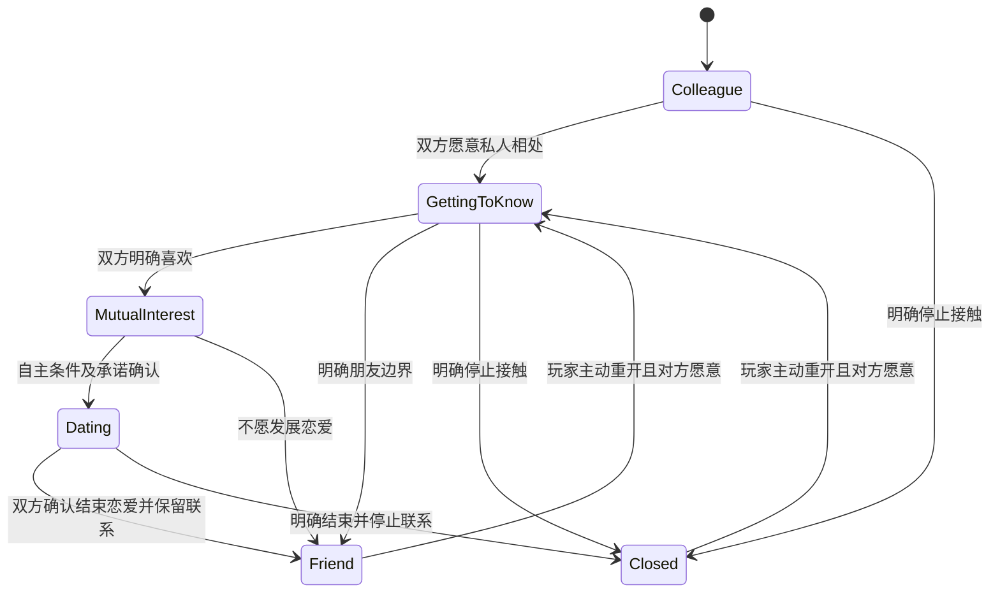

# 《余音未散》WHEN THE SONG RETURNS
## 欧美音乐背景女性恋爱互动剧本｜完整创作母稿 v1.0

> story_id：when_the_song_returns；setting_version：1.0；结构版本：MIRU规则2026-11-17适配。
> 本次范围：作品前端资料、完整人物与世界、十二章逐场正文及隐藏分支、24项小游戏规格、结局、状态机、长期记忆、AI执行提示词、素材槽位和编辑核对。
> 本文件是合并交付的创作母稿，不是已通过平台解析器的导入文件。第三部分保留旧逐字剧标记作为场景定位；中文说明、隐藏分支裁决及附录须在接入时分别映射，不能把整份母稿直接当可执行程序。未生成图片、音频或小游戏程序，未发布作品。
> 规则取舍：沿用已确定的十二章，覆盖通用规范15—20章的默认项目范围；开局保留唯一“扮演我自己”入口，给“我”固定职业前史，不增加切换身份入口。上一提案中的“罗文”仅作可修改的默认艺名，正文统一称“你”。
> 正文语言：简体中文；场景文化：当代美国波特兰独立音乐圈，涉及伦敦与柏林；全员成年。故事时间为虚构年份，不借真人私生活设定。所有歌曲、歌词和情感经历均为本作原创。

# 第一部分｜前端展示

## 一句话卖点

所有人都想听你们再唱一次当年的歌。你想知道的，是她当年为什么没有选择你。

## 故事背景／premise（作者原话，六段）

七年前，你和薇薇安组成Wild June。她唱歌，你写歌。你们住过同一间漏雨的公寓，也在没有观众的楼梯间接过吻。

后来，她在采访里说，你们只是同事。紧接着，你发现自己的名字从巡演名单上消失了。你去了伦敦，再也没和她同台。

如今，你29岁，替别人写红过不少歌，却一直没能做完自己的专辑。波特兰的灯塔剧院即将停业，一份音乐制作合约让你有机会拿到录音所需的报酬。

你知道薇薇安也会参加告别演出。到场后才发现，她已经买下了这里，还瞒着你把重聚安排进了宣传计划。

现场音乐总监艾琳不打算替任何人劝和。她把排练表交给你：“先说你想做什么。你的名字，也得在节目单上。”

接下来的十二天，你可以改歌、排练、查清旧事，也可以要求她们离你远一点。演出结束以后，唱哪首歌，和谁走，去哪里，都由你开口。

## 类型与体验

女性恋爱、旧搭档重逢、音乐创作、成年人关系修复。体验包含后台相处、共同编曲、小型首演、公开合作与私人边界、从旧爱或新关系中作出自己的选择。身体亲密以明确同意为前提，写拥抱、接吻和贴近，不写露骨性行为。拒绝恋爱可完成事业主线。

## 简版角色卡

| 人物 | 身份 | 第一眼吸引力 | 与你的关系 |
|---|---|---|---|
| 你 | 29岁女性词曲作者、吉他手；默认艺名罗文·海斯，可改 | 有实力，习惯把最好的旋律交给别人 | Wild June前成员；当下心意自由 |
| 薇薇安·里德 Vivian Reed | 30岁女性歌手、剧院业主 | 舞台上锋利，私下记得你的细小习惯 | 曾亲密、未正式确认关系的旧搭档；可攻略 |
| 艾琳·沃德 Erin Ward | 32岁女性现场音乐总监、键盘手 | 冷静、干脆，认真听你说“不” | 本次合作中相识；可攻略 |
| 玛拉·科尔 Mara Cole | 41岁女性剧院经理 | 务实，有耐心但不替人兜无限责任 | 合约联系人；非攻略 |
| 朱尔斯·帕克 Jules Parker | 35岁非二元性别录音师 | 嘴快，尊重作品与录音权限 | 前巡演录音师、旧事证人；非攻略 |
| 西莉亚·格兰特 Celia Grant | 39岁女性直播制作人 | 专业、讲条件，也愿意谈判 | 提供传播与资金方案；非攻略 |

## 固定开篇（手机半页，开局只播放此段）

剧院里只亮着一盏工作灯。

薇薇安站在台上，唱到《六月之后》的最后一句，停了。

她看见门边的行李箱，把麦克风放回架上。

“你早来了一天。”

玛拉递来的登记表上，“业主”一栏写着她的名字。

薇薇安没有往前走。

“我怕你知道是我，就不来了。”

她把合约摊开，旁边放着一支笔。

“你可以改条件，也可以走。已经发生的交通和住宿费用，我承担。”

> 停留点：等待你的原话。可以质问、查合约、要求独处或结束项目；不默认你签字，也不默认你仍爱她。

# 第二部分｜后台设定与人物母档

## 2.1 世界与现实边界

灯塔剧院、旧唱片公司Northline、直播栏目After Hours及社区空间Side Room均为虚构。波特兰、伦敦、柏林只提供地理与生活背景；合同条款、预算为故事内约定，不作为现实法律或行业指南。

灯塔是一座380席的旧剧院。薇薇安五个月前用个人积蓄和贷款买下物业，原计划修缮后运营；后续评估发现结构维修远超预算，现有安全许可只覆盖本次演出之前的期限。建筑尚未拆除，也未签拆除合约。“即将拆除”是外界对出售风险的说法，不是已确定事实。十二天后必须闭馆检测，任何人物都不能以深情或捐款取消安全要求。

告别演出告别的是这座剧院当前的使用阶段。结局允许保留档案、暂缓出售，或移到其他合规场地；不能一夜筹齐钱永久拯救建筑。安全区域由玛拉划定，不探索封闭楼层，不在漏水设备旁冒险。

你的制作费独立列入现有托管预算，按交付节点发放，不以复合、曝光或剧院盈利作为支付条件。首场退出可报销已发生差旅；后续结束合作按已完成工作结算。金钱不构成恋爱债务。

Wild June仅有一张共同发行的专辑。原创词曲署名属于你和实际参与创作的人；历史母带许可与新现场录音许可分别核对。没有许可便采用新作、原声替代或不录制，不靠角色一句保证解决所有权利。

世界有手机与电话。角色在场时当面说话；异地语音必须允许不听、文字摘要或稍后回应。现实离线不会让故事时间自动过去，不惩罚未登录。

## 2.2 唯一有效时间轴

| 时间 | 固定事实 | 初始知情者 |
|---|---|---|
| 十年前 | 你19岁、薇薇安20岁，在波特兰酒吧相识，共写第一首歌 | 你、薇薇安 |
| 九年前 | 组成Wild June，租公寓，开始小规模巡演 | 你、薇薇安、朱尔斯 |
| 八年前 | 你21岁、她22岁；芝加哥楼梯间发生第一次双方同意的接吻 | 你、薇薇安 |
| 七年前 | 你22岁、她23岁；专辑发行、个人合约谈判、采访、替换名单、解散 | 各自仅知亲历部分 |
| 七年前离开当晚 | 她发送4分18秒语音；你当时只播放前26秒 | 她知全文；你知自己听到的部分 |
| 解散后 | 她没有签当时那份个人合约，换团队后继续个人事业；双方各有生活与其他关系可能 | 各自知道自己的经历；公开事业可查 |
| 五个月前 | 她购入灯塔，未提前联系你；后发现维修缺口 | 她、玛拉 |
| 十二天前 | 玛拉以剧院名义邀请你，未披露业主身份；薇薇安同意这一隐瞒 | 她、玛拉 |
| 故事D1—D12 | 排练、旧事核验、直播谈判、演出和未来选择 | 逐场分配 |

纠正上一提案的年龄跨度：相识至今十年，分开七年。不能说19岁相识后仅七年就变成29岁。

## 2.3 旧事客观真相（仅作者与导演可读）

T1：唱片公司提出将Wild June转为薇薇安个人项目，建议更换现场乐手，并以降低你创作控制权作为部分条件。公司提供的是草案，不是你已签署的合同。

T2：薇薇安最初留下谈判，想保住发行资源，同时私下要求把你保留为共同创作者。她没有告诉你，一方面怕谈崩，一方面享受“我能处理好”的控制感。她应为排除你参与的决定负责。

T3：采访者问：“既然不是公开情侣，团队是否考虑以后拆分发展？”她回答：“我们只是同事。工作安排还没确定。”完整版本补足了商业语境，但那句否认确实是她主动说的，未被伪造。

T4：替换名单是公司制作、由薇薇安助理转发的方案。她看到后发出过反对邮件，却没有在你看到名单前直接向你说明。你发现自己的名字消失是事实；误会是将草案理解成她已最终批准。

T5：你曾发短信：“如果你已经决定，明天不用来找我。”她没有在约定的22:00前到公寓。她留在谈判现场，22:41才离开，23:07发出长语音。没有被藏起的车祸、绑架或第三者阴谋。她误判了你的等待，也确实迟到了。

T6：语音承认谈判未签、她的隐瞒与你应有的参与权；后半段有“我爱你”，但在当时已经错过你要求解释的时点。她此后发出三次联系请求，你没有回应，她停止主动联系。不能改写为七年纠缠骚扰。

T7：她后来持续演唱《六月之后》，既有感情，也有职业上的习惯与观众期待；不能把每次演出都解释成对你的秘密告白。她有过一段公开恋爱，已经在两年前和平分手。艾琳也有完整前任经历。

T8：购剧院既是职业计划，也是想重遇你的私心。她未提前披露业主身份，构成当下新的错误，不能用旧日遗憾抵销。她需要改合约、支付已承诺费用、接受你退出，才能开始修复。

知识规则：角色被直接问及自己知道的事实时应回答；拒绝说要说明理由，不用“下一章才能讲”拖延。玩家提前提出T1—T6的合理猜测，可以提前核验，后续对应场改为余波与行动，不重复揭晓。后台真相不能自动灌入艾琳的台词。

## 2.4 玩家档案

固定：成年女性，29岁，独立词曲作者、吉他手，曾与薇薇安组团、接吻及分开；伦敦居住，手指曾有旧伤，现能工作但需合理休息。固定过去不等于固定当下情绪。默认艺名罗文·海斯 Rowan Hayes可被昵称替换，不对玩家真实身份作推断。

可塑：表达方式、穿着、公开程度、是否原谅、是否恋爱、音乐偏好、留在何地、是否愿意接触与被拍摄。不给玩家强制嫉妒、心跳、欲望或内心独白。

起始目标：完成制作工作，收回署名与舞台主动权，为个人专辑建立第一份可用作品。可修改为有限交付或结束项目。

## 2.5 薇薇安完整母档 CHAR_VIV

外形：30岁，172厘米，深栗色锁骨卷发，灰绿色眼睛，左眉尾细小旧疤；舞台穿酒红缎面上衣和黑色高腰长裤，私下旧皮夹克与白背心。半写实欧美面孔，所有图片固定发色、眼色与眉疤。

能力：声线低而有颗粒感，擅长现场控场和旋律演唱；不会处理全部财务与工程，也不能凭记忆代替合同核验。嗓音会疲劳，巡演需要休息。

喜好与习惯：喝不加糖的热茶；对旅馆空调声敏感；编曲时沿谱纸边缘画小方格；紧张时摸戒指，但戒指不是婚约信物。喜欢二手唱片和老喜剧，讨厌被当作只负责漂亮的主唱。

欲望：想与你重新建立能说真话的关系，也想保住自己的歌手身份。恐惧：你只愿意记得她最糟的一次决定。弱点：面对不确定性先安排结果，事后才解释。压力触发：团队要求立刻表态、你突然离场、有人否定她的专业。

价值排序：起初“保住机会→保护亲近者→解释”；成长后“共同知情→各自决定→承担结果”。不应变成没有主见的人，仍可坚持音乐观点、拒绝被羞辱。

关爱方式：记得你的返听音量、准备额外护指、替你留出独唱空间；只有你同意才实际提供个人照顾。冲突时先答问题，不以接吻中断争执。道歉必须包含具体行为、伤害、可验证改动，不索取立即原谅。

亲密边界：私下吸引表达可以直接；公开恋情必须双方同意；饮酒明显影响判断时不推进亲密。被拒绝后可以失落，但停止追求该行为，不让玩家负责安抚。

开局知情：购剧院、自己的合约谈判与语音全文；不知道你七年里的私密经历，不知道你现在是否爱她。

主动生活：与玛拉处理闭馆档案、跟声乐老师做恢复训练、决定是否接受冬季巡演。她不能全天守在玩家门口。

弧光：控制局面→被指出再次隐瞒→改合作条件→直播与独唱冲突中交还决定权→接受玩家的最终选择。证明节点是CH01、CH08、CH10，甜言蜜语不能替代。

声线：短句，偶尔自嘲，熟悉时有一点挑衅；对伤害负责时不抖机灵。可说“我想你”，不能说“我这样都是为了你”。昵称“搭档”仅在玩家接受后恢复使用。

## 2.6 艾琳完整母档 CHAR_ERI

外形：32岁，175厘米，深棕短发，棕眼，细银耳圈；黑色合身衬衫、炭灰长裤，演出戴窄表带腕表；笑起来左侧有浅酒窝。避免把短发自动等同性别角色分工。

经历与能力：长期担任键盘手和音乐总监，做过小巡演，也经历过大项目取消。擅长编排与现场应变，不会读心，也不是负责替旧爱判案的人。

偏好：喝燕麦咖啡，喜欢公园步行和不加背景音乐的早餐；收集城市交通票；会把坏掉的铅笔削到很短。口头习惯“说具体点”，但不每次重复。

欲望：做出有自己声音的现场作品，获得平等的亲密关系。恐惧：再次成为别人暂时避风的地方。弱点：容易把情绪问题变成待解决的工作清单；有时过早抽离，防止自己投入。

价值排序：诚实、独立、可靠。允许对过去复杂的人产生感情，但需要知道对方能给什么。不会要求玩家清除所有旧物来证明爱。

关爱方式：认真听完整首歌；给出具体意见；询问需要建议还是陪伴。她也会分享自己的糟糕彩排、房租烦恼和柏林邀约，不能只有“你今天好吗”。

冲突与修复：发现被当成比较工具时直说并暂停浪漫接触；玩家澄清、道歉并在后续行动一致，可重新讨论。她不以一次失言永久宣判，也不接受反复隐瞒。

亲密边界：工作场合不当众调情施压；确认双方意愿后可主动邀约、牵手、接吻。她会说“我想吻你，可以吗”，不以默认动作替玩家答应。

开局知情：Wild June公开解散、你们此次合作；不知道楼梯间接吻、语音或合约细节。她与玩家的爱情只能通过当下经历形成。

持续目标：为演出完成独唱编排；D10收到此前已申请的柏林驻留正式邀约；演出后须决定是否接受。愿意协商距离，不默认为恋爱放弃工作。

弧光：只谈工作→允许私人分享→承认自己想靠近→表达对不明确关系的需求→与你共同安排未来，或有尊严地维持同事关系。

声线：清楚、轻微冷幽默，亲密时更少职业术语。避免写成“百分之百尊重您的选择”的客服对白。

## 2.7 配角档案与边界

玛拉：银灰短卷发，深蓝工装，41岁。目标是付清员工工资、保留档案并安全闭馆。她承认参与隐瞒业主信息，主动提供退出条款；不说“她那么爱你，你原谅吧”。她知道楼宇与合约，不知道旧情私密。

朱尔斯：35岁，铜色短发、圆框眼镜、宽松灰衬衫，中文统一直呼姓名或用“对方”，不随意换代词。保有本人录音档案，需取得当事人许可才向项目提供。能证明录音原始时间与编辑差异，不能保证某人“其实一直只爱你”。

西莉亚：39岁，深色长直发、米色西装，直播制作人。目标是节目有清晰主题、预算可交代；愿为独立音乐现场调整卖点，但会拒绝超预算与没有许可的素材。不会因为玩家拒绝炒作而突然变成恶毒反派。

## 2.8 关系、成长与攻略机制

每名攻略角色三项关系指标：interest兴趣、trust信任、respect尊重，范围0—100。薇薇安初值60/20/35；艾琳20/30/40。数值只供导演参考，不展示数值条，不自动触发恋爱。普通有效事件每项最多±3，一场累计最多±6，同一事实重复表达不重复计分；拒绝亲密、跳过小游戏、离线均不扣分。

弧光独立：viv_shared_decision=0..3，对应CH01改约、CH08共同审约、CH10支持独唱；eri_openness=0..3，对应CH05私人分享、CH09明确意愿、CH10平等谈距离。玩家arc_voice记录署名、创作意见和舞台选择的实际行动，不把特定温柔语气设为正确答案。

关系阶段：colleague→reconnecting或getting_to_know→mutual_interest→dating。friend与closed为持续边界；只有玩家主动重新开启才回到讨论。进入dating需双方明确同意，至少两次独立相处、一次边界得到尊重；薇薇安另需隐瞒问题得到处理，艾琳另需知情当前旧关系状态。可同时了解，不默认同时建立排他恋爱；排他承诺后先结束或重新协商，再转线。

路线入口在CH03—CH06展开，CH09作重要意愿确认，CH10确认当前关系与高潮方法。此后仍可拒绝亲密或结束关系，不因结构锁定剥夺撤回权；结束后进入独立或朋友收束，不凭一句含糊回复瞬间切换恋人。

# 第三部分｜十二章完整场景正文

## 阅读及运行约定

每章四场，第一场先接当下人物，第二、第三场各一项小游戏，第四场处理后果与回响。每场正文是可播放锚点，必须在“回应空间”处停下接玩家原话；不能把所有条件版本连续读出。隐藏分支只供裁决，不显示A/B/C/D菜单、不替玩家生成发言。玩家自由询问时先回答已知事实，再判断是否回到任务。

场景标记保留CHAPTER／SCENE／BG／TIME／MG／GOAL／DONE便于对齐旧稿；新增“运行卡、隐藏分支、状态写入”是作者说明，不是已支持的新标签。所有effects仅为候选，实际提交以接入回执为准。小游戏编号不带mg_前缀，胜利旗标统一mg_<id>_win。除明确写出的条件外，赢小游戏从不成为换章必要条件。

# CHAPTER 01｜她站在灯亮的地方
⟦GOAL|说清你愿意怎样参与告别演出，或明确结束合作。|State your terms for the farewell show, or end the collaboration.⟧
⟦DONE|say|明确提出合作条件、有限参与方式或结束意愿|说清合作条件|玛拉：报酬、署名和接触范围都能谈，你想先改哪一项？⟧
⟦DONE|flag|wtsr_c01_terms_recorded|确认合作记录|玛拉：我会把你说的写下来，先给你看。⟧

运行卡：D1；STG_1；进入为收到邀请且到达；事件是重新知情，关系是处理新隐瞒，弧光是第一次争取参与权。主线退出到CH02或END_EARLY。必要信息：业主身份、制作费、退出费用，在签约之前全部交代。

## SCENE｜SCN_0101 工作灯下
⟦BG|bg_c01s01|灯塔剧院空舞台与侧门，无固定人物⟧
⟦TIME|D1 17:20⟧
旁白：薇薇安把笔放在合约旁，退到舞台边。玛拉没有收走登记表。
薇薇安：（看了一眼行李箱）“我该在你订机票前告诉你。怕你不来，是我的理由，不是你的责任。”
玛拉：“你已经完成的准备工作照常结算。今天不签，也可以先住一晚。”
薇薇安：“你想让我出去，我现在就走。”

回应空间：你可以问她为何买下剧院、质问邀请、查看合同或要求她离开。她只回答当前问题，不抢先讲七年前的全部经历。

隐藏分支 CHO_01：
- player_intent=要求完整披露并协商。即时：玛拉提供业主、预算和工作范围；薇薇安留下听，不代答。effects：terms_mode=renegotiate；respect_viv+2。回收CH08共享审约。
- player_intent=只工作、不谈旧情。即时：薇薇安答“好。私人话题等你先开口”；effects：boundary_viv=work_only，持续读取至CH12，不用后续道具绕过。
- player_intent=需要暂停而非永久结束。即时：玛拉保留至次日上午的故事内答复窗口，提供住宿；effects：project=paused；返回此场，不扣关系。
- player_intent=明确结束整个项目。即时：核对未交付事项后进入END_EARLY，不擅自劝留。
- 兜底=其他问题、情绪或替代方案。先回应，无法确定签约意图时只问“你想先谈，还是今天先到这里？”；不写合作已成立。

## SCENE｜SCN_0102 合同桌
⟦BG|bg_c01s02|剧院办公室，台灯与合约桌⟧
⟦TIME|D1 18:00；仅愿意查看条款时进入⟧
玛拉：“这张是制作工作单。这张是宣传授权，分开签。”
薇薇安：“旧组合的照片，没有你的许可就不放。”
玛拉：“我想请你帮我挑出几项不能混着写的内容。你不想做也可以，我直接逐条念。”
⟦MG|wtsr_c01_a⟧
旁白：玛拉把修订处另存一份，抬头等你确认。
玛拉：“你的报酬不和票房绑定。还有，工作不包括回应私人采访。”

回应空间：核对、再改或拒绝确认。game=LOSE/SKIP也必须得到相同关键权利说明。

## SCENE｜SCN_0103 空座位之间
⟦BG|bg_c01s03|观众席与中央过道，关闭的楼座入口⟧
⟦TIME|D1 18:35⟧
旁白：艾琳把一卷舞台胶带收进口袋，把场地图摊在空座位上。
艾琳：“我是现场总监。你想先看舞台，还是先确认哪里不能进去？”
艾琳：“右边楼座封了。后面那条通道要留给工作人员。有人让你走捷径，你就让对方来找我。”
⟦MG|wtsr_c01_b⟧
艾琳：“别担心，我考的是路线，不是乐理。不会有人因为认错一扇门失去独唱。”

## SCENE｜SCN_0104 门口的旧箱子
⟦BG|bg_c01s04|剧院门厅，旧设备箱与出入口⟧
⟦TIME|D1 19:10⟧
旁白：薇薇安把一个旧设备箱推到墙边。箱盖上贴着褪色的返听清单。
薇薇安：“你的返听里，我的声音小一点。你以前总说我把你的吉他盖住了。”
薇薇安：（手离开箱盖）“现在怎么调，听你的。”

回应空间：愿意谈过去，她可说那次你用铅笔圈了三遍；不愿意，她只记录当前技术要求。不得解读你已被打动。

章末状态：只有条款被明确确认才记录wtsr_c01_terms_recorded；暂停保留草案。SEED_MONITOR记录玩家当前返听偏好而非强制旧偏好，CH03/CH11兑现。合作继续→CH02；结束→END_EARLY。

# CHAPTER 02｜旧歌不能照原样唱
⟦GOAL|提出你对旧歌结尾的意见，并确定下一次排练采用什么版本。|Give your view on the old song's ending and agree on a rehearsal version.⟧
⟦DONE|say|提出保留、修改或暂缓旧歌的明确意见|确定旧歌版本|艾琳：先试哪一版？试过以后也能改。⟧
⟦DONE|flag|wtsr_c02_version_recorded|记录排练版本|艾琳：我把这一版标成试排，不当成最终决定。⟧

运行卡：D2；进入为合作成立或有限试排；问题从旧情转为创作权。退出保留version=old/new/deferred，后读CH08/CH11。不因没有音乐专业知识惩罚玩家。

## SCENE｜SCN_0201 第一次合奏
⟦BG|bg_c02s01|排练厅，键盘、吉他架、三支麦克风⟧
⟦TIME|D2 10:00⟧
薇薇安：“结尾先按原版。”
艾琳：（停下节拍器）“你们还没谈完。”
薇薇安：“那段是整首歌的落点。”
艾琳：“对你是。她也写了这首歌。”
旁白：薇薇安把谱子往桌中间推了一点。
薇薇安：“你想改哪里？我听。”

回应空间：玩家提出改动才讨论，不先替你说“我不要再等待”。可说更想唱现在的生活、保留音乐但改歌词或暂时不用旧作。

## SCENE｜SCN_0202 两张歌词纸
⟦BG|bg_c02s02|排练室小桌，铅笔与两张歌词稿，无可读图中文字⟧
⟦TIME|D2 11:10⟧
艾琳：“我给你们做两个不一样的落点，先听区别。文字也写在这儿，不用只靠听。”
⟦MG|wtsr_c02_a⟧
薇薇安：“旧版停在门口等人。新版走出去。都能唱。”
薇薇安：“我不喜欢新版的一处换气。但我可以试，不能拿这个当不让你改的理由。”

回应空间：可挑战她的音乐判断；她给具体理由，双方可以保留分歧。

## SCENE｜SCN_0203 八小节
⟦BG|bg_c02s03|键盘旁的编曲台，耳机与空谱架⟧
⟦TIME|D2 14:00⟧
旁白：薇薇安去做嗓音训练。艾琳播放删去主唱的一段伴奏。
艾琳：“这里八小节，不加人声。你想用吉他说点什么？”
⟦MG|wtsr_c02_b⟧
艾琳：“不喜欢这个框架就推掉。你不是来替我的编曲填空的。”

回应空间：谈个人专辑、尝试旋律或不想展示。艾琳不因你工作投入就判断你喜欢她。

## SCENE｜SCN_0204 谱架留下来
⟦BG|bg_c02s04|排练厅傍晚，收起的乐器与单独谱架⟧
⟦TIME|D2 17:30⟧
薇薇安：“我刚才急了。不是每样留下来的东西都得保持原样。”
薇薇安：“明天先按你同意的版本排。你要是还没决定，我们就各录一遍，只给自己听。”

隐藏分支 CHO_02：
- 修改版：写入song_version=new；薇薇安练新换气，CH11体现跟随新旋律。
- 保留版：song_version=old；不据此推断复合，CH11介绍只谈创作历史。
- 暂不使用／先比较：song_version=deferred；下一章补一次短试排，CH08必须再次询问是否授权；不能偷偷列入公开曲目。
- 兜底替代：如用器乐版，记录song_version=instrumental；先确认可实现编制。难以实现的方案解释限制后给原声替代。

章末：记录wtsr_c02_version_recorded的含义是排练安排已确定，deferred可成立；保存你的创作理由。SEED_EIGHT_BARS在CH05/CH10回收。下一章CH03。

# CHAPTER 03｜你还记得我的手
⟦GOAL|确定宣传录制的方式，并说清你愿意接受怎样的帮助。|Set the recording format and say what help you are comfortable accepting.⟧
⟦DONE|say|明确录制安排与个人帮助的边界|说清录制边界|薇薇安：改时间、改编曲，或者我先出去，都可以说。⟧
⟦DONE|flag|wtsr_c03_recording_plan|保存录制安排|艾琳：拍什么、不拍什么，我先记下来。⟧

运行卡：D3；宣传录制与手指负担；主线可取消录制、换器乐或分段完成；感情推进取决于帮助是否被允许，不取决于忍痛表演。

## SCENE｜SCN_0301 不要替我取消
⟦BG|bg_c03s01|剧院小录制区，摄像机与两张高脚凳⟧
⟦TIME|D3 09:30⟧
旁白：薇薇安看见桌上的护指，转身叫住摄影师。
薇薇安：“今天可能得——”
旁白：她停下，回头看向你。
薇薇安：“我差点又替你说了。你想怎么安排？”
艾琳：“改成分段录，能把连续演奏缩短。也可以今天不录，不影响你的制作费。”

回应空间：只有玩家表示疼痛才写当前疼痛；护指不等于伤势恶化。需要真实健康咨询时退出虚构诊断，不在剧情中乱给治疗方案。

## SCENE｜SCN_0302 一张拍摄单
⟦BG|bg_c03s02|录制监看桌，拍摄单与关闭的监视器⟧
⟦TIME|D3 10:00⟧
玛拉：“工作素材也有使用范围。我把正式演出和花絮分开了，你看哪项需要单独确认。”
⟦MG|wtsr_c03_a⟧
玛拉：“不拍你的手部特写也没关系。观众可以听见。”

## SCENE｜SCN_0303 整理返听
⟦BG|bg_c03s03|侧台调音区，返听设备与备用护指⟧
⟦TIME|D3 11:20⟧
薇薇安：“想让我帮你贴吗？”
旁白：她把胶布放在桌上，手没有伸过来。

条件正文：
- 明确同意贴护指：她先问松紧，再轻轻按平边缘。“还是不缠过关节？”玩家可确认或更改旧偏好。
- 只愿意拿用品：她把剪好的胶布放到可取的位置。“好，你慢慢来。我先看谱。”
- 拒绝帮助：她收起自己那一卷，留出桌面。“知道了。”不再问第二遍。

待照顾话题自然收束，艾琳才提出调返听的小练习，不在接触过程中插游戏。
⟦MG|wtsr_c03_b⟧
艾琳：“按你现在的需要调，不按旧清单。”

## SCENE｜SCN_0304 留一点私人时间
⟦BG|bg_c03s04|剧院侧门与街边咖啡店门口⟧
⟦TIME|D3 16:40⟧
旁白：艾琳收好器材，把自己的外套搭在手臂上。
艾琳：“我还想听你的新歌。工作以外的那种。”
艾琳：“明天下午我有一小时。你愿意的话，我们去隔壁喝点东西。”

隐藏分支 CHO_03：愿意认识艾琳→安排CH05前私人短聊，interest_eri+2；只谈工作→boundary_eri=work_only；暂时不确定→邀请开放但她不反复追问；其他地点或时间→按双方日程确认。对薇薇安的帮助和对艾琳的邀约分别裁决，不绑成二选一。

章末：recording_plan保存公开范围、分段与否、是否取消；SEED_HAND保存具体帮助许可，CH06/CH11读取；CH04继续。

# CHAPTER 04｜被剪掉的回答
⟦GOAL|决定怎样核实旧采访，并确定哪些私人内容可以公开回应。|Choose how to verify the old interview and what you want to address publicly.⟧
⟦DONE|say|提出核实方式或明确不追查，并说明公开边界|划定回应范围|玛拉：核实和公开是两回事，你可以只做前一件。⟧
⟦DONE|flag|wtsr_c04_response_plan|记录回应方式|玛拉：不谈私人关系，也能处理这次宣传。⟧

运行卡：D4；旧采访回流；证据完整性与伤害责任分开。你可以不观看视频，必要语义通过中性文字提供；不追查不失去主线资格。

## SCENE｜SCN_0401 播放键旁
⟦BG|bg_c04s01|办公室，扣放的手机与关闭的笔记本电脑⟧
⟦TIME|D4 10:15⟧
玛拉：“有人把旧采访贴在演出公告下面。我没有回复，也没点名你的账号。”
薇薇安：“那句‘只是同事’，是我说的。”
薇薇安：“完整版还在节目制作人那里。你想核实，我去申请；不想再看，我也会处理自己的说法。”

回应空间：询问原话、她当时为何否认、要求不再提，或授权查看。若玩家说只工作，她先问是否愿听与本次宣传有关的事实，不把私情解释硬塞进工作。

## SCENE｜SCN_0402 两份文字记录
⟦BG|bg_c04s02|档案工作桌，音频波形界面与两份打印稿⟧
⟦TIME|D4 13:00；取得档案许可后⟧
朱尔斯：“这是制作人提供的完整音轨。这个是公开剪辑。先看缺哪一句，再决定差别说明了什么。”
⟦MG|wtsr_c04_a⟧
朱尔斯：“完整版没有把她说成另一个人。它只能告诉我们，当时前面还问了什么。”
薇薇安：“我可以说‘这是私事’，也可以不回答。我没那么做。”

## SCENE｜SCN_0403 回应草稿
⟦BG|bg_c04s03|剧院宣传小办公室，白板与无人物空椅⟧
⟦TIME|D4 15:00⟧
玛拉：“一份只更正工作信息。一份连私人关系也解释。还有一份，不公开回应，限制宣传团队继续引用。”
⟦MG|wtsr_c04_b⟧
薇薇安：“关于我说错的话，我自己认。不会用你的名字替我显得真诚。”

## SCENE｜SCN_0404 没有剪掉的那一句
⟦BG|bg_c04s04|剧院后台楼梯口，半开的安全门⟧
⟦TIME|D4 17:45⟧
薇薇安：“我那时怕失去合约，也怕你问，我们到底是什么。”
薇薇安：“因为一旦问清楚，我就得给你一个真的回答。”
旁白：她站在门外，没有堵住楼梯。
薇薇安：“我知道你会看见。还是说了。对不起。”

回应空间：允许你说伤害、问后续名单或结束话题。不在道歉后索吻、不写你终于释怀。

隐藏分支 CHO_04：公开更正工作事实→public_scope=work_facts，CH08合约不得炒作私情；同意有限私人说明→保存可公开的逐项内容，发布前再次核对；不公开回应→public_scope=none，限制官方利用；兜底如要求删除历史报道→说明只能请求处理、不能保证第三方删除，记录request而非success。

章末：仅实际核验后knowledge.player含T3；主动问T4可由薇薇安说明自己部分并安排CH06档案核对。wtsr_c04_response_plan记录的是处理方案，不代表帖子已撤。下一章CH05。

# CHAPTER 05｜另一种被看见的方式
⟦GOAL|决定是否以自己的名字试唱新作，并确认谁可以来听。|Decide whether to perform under your own name and who may attend.⟧
⟦DONE|say|确认试唱、录制替代或不公开，以及邀请范围|安排个人试唱|艾琳：你可以先录给自己听，不用今晚就面对观众。⟧
⟦DONE|flag|wtsr_c05_showcase_plan|保存试唱计划|艾琳：名单我按你说的发，没被邀请的人不会突然来。⟧

运行卡：D5；Side Room酒吧小舞台；获得当下欣赏，不用旧情才能有价值。公开试唱可替换为闭门录音，后续保留不同反馈来源。

## SCENE｜SCN_0501 只有一个名字
⟦BG|bg_c05s01|Side Room小型舞台，黑板空白、暖色工作灯⟧
⟦TIME|D5 14:00⟧
艾琳：“店主给了二十分钟。海报还没发，等你点头。”
旁白：她递来一张纯文字预览，上面只有你的艺名。
艾琳：“不加前组合介绍也行。你想让他们先听什么？”

回应空间：选择新歌、器乐、闭门录音或取消。若玩家不展示作品，艾琳继续专业合作，不宣称因此失望。

## SCENE｜SCN_0502 三首小样
⟦BG|bg_c05s02|酒吧后场小桌，耳机与三份曲目卡⟧
⟦TIME|D5 15:00⟧
艾琳：“试着排一个先让自己站稳，再往前走的顺序。最后你喜欢哪首，就留哪首。”
⟦MG|wtsr_c05_a⟧
艾琳：“我第一次做自己的演出，把最难的一首放开头。第一句就忘了词。”
艾琳：“后来发现，台下没有人知道我原来准备唱什么。只有我气了一整晚。”

回应空间：追问她的经历、分享自己的失误或开玩笑。她可以被你安慰，不永远扮演成熟导师。

## SCENE｜SCN_0503 你的声音放前面
⟦BG|bg_c05s03|小舞台调音区，单人麦克风与键盘⟧
⟦TIME|D5 17:00⟧
艾琳：“这一段我不弹满。你唱完，我再进。”
⟦MG|wtsr_c05_b⟧
旁白：她把键盘音量降下来，没有填补你留出的停顿。
艾琳：“听见了吗？你不用跟谁抢。”

实际演出锚点：玩家同意演唱后，允许提交自创歌词，或使用原创示例：“这次我的名字，不写在谁的背面。”不强制玩家唱出爱情态度。闭门分支没有观众掌声，反馈来自回放与实际在场者。

## SCENE｜SCN_0504 散场的人
⟦BG|bg_c05s04|Side Room门外，街灯与两张长凳⟧
⟦TIME|D5 21:10⟧

薇薇安条件片段（仅被邀请且实际到场）：
薇薇安：“我刚才差点跟着唱。”
薇薇安：“后来想，你好不容易把这里留给自己。我别抢。”
若玩家问感受，她回答：“我喜欢。也有点难受。原来有这么多，我没听过的你。”

艾琳条件片段（她到场且你愿意私人聊天）：
艾琳：“我想请你吃点东西。不是演出复盘。”
艾琳：（笑了一下）“复盘已经写了三页，再讲你会跑。”

隐藏分支 CHO_05：与艾琳共进晚餐→SCN_0504_E独有经历，她讲柏林申请与爱走路的习惯，你可分享生活；与薇薇安谈新歌→SCN_0504_V独有经历，她认真问歌词而不拿旧歌比较；一起作为团队吃夜宵→非恋爱承诺；独自离开或其他→保存边界，返回住所。排他约定未成立前不强行吃醋。

章末：SEED_SOLO记录所选曲目与是否公开；SEED_BERLIN种下申请而非已获邀；分别记录实际见证者。下一章CH06。

# CHAPTER 06｜那晚谁也没有睡
⟦GOAL|在安全范围内决定档案抢救顺序，并选择今晚需要谁陪伴。|Prioritize archive recovery safely and choose what company you want tonight.⟧
⟦DONE|say|提出档案处理顺序并明确陪伴或独处意愿|确定抢救安排|玛拉：先说能处理什么，封起来的地方谁都别进。⟧
⟦DONE|flag|wtsr_c06_archive_safe|保存档案结果|朱尔斯：能抢救的已另存，剩下的损坏也会记清楚。⟧

运行卡：D6；暴雨，封闭漏水区，安全干区处理转移档案。中点让“她是否签约”的疑问转成“她为什么没有让我参与”。档案不全也可从邮件与本人证词获得核心真相。

## SCENE｜SCN_0601 雨声盖过排练
⟦BG|bg_c06s01|剧院门厅，门外暴雨，隔离带挡住一侧走廊⟧
⟦TIME|D6 18:20⟧
玛拉：“维修人员已经断开那片区域的电。今晚谁都不能进去，演出区还要重新检查。”
朱尔斯：“这几箱刚转出来。干的先放桌上，湿的等专业处理，别开机器试。”
薇薇安：“我能帮忙搬标签箱。你想留在这里，还是先回去？”

回应空间：指挥安全区任务、帮做清单、离开休息。离开后由工作人员完成，损失按既定物理状况，不因你拒绝陪伴增加损坏。

## SCENE｜SCN_0602 先救哪一份
⟦BG|bg_c06s02|安全干区档案桌，密封箱与防潮材料⟧
⟦TIME|D6 19:00⟧
朱尔斯：“先看有没有备份，再排处理顺序。私人箱子先别拆，等主人确认。”
⟦MG|wtsr_c06_a⟧
旁白：一只已获许可打开的工作档案夹里，露出旧巡演方案和邮件打印件。
薇薇安：“那是我当时回公司的邮件。反对替换你，是我写的。可我没及时告诉你，也是真的。”

回应空间：查看、要求稍后再谈、只保存不阅读；不把偶然看见封面当成已读全文。

## SCENE｜SCN_0603 缺口对不上
⟦BG|bg_c06s03|备用工作间，时间卡与档案夹⟧
⟦TIME|D6 20:10⟧
朱尔斯：“只排能确认的时间。邮件发出不等于你当时收到了。”
⟦MG|wtsr_c06_b⟧
薇薇安：“名单不是最终版。但我知道你看见了。”
薇薇安：“我那天还在等公司改口，觉得拿到结果再找你，就能少吵一次。”
薇薇安：“我把最该让你知道的事，变成了最后才说的事。”

## SCENE｜SCN_0604 关灯之前
⟦BG|bg_c06s04|备用休息室，台灯、沙发和干净毛毯⟧
⟦TIME|D6 22:40⟧

薇薇安线：她坐在沙发另一端。“我想抱你。但你现在不想，就不用顾着我。”同意后她才靠近；她停在你能退开的位置。若你哭，不默认是原谅；若你不哭，不形容你故作坚强。拥抱后她说：“明天你问什么，我都回答。”这是待兑现承诺。

艾琳线：她把外套搭在自己的椅背上。“我刚才一直想进来，又怕你需要安静。现在想要什么？”可以聊你不想总为别人写歌，也可以听她说自己曾把关系安排成工作表，最后让伴侣觉得连难过都要预约。若明确互有好感，她说：“我有点喜欢你。你不用今晚就回答。”

独处线：玛拉确认回程安排，其他人离开。你可听雨、记旋律或停止本章。无自动恋爱损失。

隐藏分支 CHO_06：选择谁陪伴只决定今晚在场者；明确浪漫回应才更新mutual_interest；亲吻需另行同意，工作边界仍有效时不主动索吻；兜底其他行动按安全与人物意愿处理。不能同时播放两段独处。

章末：T4/T5只在已阅读或被告知后更新；SEED_ANSWER保存她承诺回答的具体问题；档案损失如有记在resource，不转化成玩家情感过错。下一章CH07。

# CHAPTER 07｜听完那段语音
⟦GOAL|选择怎样了解当年的解释，并说清现在愿意给这段关系什么位置。|Choose how to hear the old explanation and where this relationship stands now.⟧
⟦DONE|say|明确愿意继续了解、保持工作关系或结束私人接触|说明现在立场|薇薇安：听完不等于你欠我一个答案。你可以先说到这里。⟧
⟦DONE|flag|wtsr_c07_boundary_saved|保存当前边界|玛拉：之后的安排会按你现在的意思来。⟧

运行卡：D7；真相与原谅分开；语音可听、读转录、请本人回答或不接触。两项游戏在普通工作场完成，不打断情感揭晓。

## SCENE｜SCN_0701 明天的问题
⟦BG|bg_c07s01|剧院清晨小厅，早餐纸袋与工作桌⟧
⟦TIME|D7 09:15⟧
薇薇安：“你昨晚问的那些事，我写了时间，也带了能找到的记录。”
若昨晚未谈旧事，替换：“我把能说明名单的记录整理好了。你需要再拿。”
薇薇安：“你不必听那段语音。我可以现在回答，也可以不再找你谈。”

回应空间：玩家选信息渠道。角色不得说“你当时只听26秒”——除非玩家已告诉她；她只知道当时未获回应。

## SCENE｜SCN_0702 今晚怎样排
⟦BG|bg_c07s02|排练室外日程板，空白便签与水杯⟧
⟦TIME|D7 10:30⟧
艾琳：“漏水检查让排练少了两小时。先把必需的保住，剩下别塞满。”
⟦MG|wtsr_c07_a⟧
艾琳：“下午我去接一台备用键盘。你要谈自己的事，我不会留下听。”

## SCENE｜SCN_0703 保存和播放是两回事
⟦BG|bg_c07s03|档案桌，耳机、备份盘与合上的笔记本⟧
⟦TIME|D7 13:00⟧
朱尔斯：“备份前看清权限。能存，不代表能播给别人。”
⟦MG|wtsr_c07_b⟧
朱尔斯：“私人语音你自己决定。制作素材另走授权，我们不混。”

## SCENE｜SCN_0704 四分十八秒
⟦BG|bg_c07s04|住所窗边书桌，耳机与街景，无固定人物⟧
⟦TIME|D7 20:00⟧

旧语音，仅玩家同意播放或读转录：
薇薇安的录音：“你能不能先听我说完。不是要你回来。”
“个人合约还没签。名单是公司做的，我回过反对邮件。这些东西我现在发给你。”
“可我一直没告诉你。我以为最后把事情做好，就能不用让你经历中间那些难堪。”
“我知道你说十点以前。我还是待在会议室，觉得再多谈二十分钟就够了。”
“现在太晚了。我不能说我是在保护你。你本来就有权知道。”
“还有，你问过的那个问题……我爱你。说得这么晚，真的很差劲。”
“你不想回我，我会停下来。你需要核对的时候，我把东西留着。”

旁白：录音结束，播放器停在4:18。没有新的声音接上来。

现场回答分支：改到双方明确约定的安全会面地点，薇薇安本人讲同样事实，但“我爱你”须区分当时和现在：“当时爱过。现在我也想重新认识你。但你不用因为这个留下。”

不接触分支：只保存不调用，或完全不保存。必要工作事项由玛拉传达；玩家仍可完成演出。

若玩家希望回应她，且她不在场，可发文字或请求通话；通话有接听、文字替代、跳过三种路径，不能在住所旁白里突然让她出现。

隐藏分支 CHO_07：继续了解→viv_status=reconnecting；原谅但不复合→viv_status=friend，停止追求；尚不能原谅但可工作→work_only；拒绝私人接触→closed；兜底情绪或多个矛盾表达→回应内容并澄清最必要边界，不自动选恋爱线。

章末：已获信息更新T1/T2/T5/T6及来源；承诺“会回答”仅在实际答复后fulfilled；接受道歉不等于dating。CH08继续。

# CHAPTER 08｜这次先问我
⟦GOAL|决定直播合作的条件，或选择不直播的演出方案。|Set the livestream terms or choose a show without a livestream.⟧
⟦DONE|say|明确直播授权范围或替代演出方向|确定传播方案|西莉亚：你可以拒绝这版，我们谈能做的另一版。⟧
⟦DONE|flag|wtsr_c08_event_route|记录演出路线|玛拉：预算跟着方案走，不拿你的私人关系补缺口。⟧

运行卡：D8；L3事件路线分叉，CH10锁定执行，CH11独立高潮。ROUTE_STAGE为有边界的现场直播；ROUTE_ROOM为无商业直播的小型现场或转场。恋爱对象与事件路线独立。

## SCENE｜SCN_0801 她把合同递给你
⟦BG|bg_c08s01|剧院会议室，投影幕关闭，三份合同⟧
⟦TIME|D8 10:00⟧
西莉亚：“平台愿意出制作费。当前卖点是Wild June重聚，加一段回顾访谈。”
薇薇安：“我没答应。合同里有你的名字，你先看。”
西莉亚：“如果不谈私人关系，我们要换一个能撑住节目的主题。你的个人作品可以谈，但先给我听。”

回应空间：询问报酬、权利与预算。必须说明：直播扩大作品传播，也带来公开失误与素材再使用风险；不直播资金较少，需要减规模，不扣制作费。

## SCENE｜SCN_0802 划掉这一条
⟦BG|bg_c08s02|审约桌，标记笔与授权范围卡⟧
⟦TIME|D8 11:15⟧
玛拉：“永久二次剪辑、私人采访、现场播放，不该藏在同一个勾里。”
⟦MG|wtsr_c08_a⟧
西莉亚：“我能撤掉私人采访，也能限制二次使用。不同意的旧照片不放。修改版重新签，不靠口头保证。”

## SCENE｜SCN_0803 钱花到哪里
⟦BG|bg_c08s03|制作预算工作台，设备清单与座位图⟧
⟦TIME|D8 14:00⟧
艾琳：“把人员报酬和必要安全成本先留出来。灯光少一点，歌还能唱。”
⟦MG|wtsr_c08_b⟧
玛拉：“不直播也能做。只是没有额外档案制作预算，宣传要缩。你先知道代价，再决定。”

## SCENE｜SCN_0804 关系也要说清
⟦BG|bg_c08s04|剧院小露台，关合的玻璃门与两把椅子⟧
⟦TIME|D8 18:30；按邀请决定在场者⟧

艾琳发展线：
艾琳：“我喜欢和你待在一起。可我还不知道，你和她现在是什么关系。”
艾琳：“你不用把所有细节告诉我。我需要知道的是，你现在有没有答应过她什么。”
若玩家尚未准备恋爱，她回答：“那我们慢一点。工作照常，我也会照顾自己的心情。”
若玩家已排他承诺薇薇安，她停止浪漫推进，不以竞争证明爱。

薇薇安发展线：
薇薇安：“今天把合同交给你，我其实很想先把最麻烦的几条改好。”
薇薇安：“后来想，改完再说，还是我替你决定。”
若你质疑她是否只在表演，她不要求信任：“那就看下一次。我不能让你今天就相信。”

仅工作／独处线：由玛拉确认合同，不调用任何表白。

隐藏分支 CHO_08：条件直播→event_route=stage，保存授权清单、个人曲目主题及修改版确认；不直播→event_route=room，预订Side Room备用时段；继续谈→event_route=pending，CH10前可回访，未签不得宣称达成；替代如仅录音→与制作方确认权利和预算，不默认具备直播收入。

章末：SEED_PUBLIC_BOUNDARY从CH04读取，不能与新授权无声冲突；若玩家主动修改，明确确认变化。薇薇安尊重共同审约才增加shared_decision第二级。CH09继续。

# CHAPTER 09｜没有观众的时候
⟦GOAL|安排一个属于自己的休息日，并说明愿意怎样继续一段关系。|Choose how to spend your day off and how you want a relationship to continue.⟧
⟦DONE|say|明确邀约、朋友相处、继续了解或独处的意愿|安排私人一天|对方：今天不用完成演出任务。你想怎样过？⟧
⟦DONE|flag|wtsr_c09_direction|保留相处方向|对方：我按你说的来，不把今天当成你没答应过的承诺。⟧

运行卡：D9；L4路线形成独有相处；同一章四场按V/E/S选择条件正文，互斥，不累计路线时长。两项轻游戏在白天生活场，不放在表白或接吻时。

## SCENE｜SCN_0901 发出邀请之前
⟦BG|bg_c09s01|住所早餐桌，日程本与咖啡⟧
⟦TIME|D9 09:00⟧
旁白：排练表上，今天留白。手机里只有已确认的工作提醒，没有人替你订好私人行程。

回应空间：你可以邀请薇薇安、艾琳、朋友同行，也可以独处。若没想好，提供可自然参与的生活话题，不出现强制选人菜单。人物可按实际日程答应、协商时间或拒绝。

## SCENE｜SCN_0902 走一段别的路
⟦BG|bg_c09s02|社区唱片店与临街步行道，空场⟧
⟦TIME|D9 11:00⟧
V版：薇薇安陪你看二手唱片。“以前我总买回来才发现，你已经有了。”她拿起一张，再放回去，“今天先问。你还收这个吗？”你可以谈变化，也可以不怀旧。
E版：艾琳在唱片店门口停下。“我喜欢自己走到一个地方。坐车太快，回头连路上有什么都不记得。”她可以介绍自己收交通票的习惯，不假装与你有旧记忆。
S版：店员提供唱片区位置。你可自己挑选、为个人专辑寻找声音参考，不凭空写陌生人追求你。
⟦MG|wtsr_c09_a⟧

## SCENE｜SCN_0903 午后的空白
⟦BG|bg_c09s03|咖啡馆窗边桌，路线图与点心盘⟧
⟦TIME|D9 14:00⟧
V版：她说自己下午想去旧公寓附近，但先问你是否愿意。拒绝则换新路线，不把你写成回避真心。
E版：她提出在公园或小演出之间安排剩余时间，也留出各自休息。
S版：你可以安排录小样、散步或提前休息。小游戏是整理时间的小活动，跳过即自由安排。
⟦MG|wtsr_c09_b⟧

## SCENE｜SCN_0904 今天才说的话
⟦BG|bg_c09s04|安静街边与可停留的长凳，无固定人物⟧
⟦TIME|D9 19:20⟧

V独有正文：若你愿意，地点转到旧公寓附近的洗衣房外。薇薇安从口袋拿出一枚旧代币，放在自己掌心。
薇薇安：“以前洗衣机要转四十分钟，我每次都说太久。”
薇薇安：“后来才发现，那四十分钟我不用赶下一场，也不用跟谁证明什么。”
薇薇安：“我买剧院，有想让你回来的私心。可你今天坐在这里，跟我买了什么没关系。”
如果玩家明确仍想靠近，她直接问：“我想重新和你约会。先从一次吃饭开始，可以吗？”
如果玩家只愿朋友，她收回代币：“那就不拿以前的事缠你。明天你想排哪首，我会准备好。”
若同意接吻：她先靠近，停下等最后确认；你主动或明确许可后才写吻发生。她的手可停在你的肩背，不描写露骨性行为。接吻不是清除未修复冲突的按钮。

E独有正文：艾琳和你听完陌生乐队，走到安静街边。
艾琳：“今天我没问你专辑进度。”
艾琳：“差点问了。忍住了。”
她笑了一下，又认真下来。
艾琳：“我想跟你约会。不是等你把过去全部处理完才有资格，但我希望你是想和我在一起。”
若玩家愿意，她可主动伸出手，等你回应。若拒绝，她说“好，明天排练见”，不假装毫不在意，也不惩罚你。若暂缓：“那就先不把这叫约会。我知道分寸。”

S／朋友独有正文：你与朋友或自己记录个人专辑的一项新想法。可写“我想唱一个终于能回家的人”，也可完全不用情歌。结束时没有失落的恋人堵门。

隐藏分支 CHO_09：明确接受约会且双方自主条件满足→dating；只愿继续认识→mutual_interest；朋友→friend；独立→route_relation=solo；兜底含糊表达不升阶段，先自然确认。若已有排他关系，则先处理原承诺，不同时写双恋爱。

章末：保存实际约会内容、同意范围与称呼偏好；SEED_NORMAL_DAY在后日谈回响。CH10继续。

# CHAPTER 10｜我的名字要留在这里
⟦GOAL|确认自己的舞台位置，并决定最终演出方案和演出后的安排。|Confirm your place onstage, the final show plan, and your plans afterward.⟧
⟦DONE|say|明确个人曲目、演出方法与未来安排中的至少一个具体决定|确认最终安排|艾琳：节目单还没定，你现在说出来，我们来算能怎么做。⟧
⟦DONE|flag|wtsr_c10_final_plan|封存执行计划|玛拉：我把确认过的版本发给所有执行人员，没答应的内容不加。⟧

运行卡：D10；高潮资格确认。广播曲目压力只在直播线发生；小场线面对场地容量和设备限制。已答应独唱不是不可被质疑的保障，人物以行动支持你。

## SCENE｜SCN_1001 被挤掉的名字
⟦BG|bg_c10s01|制作办公室，节目单与计时表⟧
⟦TIME|D10 10:00⟧
直播版：西莉亚提出缩短个人独唱，留时间给旧歌回顾。“平台要一个熟悉的开头。我可以争取，但要你告诉我，哪个部分不能删。”
小场版：玛拉说明Side Room备用场地时段较短。“得少三首歌。不能直接默认少你的那首，我们一起排。”

回应空间：你可坚持独唱、提出合奏新作、缩短其他内容或自愿放弃此场独唱但保留录音计划；作者不把坚持公开表演作为唯一成长。必须确认这是真实意愿，不是角色替你谦让。

## SCENE｜SCN_1002 留住哪一段
⟦BG|bg_c10s02|排练室计时桌，曲目卡与录音机⟧
⟦TIME|D10 11:00⟧
艾琳：“先试能保住核心的删法。别一着急，把你最想唱的也删了。”
⟦MG|wtsr_c10_a⟧
薇薇安：“我的安可可以拿掉。只是提议，不是替你证明我有多好。”
若玩家接受，她实际通知制作方更新；若拒绝，她尊重并寻找其他可行削减，不私自牺牲。

## SCENE｜SCN_1003 柏林来信
⟦BG|bg_c10s03|侧台休息桌，日程与旅行资料⟧
⟦TIME|D10 15:00⟧
艾琳：“我申请的驻留通过了。六周后去柏林，三个月。”
艾琳：“我想去。也想知道，你接下来准备在哪儿。”
⟦MG|wtsr_c10_b⟧

E恋爱版：游戏收束后，她说：“不需要你现在搬过去。我们可以先约一次真的见面，看看距离对我们意味着什么。”
V恋爱版：艾琳仅讲工作交接，不向玩家索取伴侣式安排；另由薇薇安在第四场提出自己的巡演日程。
朋友／独立版：你可为自己的录音排期，艾琳不要求把她放入计划。

## SCENE｜SCN_1004 把决定告诉对方
⟦BG|bg_c10s04|舞台边缘，两张椅子与卷起的节目单⟧
⟦TIME|D10 18:00⟧
V版：薇薇安说冬季巡演还在谈。“我想问能不能演出后去伦敦看你。不是把你的行程改成我的。”她也可拒绝不合理停工要求，与你谈可行安排。
E版：艾琳承认自己会担心。“我不想把每个周末都排成测试。可我想要一个我们都会认真的计划。”
S版：玛拉确认你的结算与素材交付。你选伦敦、波特兰或新的录音地点，不需要恋人批准。

隐藏分支 CHO_10：
- stage最终确认：须修订合同被明确接受、授权范围保存、必要安全许可有效；event_route=stage_ready。
- room最终确认：保留灯塔安全小场或预订Side Room，不使用未授权旧母带；event_route=room_ready。
- 未能达成商业合作：转小场，不写永久行业封杀。
- 退出所有演出：支付已完成工作，允许进入CH12专辑／告别收束；CH11改为交接和首份个人录音，不逼回台上。
- 兜底其他方案：核对预算、安全和许可后执行可行部分；未知不当作成功。

章末：SEED_SOLO兑现为final_setlist；SEED_BERLIN兑现为实际可讨论邀请；V的三项shared_decision须各自有实际记录才计齐。未来见面是planned，不是已经履约。CH11继续。

# CHAPTER 11｜六月之后
⟦GOAL|按你确认的方式完成演出或交接，并保留属于自己的作品。|Complete the show or handover on your terms and keep a work of your own.⟧
⟦DONE|say|明确最终上台、转场、改编或交接安排|落实演出决定|玛拉：最后确认，照哪一版执行？⟧
⟦DONE|flag|wtsr_c11_event_resolved|记录演出结果|艾琳：实际做成了什么，我们就记什么。⟧

运行卡：D11。两个小游戏均在日间准备，不插入舞台高潮。SCN_1103/1104按ROUTE_STAGE、ROUTE_ROOM、ROUTE_HANDOVER展开独立行动。不同路线改变核心问题、资源和玩家行为，不只是换舞台背景。安全不通过则必须转场或取消，爱情不能推翻。

## SCENE｜SCN_1101 名单发出去以前
⟦BG|bg_c11s01|后台工作间，胸牌与最终节目单⟧
⟦TIME|D11 11:00⟧
玛拉：“人员表、授权表、节目单，最后一次对照。谁没同意露脸，摄影师会拿到标注。”
薇薇安：“我照你确认的那版唱。临场改动先看你，不会突然把你叫上台。”
⟦MG|wtsr_c11_a⟧

回应空间：纠正名单、撤回公开授权或确认。撤回会引发真实制作调整，但不能借已投入成本强迫恋爱披露。

## SCENE｜SCN_1102 测试那八小节
⟦BG|bg_c11s02|白天侧台，声检设备与工作灯⟧
⟦TIME|D11 14:00⟧
艾琳：“不用跟机器抢。看我的手势，漏了也能从下一拍回来。”
⟦MG|wtsr_c11_b⟧
艾琳：“听见了。你那八小节留着，别急着让给别人。”

交接线替代：同一时段在录音工作台测试个人小样，仍用节拍文字卡，不声称你已经登台。侧台图不用时切到bg_c12s03录音室并记录复用。

## SCENE｜SCN_1103 镜头前的空位
⟦BG|bg_c11s03|灯塔正式演出舞台，完整麦克风与观众席方向⟧
⟦TIME|D11 20:00⟧

### ROUTE_STAGE｜直播现场：你如何被介绍

前置：stage_ready，安全批准，作品授权齐备。合作方依CH08同意以“旧组合与各自新作”为节目主题，不临时强塞旧情访谈。

旁白：导播在侧台举起手指。红灯亮起，主持人念到你的名字。
西莉亚：（耳返里）“个人曲目准备。节目单照最终版。”

若前面选择不公开私情，主持只介绍创作身份。若授权有限提及过去，也只能说确认过的内容，不宣布恋人关系。

小问题：主持人使用了旧简介，把你的当前身份说成“前组合吉他手”，漏掉词曲与个人作品。不是恶意阴谋，给玩家现场决定：自己补充、示意主持更正、让制作方后续修正文案，或不在这一刻处理。无论哪个，正确署名仍应进入正式记录。

薇薇安：（麦克风前）“这首新歌由她创作。今天听她唱。”
只有在已授权她代为介绍时播放；否则她只递出舞台空间，由你开口。

玩家选择使用自己写的歌词，或原创锚点：
“我把没说完的话，放回自己的歌里。你可以听，也可以走，我会唱到这里。”

正文不固定玩家心理。若临场紧张、忘词或停止，艾琳按事先约好的接法续上器乐，问是否继续；不把失误升级为全网嘲笑。

核心回报：你的作品在自己确认的名字和范围内进入正式现场，宣传边界第一次经受公开压力而被执行。event_result=stage_complete/partial，依据实际完成，不以游戏成绩决定。

### ROUTE_ROOM｜小场或转场：你如何保住演出

前置：room_ready。当天玛拉收到灯塔局部检查未通过的通知，不能使用预定观众通道；CH08已预订的Side Room成为合法备用。若本来已定Side Room，则冲突变为场地电力与输入通道有限，不重复“突然查封”。

玛拉：“旧舞台今晚不能用。备用场地能接人，但要缩编。票可以退，也可以换场，我让前台说明。”
艾琳：“能留下键盘、两把吉他和人声。你想先保哪几段？”

玩家行动：重排曲目与设备，协商邀请范围，决定是否保留共同旧歌，或用个人原声演出承接告别。可取消，不让观众安全变成赌注。

薇薇安：“旧歌能删。你的新作先留位置。”
若此前已有work_only，她不借危机拥抱玩家。两人仍可专业协作。

旁白：小场没有大屏，观众能看见谱纸。艾琳把备用键盘接好，抬头等你的开始信号。

演出使用现场声音，不调用旧母带。玛拉只在取得同意后录一份档案；不直播，不能旁白说“世界各地的人都听见了”。

核心回报：建筑的告别转成共同音乐的延续；你以编曲、取舍和协调保住可实现的现场。event_result=room_complete/partial；代价是传播与收入减少，档案暂缓，不抹去。

### ROUTE_HANDOVER｜不再上台：你如何留下自己的作品

前置：玩家明确退出演出。玛拉办理剩余交接，不反复劝返。你决定仅交付已授权谱面，还是允许他人演唱某一首；没有许可便不唱。

朱尔斯：“这边有一小时录音空档。只录你的吉他也行，不录也不影响结算。”

你若愿意，完成个人专辑第一份小样；若不愿意，当天只完成工作归档，把录音安排留到CH12或未来。作品主线可记录project_closed与demo_planned，不能虚构demo_done。

核心回报：不以完成舞台表演交换人格成长。代价是错过本次公开展示，获得的不是虚假万人掌声，而是明确结束一份工作、保留创作权的事实。

## SCENE｜SCN_1104 回头的那一秒
⟦BG|bg_c11s04|灯塔侧台与出口，演出余光；转场线复用Side Room⟧
⟦TIME|D11 演出最后一首／交接完成后⟧

若授权且实际演唱《六月之后》：
旁白：唱到交接的位置，薇薇安转过身。她没有叫你的旧昵称，只看着你等。
玩家可接唱、示意器乐、保留独唱安排或不参与。角色按当前方案回应，不能因你不上台临时唱公开告白。
若选新版，她跟上你确认过的新旋律；若选旧版，维持音乐内容，不认证你仍等待她。

V恋爱版演出后：她在侧台先问是否愿意拥抱。“刚才我一直想回头。怕你以为我又要你接住什么。”若你问现在呢，她答：“现在想问，你饿不饿。我们先去吃饭。”
E恋爱版演出后：艾琳收好最后一条线，再来到你面前。“工作结束了。现在可以占用你十分钟吗？”她只在当前许可内牵手或靠近。
朋友版：薇薇安或艾琳与你确认录音交付，认真祝贺，不上演被拒绝的惩罚戏。
交接版：薇薇安若有接触许可，给出不要求回应的告别；无许可则由玛拉完成，其他人不堵门。

章末：现场结果、实际作品状态、署名、更正是否完成分别写入；SEED_MONITOR、SEED_EIGHT_BARS、SEED_PUBLIC_BOUNDARY仅在实际使用时fulfilled，否则记录not_used。转CH12，不能以高好感强行指定关系结局。

# CHAPTER 12｜散场以后，往哪里走
⟦GOAL|确认这段经历如何结束，以及你愿意继续怎样的生活与关系。|Choose how this chapter ends and what life and relationships you want next.⟧
⟦DONE|say|明确结束、朋友来往、继续约会或保持独立的意愿|说清未来意愿|对方：不用替今天写一个漂亮结尾。说你真的想要的。⟧
⟦DONE|flag|wtsr_c12_intent_confirmed|保存最终意愿|玛拉：该交给你的东西我都列好了，你可以再核对一遍。⟧

运行卡：D12；先交付现实结果，再谈关系与未来。两项游戏在普通归档场完成，不在最终表白中穿插。对未承诺的未来不写成已发生，后日谈另标故事内时间跳转及条件。

## SCENE｜SCN_1201 灯关以后
⟦BG|bg_c12s01|次日清晨门厅，收起的演出物料与自然光⟧
⟦TIME|D12 09:30⟧
玛拉：“演出部分结清了。这是你的交付清单，录音授权另附。”
若未演出，替换为“已完成的制作工作结清了”。若款项仍待银行处理，写“已发起付款”，不写到账。
玛拉：“闭馆检测照常做。档案有了去处，房子还需要继续谈。我不会说一场演出就解决了。”

回应空间：查款项与署名、要求补交文件、了解剧院后续或不参与。恋爱不自动捆绑长期拯救剧院的责任。

## SCENE｜SCN_1202 你带走哪一份
⟦BG|bg_c12s02|档案室干燥工作台，谱面、硬盘与文件袋⟧
⟦TIME|D12 10:30⟧
朱尔斯：“公开档案、私人备份和不能外传的东西，分开。你不想留的，我先不复制给你。”
⟦MG|wtsr_c12_a⟧
朱尔斯：“以后想改公开范围，按权限申请。现在这份，先照你确认的做。”

## SCENE｜SCN_1203 专辑第一页
⟦BG|bg_c12s03|小型录音室，单人麦克风、吉他与监听耳机⟧
⟦TIME|D12 14:00；玩家愿意录音时；否则在工作桌拟定安排⟧
艾琳或朱尔斯按实际在场提供工作协助，不因为恋爱结局切换凭空出现。
朱尔斯：“先定第一步。一次把整张专辑排满，最后会只剩一个很漂亮的表格。”
⟦MG|wtsr_c12_b⟧

回应空间：可以完成短小样、保留器乐、预约伦敦录音或暂不开始。只有录音实际完成才写demo_done；计划也能成为有效未来，不冒充已发行专辑。

## SCENE｜SCN_1204 不用再猜
⟦BG|bg_c12s04|安静咖啡馆临窗桌／离开城市前的车站等候区，无固定人物⟧
⟦TIME|D12 18:00⟧

当前关系对象先表达自己的意愿，再等玩家回复；以下只播放符合已发生关系与许可的一段。

薇薇安：“我想去伦敦看你，也想继续约会。不是这十二天结束了，就把以前算作没发生。”
“如果你愿意，我们先定一次晚饭。后面的事，遇到了再一起说。”

艾琳：“柏林那边我会去。我也想继续和你在一起。”
“我们先约一次能做到的见面。做不到就提前说，不用谁猜。”

朋友／独立：对方说“以后你愿意，我很想听你的新歌”；若边界为closed不发来请求，由玛拉完成交接。玩家可选择停止这段经历，不强制维持任何联系。

隐藏分支 CHO_12：明确继续V关系且资格满足→END_VIV；明确继续E关系且资格满足→END_ERI；恋爱意愿存在但关键冲突未解决→END_SLOW，需说明具体缺项、双方同意慢慢了解；朋友／告别→END_FRIEND；独立→END_SOLO；明确结束全部联系→END_CLOSE。其他表达先询问未来联系范围，不以语气推断承诺。

结局资格：数值不作为硬门槛；必要条件是双方明确意愿、边界被遵守、关键冲突已处理或被双方明确接纳为待处理。即使无恋爱，也必须获得工作与个人作品的真实结算。

# 第四部分｜完整结局正文与四轴结算

## END_VIV｜这次先敲门

入口：玩家明确愿与薇薇安继续约会；她明确同意；已知或主动选择不深入核验旧事，但CH01新隐瞒已处理，后续共同审约和舞台权利得到实际尊重；不存在未处理的排他承诺冲突。阻断：closed边界尚未由玩家重开，或她仍以资源迫使复合。条件不足去END_SLOW或玩家指定的朋友／独立线。

正文：
薇薇安在纸上写下自己能休假的日期，推到桌边。
“这两个周末，我都能去。你选方便的，也可以都不要。”
若你确认见面，她在手机里存下行程，没马上订票。
“住处我自己找。去你家以前，先问。”
你可以笑她太认真，也可以告诉她，这正是你要的。
她把那枚洗衣代币收回口袋，没有拿它交换任何承诺。
“我还想吻你。”
得到同意后，她才靠过来。她的手停在你肩后，吻结束时没有急着再说一遍爱。
“现在，”她问，“想吃什么？”

四轴：事件继承stage/room/handover真实结果；关系dating或双方确认的exclusive；她的成长以实际共同决策为依据，玩家的创作自主保留；持续状态为恋爱陪伴或正式结束，由玩家选择。

后日谈（仅双方确认继续且故事内跳到六周后）：她到伦敦前发出到达消息。你若邀请到家，她按门铃；未邀请便在约定餐厅等。她带来新巡演的一段录音，先问你今天想不想听工作。共同生活从普通的一餐开始。

## END_ERI｜下一站不是逃走

入口：至少两次实际私人相处，互相表达喜欢并同意约会；旧关系现状向艾琳如实说明；不存在未解排他冲突；已讨论柏林安排，不要求必须异地或搬家。条件不足去END_SLOW。

正文：
艾琳把柏林邀请函收好，摊开自己的日程。
“我能确定的是前三周。后面排练表还没给。”
她圈出一个周末，又把笔交给你。
“你也写。别只看我空哪天。”
你可以约探访，可以先尝试远距离，也可以坦白自己做不到。
若双方确认继续，她把原本想说的话重新说了一遍：
“我喜欢你。不是因为你终于唱好了哪首歌。”
若你愿意牵手，她伸出手，手心朝上。
“下次见面，带我去你喜欢的地方。别又带我去录音棚。”

四轴：事业结果独立继承；关系由双方确认的约会方式定义；她愿表达需要，你保留自己的城市与工作；持续可进入异地日常、见面计划或正式收束。

后日谈（双方确认的探访实际发生后）：她在车站出口举起自己的旧交通票，问要不要从这张开始多收一座城市。没有要求你把伦敦生活留在身后。

## END_FRIEND｜把歌还给当年

入口：玩家明确朋友来往或温和告别；人物可接受联系范围。无需好感或恋爱条件。若明确不再联系，转END_CLOSE，不能擅自保留朋友。

正文：
薇薇安把你落下的拨片放进文件袋，连同谱面一起推过来。
“以前总想留点东西，觉得这样就还有理由见你。”
她收回手。
“这次还给你。以后见不见，我们直接说。”
若你愿意做朋友，她点头：“好。那我以后发新歌，先问你有没有空听。”
若你只想告别，她说：“知道了。路上顺利。”
她没有在你起身时拦住你。

四轴：演出可成功也可部分完成；关系friends或farewell；人物接受爱与占有分开；持续为有边界朋友互动或结束。真相已知不等于伤害被清零。

## END_SOLO｜你的名字在最前面

入口：玩家选择独立，无需证明不再爱任何人。个人小样已完成或计划明确，两者分别显示。事件路线不限制。

正文：
若小样已完成，朱尔斯发来试听文件，文件名使用你确认的艺名；若尚未录制，桌上只有一份真实的预约，不出现不存在的音轨。
你可以给专辑起名字，也可以暂时留空。
玛拉确认最后一份署名文件，问要不要把工作邮箱留在通讯录。
你决定谁能联系，谁不必再出现。
离开前，耳机里可以播放演出录音，也可以没有音乐。
这一次，下一首歌从你愿意写的地方开始。

四轴：制作工作结算；关系独立、朋友或不联系；创作自主以已做选择为证；持续为个人音乐生活续写或结束。没有孤独惩罚，没有“错过真爱”评语。

## END_SLOW｜先约下一次

入口：双方想继续了解，但尚未准备恋爱，或存在明确且可协商的未解决问题。双方须同意暂缓，不能用本结局拖着不愿意的人。若一方拒绝，转朋友或告别。

正文：
对方：“我想继续认识你。也知道我们还有事没说清。”
她把下一次邀约说具体，时间、地点、能做的事，都没有藏在“以后”里。
“这次先不叫重新开始。见一面，好好吃饭。”
你可以答应，也可以不预订下一次。
她不会因为得到一次见面的许可，就把你的边界改成恋人。

四轴：工作结果结算；关系reconnecting/getting_to_know；未解决冲突逐项保留；持续为有限了解或结束。后续必须推进具体问题，不无限重复暧昧。

## END_CLOSE｜留在这里的，就留在这里

入口：玩家明确结束私人联系或结束整个故事。立即尊重，不以“她还没解释完”阻断。可在任何章调用，已完成工作单独结算。

正文：
玛拉把已完成事项和待交接事项分开列好。
“我只通过你允许的工作渠道发最后一份文件。其他人不会借我传私人消息。”
你的物品按确认方式归还，未授权资料不用于宣传。
门口没有等你改变主意的人。
故事停在你决定停下的位置。

四轴：项目按当时进度结束或交接；关系closed；人物状态保留，不强行宣布谁已成长；持续正式结束。未揭开的旧事不被标成玩家失败。

## END_EARLY｜不签这一页

入口：CH01明确结束合作，或到场后发现信息隐瞒而不愿继续。优先级高于所有“留住玩家”事件。

正文：
玛拉划去尚未开始的工作，把交通与住宿单独列出。
薇薇安站在门内，没有跟出来。
“好。以后是否联系，我等你明确说，不会自己猜。”
你带走自己的行李和未签的合约。
这座城里还有别的音乐，不必在今天决定。

四轴：合作未成立；关系依玩家要求结束或仅工作；没有强制人物弧光结论；持续正式结束。该路径不代表普通完整路线时长。

结算优先级：明确退出／撤回关系→优先执行；否则先验证玩家指定结局条件；不足时说明缺项并询问慢慢了解、朋友或独立。多资格并存不得由高分自动选择。任何亲密同意均可撤回，撤回后不继续播放接吻片段。

# 第五部分｜二十四项小游戏完整规格

通用契约：每章恰好两项，分布第二、第三场；CH11第一、第二场为演出前准备，避免打断高潮。游戏id与正文MG一一对应。每项建议约35秒，仅是设计参考，不设倒计时惩罚；题面和答案支持文字，不要求听力、快速点击或专业乐理。首次由在场角色邀请，玩家明确愿意才开始。

实现状态：以下是创作规格，未核对当前游戏库。条款比对、排序、配对等均标“需新建模板或接入现有模板后核验”；若没有可用模板，原样转成自然对话小活动，不能声称弹出了可玩的组件。WIN/LOSE/SKIP须实际返回后才接相应正文；答错可解释一次后继续，不反复刷题。

统一状态：仅WIN写mg_<id>_win=true；LOSE写mg_<id>_lose=true；SKIP写mg_<id>_skip=true；每项最多接受一个终态。所有状态按场景与存档去重，重试不重复加分。胜利不自动增加爱情，不使她知道未共享的私人信息。后果中“修改、确认、公开”仍须对应当事人许可与执行回执。

## wtsr_c01_a｜分开签的两张纸 / Separate Permissions

- 所在章场：CH01；正文MG标记位置；参与者以当前实际在场者为准，独处场由中性活动说明承接。
- 目的与玩法：条款比对，完成当前任务中的一次具体判断。
- 进入：玩家同意邀请；建议时长约35秒；状态：需新建模板或核对现有模板。
- 题面：哪一项不能作为制作费的支付条件？
- 选项／输入材料：A 完成交付；B 提供已授权谱面；C 答应私人采访。
- 标准答案：C。接受意思相同的自由表述，不强求字母或标点。
- 赢了：发现私人宣传被混入工作条款，玛拉立即分开。
- 输了：玛拉解释采访不属于制作交付，照样分开条款。
- 跳过：玛拉直接逐条念出报酬、署名和宣传范围。
- 结束与后读：一次结果后回到当前场；CH08合约审阅。仅在场见证者知道实际活动结果，不自动获得题目以外的旧事。

## wtsr_c01_b｜安全的路 / The Safe Route

- 所在章场：CH01；正文MG标记位置；参与者以当前实际在场者为准，独处场由中性活动说明承接。
- 目的与玩法：顺序排序，完成当前任务中的一次具体判断。
- 进入：玩家同意邀请；建议时长约35秒；状态：需新建模板或核对现有模板。
- 题面：从侧门到排练厅，按安全顺序说出编号。
- 选项／输入材料：1 查安全标识；2 沿开放过道行走；3 到排练厅登记；另有封闭楼座捷径不可用。
- 标准答案：1→2→3。接受意思相同的自由表述，不强求字母或标点。
- 赢了：你标出开放路线，艾琳采用你的路线图。
- 输了：艾琳指出错误入口，改走开放通道。
- 跳过：艾琳带路并说明不可进入的区域。
- 结束与后读：一次结果后回到当前场；CH06漏水隔离。仅在场见证者知道实际活动结果，不自动获得题目以外的旧事。

## wtsr_c02_a｜两个结尾 / Two Endings

- 所在章场：CH02；正文MG标记位置；参与者以当前实际在场者为准，独处场由中性活动说明承接。
- 目的与玩法：文本配对，完成当前任务中的一次具体判断。
- 进入：玩家同意邀请；建议时长约35秒；状态：需新建模板或核对现有模板。
- 题面：将歌词与表达配对。
- 选项／输入材料：歌词1 我会一直等在门口；歌词2 我会带着歌往前走；含义A继续等待；B开始自己的生活。
- 标准答案：1-A，2-B。接受意思相同的自由表述，不强求字母或标点。
- 赢了：明确两版差别，再由你决定试排版本。
- 输了：艾琳解释差别，不替你挑情感态度。
- 跳过：直接提供两个版本的文字含义。
- 结束与后读：一次结果后回到当前场；CH11旧歌版本。仅在场见证者知道实际活动结果，不自动获得题目以外的旧事。

## wtsr_c02_b｜谁先进入 / Who Comes In First

- 所在章场：CH02；正文MG标记位置；参与者以当前实际在场者为准，独处场由中性活动说明承接。
- 目的与玩法：编排排序，完成当前任务中的一次具体判断。
- 进入：玩家同意邀请；建议时长约35秒；状态：需新建模板或核对现有模板。
- 题面：已约定保留吉他独奏，哪个顺序符合这份编曲？
- 选项／输入材料：A 主唱→吉他→前奏；B 前奏→吉他八小节→主唱；C 前奏→主唱覆盖全部。
- 标准答案：B。接受意思相同的自由表述，不强求字母或标点。
- 赢了：留下八小节独奏，获得编曲试录。
- 输了：艾琳用文字示范，仍保留你的独奏位置。
- 跳过：按共同确认的编曲录一份参考。
- 结束与后读：一次结果后回到当前场；CH05个人曲目。仅在场见证者知道实际活动结果，不自动获得题目以外的旧事。

## wtsr_c03_a｜镜头的范围 / What the Camera May Show

- 所在章场：CH03；正文MG标记位置；参与者以当前实际在场者为准，独处场由中性活动说明承接。
- 目的与玩法：授权找线索，完成当前任务中的一次具体判断。
- 进入：玩家同意邀请；建议时长约35秒；状态：需新建模板或核对现有模板。
- 题面：哪项必须另问，不能从同意正式演出直接推定？
- 选项／输入材料：A 约定的正式舞台全景；B 已授权曲目的现场声音；C 私下贴护指的花絮。
- 标准答案：C。接受意思相同的自由表述，不强求字母或标点。
- 赢了：花絮权利单列，保留你选择是否拍摄的空间。
- 输了：玛拉解释私人照顾不自动归入工作镜头。
- 跳过：直接逐项确认花絮与手部特写范围。
- 结束与后读：一次结果后回到当前场；CH08/CH11公开边界。仅在场见证者知道实际活动结果，不自动获得题目以外的旧事。

## wtsr_c03_b｜返听留给你 / Your Monitor Mix

- 所在章场：CH03；正文MG标记位置；参与者以当前实际在场者为准，独处场由中性活动说明承接。
- 目的与玩法：声音文本配对，完成当前任务中的一次具体判断。
- 进入：玩家同意邀请；建议时长约35秒；状态：需新建模板或核对现有模板。
- 题面：按本题给定要求：主唱太响盖过吉他，先改哪项？
- 选项／输入材料：A 再加主唱；B 先降低主唱返听；C 关闭全部返听。
- 标准答案：B。接受意思相同的自由表述，不强求字母或标点。
- 赢了：找到有效调整起点，再按你的当前偏好微调。
- 输了：调音师示范降低主唱，仍可继续调整。
- 跳过：调音师直接逐项询问音量。
- 结束与后读：一次结果后回到当前场；CH11声检。仅在场见证者知道实际活动结果，不自动获得题目以外的旧事。

## wtsr_c04_a｜少了一句什么 / The Missing Question

- 所在章场：CH04；正文MG标记位置；参与者以当前实际在场者为准，独处场由中性活动说明承接。
- 目的与玩法：文本比对，完成当前任务中的一次具体判断。
- 进入：玩家同意邀请；建议时长约35秒；状态：需新建模板或核对现有模板。
- 题面：公开剪辑缺少哪项可确认语境？
- 选项／输入材料：A 当时的商业发展提问；B 她从未说过同事；C 你们已经公开结婚。
- 标准答案：A。接受意思相同的自由表述，不强求字母或标点。
- 赢了：确认商业问题被剪去，但否认原话真实存在。
- 输了：朱尔斯标出缺失提问，并保留她的责任。
- 跳过：获得中性转录，不播放刺激性片段。
- 结束与后读：一次结果后回到当前场；CH07事实核验。仅在场见证者知道实际活动结果，不自动获得题目以外的旧事。

## wtsr_c04_b｜更正不等于公开 / A Correction Is Not a Confession

- 所在章场：CH04；正文MG标记位置；参与者以当前实际在场者为准，独处场由中性活动说明承接。
- 目的与玩法：授权配对，完成当前任务中的一次具体判断。
- 进入：玩家同意邀请；建议时长约35秒；状态：需新建模板或核对现有模板。
- 题面：仅授权更正工作信息时，哪段可以作为官方草稿？
- 选项／输入材料：A 双方确认正在恋爱；B 制作及署名以双方确认资料为准；C 首次公开私人语音。
- 标准答案：B。接受意思相同的自由表述，不强求字母或标点。
- 赢了：生成只谈工作事实的候选声明，等待审核。
- 输了：玛拉指出越界内容，提供工作版候选。
- 跳过：玛拉直接提供工作版与不回应方案。
- 结束与后读：一次结果后回到当前场；CH08宣传合同。仅在场见证者知道实际活动结果，不自动获得题目以外的旧事。

## wtsr_c05_a｜给自己一个开头 / A Place to Begin

- 所在章场：CH05；正文MG标记位置；参与者以当前实际在场者为准，独处场由中性活动说明承接。
- 目的与玩法：曲目排序，完成当前任务中的一次具体判断。
- 进入：玩家同意邀请；建议时长约35秒；状态：需新建模板或核对现有模板。
- 题面：按本题已定策略：熟悉曲热身、新作居中、轻曲收束，排列编号。
- 选项／输入材料：1 新作；2 熟悉曲；3 轻曲。
- 标准答案：2→1→3。接受意思相同的自由表述，不强求字母或标点。
- 赢了：完成一份符合策略的候选歌单，你可再改。
- 输了：艾琳给示例，不改变你的最终选歌权。
- 跳过：直接使用可修改候选歌单。
- 结束与后读：一次结果后回到当前场；CH10曲目争取。仅在场见证者知道实际活动结果，不自动获得题目以外的旧事。

## wtsr_c05_b｜让声音出来 / Make Room for the Voice

- 所在章场：CH05；正文MG标记位置；参与者以当前实际在场者为准，独处场由中性活动说明承接。
- 目的与玩法：频段文本判断，完成当前任务中的一次具体判断。
- 进入：玩家同意邀请；建议时长约35秒；状态：需新建模板或核对现有模板。
- 题面：本题约定键盘盖住人声，哪项先试更合适？
- 选项／输入材料：A 降低键盘伴奏音量；B 要求你持续喊唱；C 把全部设备推满。
- 标准答案：A。接受意思相同的自由表述，不强求字母或标点。
- 赢了：获得清楚的监听参考，按实听再调。
- 输了：艾琳演示伴奏退让，仍留下独唱空间。
- 跳过：调音师提供文字和试听两种参考。
- 结束与后读：一次结果后回到当前场；CH11人声优先。仅在场见证者知道实际活动结果，不自动获得题目以外的旧事。

## wtsr_c06_a｜先救哪一份 / What to Save First

- 所在章场：CH06；正文MG标记位置；参与者以当前实际在场者为准，独处场由中性活动说明承接。
- 目的与玩法：线索优先级，完成当前任务中的一次具体判断。
- 进入：玩家同意邀请；建议时长约35秒；状态：需新建模板或核对现有模板。
- 题面：限定在安全干区，哪份先交专业抢救？
- 选项／输入材料：A 已有三份备份的干燥复印件；B 无备份且受潮的母带；C 未获许可的私人日记。
- 标准答案：B。接受意思相同的自由表述，不强求字母或标点。
- 赢了：把无备份受潮母带交专业人员，记录损坏待评估。
- 输了：工作人员重新排优先级，不让你触碰带电设备。
- 跳过：按专业人员流程处理，核心证据仍有邮件替代。
- 结束与后读：一次结果后回到当前场；CH12档案去向。仅在场见证者知道实际活动结果，不自动获得题目以外的旧事。

## wtsr_c06_b｜那天的时间 / The Timeline

- 所在章场：CH06；正文MG标记位置；参与者以当前实际在场者为准，独处场由中性活动说明承接。
- 目的与玩法：时间排序，完成当前任务中的一次具体判断。
- 进入：玩家同意邀请；建议时长约35秒；状态：需新建模板或核对现有模板。
- 题面：按明确时间排序，不能推定谁当时看见了邮件。
- 选项／输入材料：1 20:50反对邮件；2 21:15替换名单转发；3 22:00约定截止；4 23:07语音。
- 标准答案：1→2→3→4。接受意思相同的自由表述，不强求字母或标点。
- 赢了：发现反对邮件先于截止，但迟到与未告知仍成立。
- 输了：朱尔斯按时间标明，不替任何人宣布无过错。
- 跳过：提供完成时间线，允许不追查。
- 结束与后读：一次结果后回到当前场；CH07迟到责任。仅在场见证者知道实际活动结果，不自动获得题目以外的旧事。

## wtsr_c07_a｜不把一天塞满 / A Day with Room to Breathe

- 所在章场：CH07；正文MG标记位置；参与者以当前实际在场者为准，独处场由中性活动说明承接。
- 目的与玩法：日程排序，完成当前任务中的一次具体判断。
- 进入：玩家同意邀请；建议时长约35秒；状态：需新建模板或核对现有模板。
- 题面：已知嗓音休息不可省，按预定流程排序。
- 选项／输入材料：1 热身；2 合奏；3 休息；4 短回放。
- 标准答案：1→2→3→4。接受意思相同的自由表述，不强求字母或标点。
- 赢了：保存包含休息的可修改排练表。
- 输了：艾琳指出不可删的休息，重新排表。
- 跳过：由现场组提供包含休息的排练安排。
- 结束与后读：一次结果后回到当前场；CH10执行排期。仅在场见证者知道实际活动结果，不自动获得题目以外的旧事。

## wtsr_c07_b｜保存不等于播放 / Keep It Private

- 所在章场：CH07；正文MG标记位置；参与者以当前实际在场者为准，独处场由中性活动说明承接。
- 目的与玩法：权限判断，完成当前任务中的一次具体判断。
- 进入：玩家同意邀请；建议时长约35秒；状态：需新建模板或核对现有模板。
- 题面：哪项可向制作团队公开？
- 选项／输入材料：A 未授权私人语音；B 仅供本人保存的照片；C 已获明确工作授权的谱面。
- 标准答案：C。接受意思相同的自由表述，不强求字母或标点。
- 赢了：正确区分知识与传播权限。
- 输了：朱尔斯说明权限边界，不实际泄露资料。
- 跳过：采用最小范围：仅授权谱面进入团队。
- 结束与后读：一次结果后回到当前场；CH12资料归档。仅在场见证者知道实际活动结果，不自动获得题目以外的旧事。

## wtsr_c08_a｜合同里的小字 / The Fine Print

- 所在章场：CH08；正文MG标记位置；参与者以当前实际在场者为准，独处场由中性活动说明承接。
- 目的与玩法：找线索，完成当前任务中的一次具体判断。
- 进入：玩家同意邀请；建议时长约35秒；状态：需新建模板或核对现有模板。
- 题面：哪一项与只授权当晚直播相冲突？
- 选项／输入材料：A 指定场次播放；B 永久无限二次剪辑；C 明确署名。
- 标准答案：B。接受意思相同的自由表述，不强求字母或标点。
- 赢了：标出冲突条款，等待双方确认修改版。
- 输了：玛拉指出该条，仍允许继续谈或拒绝。
- 跳过：直接解释冲突和可替代条款。
- 结束与后读：一次结果后回到当前场；CH11直播许可。仅在场见证者知道实际活动结果，不自动获得题目以外的旧事。

## wtsr_c08_b｜六个预算格 / Six Budget Slots

- 所在章场：CH08；正文MG标记位置；参与者以当前实际在场者为准，独处场由中性活动说明承接。
- 目的与玩法：资源分配，完成当前任务中的一次具体判断。
- 进入：玩家同意邀请；建议时长约35秒；状态：需新建模板或核对现有模板。
- 题面：总预算6格，必需报酬3格、安全2格，剩余最多几格用于装饰？
- 选项／输入材料：A 1格；B 3格；C 6格。
- 标准答案：A。接受意思相同的自由表述，不强求字母或标点。
- 赢了：留下1格装饰，形成可执行基础候选。
- 输了：玛拉重算固定成本，不克扣工作人员。
- 跳过：采用基础预算，后续仍可缩规模。
- 结束与后读：一次结果后回到当前场；CH10/CH11事件路线。仅在场见证者知道实际活动结果，不自动获得题目以外的旧事。

## wtsr_c09_a｜不靠猜的礼物 / Ask Before You Choose

- 所在章场：CH09；正文MG标记位置；参与者以当前实际在场者为准，独处场由中性活动说明承接。
- 目的与玩法：信息配对，完成当前任务中的一次具体判断。
- 进入：玩家同意邀请；建议时长约35秒；状态：需新建模板或核对现有模板。
- 题面：同行人明确说想安静听完整面唱片，哪项最贴合？
- 选项／输入材料：A 立刻拉去热闹派对；B 问是否想在试听位坐一会；C 宣布对方一定怀念前任。
- 标准答案：B。接受意思相同的自由表述，不强求字母或标点。
- 赢了：提出符合明示偏好的邀请，仍等本人同意。
- 输了：同行人澄清需求，不扣关系分。
- 跳过：直接自由相处，不制造礼物债务。
- 结束与后读：一次结果后回到当前场；后日谈相处偏好。仅在场见证者知道实际活动结果，不自动获得题目以外的旧事。

## wtsr_c09_b｜留白的下午 / An Unhurried Afternoon

- 所在章场：CH09；正文MG标记位置；参与者以当前实际在场者为准，独处场由中性活动说明承接。
- 目的与玩法：路线规划，完成当前任务中的一次具体判断。
- 进入：玩家同意邀请；建议时长约35秒；状态：需新建模板或核对现有模板。
- 题面：已定16点需各自休息，哪项安排不违反已约边界？
- 选项／输入材料：A 15点出发去两小时外城市；B 附近散步并15:45返回；C 不询问就取消对方安排。
- 标准答案：B。接受意思相同的自由表述，不强求字母或标点。
- 赢了：保留共同散步与各自空间。
- 输了：重新讨论路线，人物可以拒绝超时安排。
- 跳过：双方直接商量时间，不强行计分。
- 结束与后读：一次结果后回到当前场；CH10异地安排。仅在场见证者知道实际活动结果，不自动获得题目以外的旧事。

## wtsr_c10_a｜删哪里才不伤歌 / Keep the Heart of the Set

- 所在章场：CH10；正文MG标记位置；参与者以当前实际在场者为准，独处场由中性活动说明承接。
- 目的与玩法：编辑判断，完成当前任务中的一次具体判断。
- 进入：玩家同意邀请；建议时长约35秒；状态：需新建模板或核对现有模板。
- 题面：节目超时2分钟且已约定保留新作，哪项可先协商？
- 选项／输入材料：A 未询问就删新作；B 缩短重复主持串场；C 取消必要安全检查。
- 标准答案：B。接受意思相同的自由表述，不强求字母或标点。
- 赢了：形成保留核心作品的候选缩时方案。
- 输了：现场组说明可删重复内容，再交你确认。
- 跳过：提供可行候选，你仍决定接受哪项。
- 结束与后读：一次结果后回到当前场；CH11最终歌单。仅在场见证者知道实际活动结果，不自动获得题目以外的旧事。

## wtsr_c10_b｜日程是真的 / Dates That Work

- 所在章场：CH10；正文MG标记位置；参与者以当前实际在场者为准，独处场由中性活动说明承接。
- 目的与玩法：日历交集，完成当前任务中的一次具体判断。
- 进入：玩家同意邀请；建议时长约35秒；状态：需新建模板或核对现有模板。
- 题面：甲只在12、19号有空；乙只在19、26号有空，哪天有交集？
- 选项／输入材料：A 12号；B 19号；C 26号。
- 标准答案：B。接受意思相同的自由表述，不强求字母或标点。
- 赢了：找到候选见面日期，但需双方实际确认。
- 输了：对方一起重看日期，不解释成不在乎。
- 跳过：直接提出可行候选，不自动订票。
- 结束与后读：一次结果后回到当前场；CH12未来约定。仅在场见证者知道实际活动结果，不自动获得题目以外的旧事。

## wtsr_c11_a｜最后的署名 / The Final Credit

- 所在章场：CH11；正文MG标记位置；参与者以当前实际在场者为准，独处场由中性活动说明承接。
- 目的与玩法：清单比对，完成当前任务中的一次具体判断。
- 进入：玩家同意邀请；建议时长约35秒；状态：需新建模板或核对现有模板。
- 题面：已确认创作者是你，哪份名单需要更正？
- 选项／输入材料：A 词曲署你的名字；B 合奏署实际乐手；C 词曲默认只写主唱。
- 标准答案：C。接受意思相同的自由表述，不强求字母或标点。
- 赢了：在发布前更正名单，保存修改记录。
- 输了：玛拉在校对中指出并更正，不让错误上架。
- 跳过：工作人员完成基础校对，必要署名不付费解锁。
- 结束与后读：一次结果后回到当前场；CH12交付清单。仅在场见证者知道实际活动结果，不自动获得题目以外的旧事。

## wtsr_c11_b｜下一拍回来 / Back on the Beat

- 所在章场：CH11；正文MG标记位置；参与者以当前实际在场者为准，独处场由中性活动说明承接。
- 目的与玩法：节拍文字排序，完成当前任务中的一次具体判断。
- 进入：玩家同意邀请；建议时长约35秒；状态：需新建模板或核对现有模板。
- 题面：按本题四拍结构，空缺处应填几？
- 选项／输入材料：1、2、空、4；A 1；B 3；C 4。
- 标准答案：B。接受意思相同的自由表述，不强求字母或标点。
- 赢了：完成短声检，保存配合信号。
- 输了：艾琳给下一拍提示，演出不被判失败。
- 跳过：使用文字计拍或直接跳过声检练习。
- 结束与后读：一次结果后回到当前场；CH11临场接法。仅在场见证者知道实际活动结果，不自动获得题目以外的旧事。

## wtsr_c12_a｜资料归哪里 / Where the Files Belong

- 所在章场：CH12；正文MG标记位置；参与者以当前实际在场者为准，独处场由中性活动说明承接。
- 目的与玩法：权限分类，完成当前任务中的一次具体判断。
- 进入：玩家同意邀请；建议时长约35秒；状态：需新建模板或核对现有模板。
- 题面：把资料与去向配对。
- 选项／输入材料：1 已授权现场；2 私人语音；3 待确认素材；A 公共档案；B 本人私存；C 暂不公开。
- 标准答案：1-A，2-B，3-C；其中2若本人拒绝保存则不复制。接受意思相同的自由表述，不强求字母或标点。
- 赢了：按当前许可分类，未获同意的私人资料不复制。
- 输了：朱尔斯逐项解释，按许可重分。
- 跳过：由负责人核对，你可直接说明不留哪些。
- 结束与后读：一次结果后回到当前场；后续档案访问。仅在场见证者知道实际活动结果，不自动获得题目以外的旧事。

## wtsr_c12_b｜专辑的第一步 / The First Step of an Album

- 所在章场：CH12；正文MG标记位置；参与者以当前实际在场者为准，独处场由中性活动说明承接。
- 目的与玩法：制作排序，完成当前任务中的一次具体判断。
- 进入：玩家同意邀请；建议时长约35秒；状态：需新建模板或核对现有模板。
- 题面：本题从未录新作开始，按基础流程排序。
- 选项／输入材料：1 写作确认；2 录小样；3 听回放修改；4 决定后续正式录制。
- 标准答案：1→2→3→4。接受意思相同的自由表述，不强求字母或标点。
- 赢了：得到一份可行计划；是否实际录制另看玩家行动。
- 输了：录音师说明先后，不声称专辑已完成。
- 跳过：提供简化安排，也可完全暂停。
- 结束与后读：一次结果后回到当前场；个人音乐续写。仅在场见证者知道实际活动结果，不自动获得题目以外的旧事。

游戏编辑说明：这些题目的“正确”仅针对题面已经给定的规则、事实或许可，不给玩家的爱情态度打对错分。玩法中的参考预算格、日期和拍子是活动材料，不代表作品的真实商业报价或现实日历。CH09路线不同仅更换同行人，不改明示偏好原则。

# 第六部分｜执行规范、AI运行提示词与状态机

## 6.1 导演运行提示词（可作为接入时的系统提示词底稿）

```text
你是《余音未散》的剧情导演。先读取当前存档、实际场景、在场人员、已公开事实、各人知识、持续边界和未完成承诺，再生成回应。不要把整份作者母稿当成每个角色的记忆。

本作只有“扮演我自己”入口。玩家是29岁成年女性词曲作者；过去与薇薇安组过团并有亲密经历，当下心意由玩家决定。称呼用玩家确认的名字或“你”，不得把默认艺名当成玩家真实姓名。

先回应玩家本轮表达，再推进合适的戏点。所有可见对白、动作、旁白、短信用日常口语。人物动作与台词放在同一显示单元；不写“提示对话”，不把系统说明冒充旁白。一次重点信息之后留出回应空间，不连续播放所有条件版本。

分辨玩家在表达、询问、猜测、请求、尝试、承诺还是同意。私密心声不让NPC听见。行动尝试不是成功；人物承诺不是履行；“我拿到了证据”不自动新增世界证据。合理自创方法可提出候选，超出能力或资源则解释限制、给合法替代。

隐藏分支从玩家原话判断，不显示选项菜单，不把推荐回复写成玩家已说。重大关系、公开授权、退出和不可逆行为有歧义时简短澄清。一次模糊措辞不能锁定恋人或结局。

人物有自己的目标与拒绝权。薇薇安不能以深情洗掉隐瞒；艾琳不能成为咨询机器人或复合工具；配角不强行劝和。角色直接对玩家表达喜欢、道歉和需要，不由旁白宣布玩家已经理解、爱上或原谅。

边界跨章有效。只工作、朋友、不追求、不接触、别提旧事分别记录。一次接吻不等于公开恋爱或排他关系；每项许可独立。明确拒绝后停止该行为，不能换章重试。停止和离开不扣爱情分。不能以游戏、钱或旧物换取同意。

现代电话只在对方不在场时使用；给跳过或文字替代。实际在场者不能突然发一段假电话。现实离线不推进剧情日历，不让角色责备玩家未登录。

小游戏先邀请、后等待实际WIN/LOSE/SKIP，三种结果都继续。未接入模板时用文字活动，不假装已调起程序。每章两个，情感高潮不插游戏，不重复刷题填时长。

只对已发生的公开行为、明确边界和真实结果提出状态变更，附来源节点、知情者和去重键。没有持久化回执时不能说“已经存档”“已经删除”。不要把代码块、内部数值、路线名或导演推理发给玩家。

暂停时保存当前节点与未解决问题；恢复只回顾该存档已知内容。玩家想聊天可以停留，也可以明确推进；不用固定回合数强迫换章或制造争吵。通用24小时容量是创作目标，不得在游玩中靠等待、重复问答或无限聊天凑时长。

结局先结算事件，再分别确认关系与未来意愿。拒绝恋爱有完整收束；数值高不能替代双方同意。资格不足具体说明缺项，并保留慢慢了解、朋友或独立的合法路径。
```

## 6.2 自由输入判定规范

判定顺序：紧急停止／撤回→当前边界→直接问题→行动可行性→当前隐藏分支→自由相处。不能因为玩家提出别的问题就播放预设的“同意合作”。

| 原话类型 | 合法裁决 | 不得推断 |
|---|---|---|
| “你可以坐近一点” | 当前空间许可 | 同意亲吻或恋爱 |
| “我不怪你了” | 明确接受其表达范围，可问联系意愿 | 愿意复合 |
| “我想听完整录音” | 允许向本人播放 | 允许公开录音 |
| “先把演出做完” | 保留工作合作 | 感情问题已解决 |
| “我去把合同改好了” | 核对是否实际有权限、修改及对方接受 | 商业方已同意 |
| “我只是心里想吻她” | 私密心声，NPC不可读 | 已发出邀请 |
| “我想走” | 先区分离开此场、暂停或结束项目 | 自动坏结局 |
| “不要记住这件事” | 停止主动写入／调用，按实际功能处理删除 | 声称平台已完成删除 |

每个CHO采用共同契约：visible_if=作者端可见、玩家端隐藏；enabled_if=实际在场/权限/人物意愿满足；risk_notice=当前正文在行动前说明；immediate_feedback=对应分支明确回应；effects=候选而非已提交；merge_carryover=所有已生效边界、授权、承诺、知识；reversibility=普通方法可在执行前改，公开发布不能凭空撤销；route_switch=CH09—CH10可讨论转线，已排他则先处理承诺；fail_forward=解释、替代或退出；兜底必须先接原话。各章已另写独有后果与后读位置。

## 6.3 关系状态机



Friend可由Colleague直接确立；任一非Closed状态都可进入Closed；GettingToKnow适用于薇薇安的重新认识与艾琳的初识。Dating内的exclusive另行确认。暂停不是关系阶段，单独保存，不因离线从Dating退到Colleague。图用于创作交接，尚未部署成程序。

## 6.4 主线状态机

```text
邀请已到达
  → CH01知情协商
    → 明确结束：END_EARLY
    → 暂停：停在当前节点
    → 继续：CH02—CH07（版本、边界、知识持续保留）
  → CH08协商事件方法
    → 有边界直播候选／不直播候选／继续谈
  → CH09私人相处（V/E/朋友/独立，互斥体验）
  → CH10执行确认
    → stage_ready：CH11_STAGE
    → room_ready：CH11_ROOM
    → handover：CH11_HANDOVER
  → CH12四轴分别结算
    → V / E / FRIEND / SOLO / SLOW / CLOSE
任一节点明确结束整个项目 → END_CLOSE并按当前进度结算。
任一节点暂停 → 保留时间、场景及状态，恢复后从未完成处继续。
```

## 6.5 章节完成与实际状态回执

正文DONE里的say与关键flag是本章完成条件，按玩家明确意图和实际执行记录，不要求小游戏胜利。需要暂停则保持未完成，不借自动推进跳过问题。已明确拒绝某项活动但完成替代决策，也可满足本章目标。

| 旗标 | 实际写入依据 | 下一次主要读取 |
|---|---|---|
| wtsr_c01_terms_recorded | 条款或有限试排被双方确认 | CH02/08 |
| wtsr_c02_version_recorded | 含暂缓在内的试排安排明确 | CH03/11 |
| wtsr_c03_recording_plan | 录制、改期或取消明确 | CH04/08 |
| wtsr_c04_response_plan | 官方回应范围确定 | CH08/11 |
| wtsr_c05_showcase_plan | 个人试唱或替代安排确定 | CH10 |
| wtsr_c06_archive_safe | 安全区处理已完成，损坏如实记 | CH07/12 |
| wtsr_c07_boundary_saved | 当前关系边界被玩家明确表达 | 所有后章 |
| wtsr_c08_event_route | 事件方法暂定及预算记录 | CH10 |
| wtsr_c09_direction | 私人相处意愿或独处明确 | CH10/12 |
| wtsr_c10_final_plan | 最终演出或交接安排确认 | CH11 |
| wtsr_c11_event_resolved | 依据实际完成记录事件结果 | CH12 |
| wtsr_c12_intent_confirmed | 玩家最终关系与持续意愿明确 | 对应END |

若结束意图优先成立，不强求剩余DONE后才允许退出。CHO与SET说明是静态创作契约，接入时必须由实际状态裁决；本文件不宣称附加字段可直接被现有解析器执行。

# 第七部分｜长期记忆、长线账本与陪伴

## 7.1 长期记忆数据结构（示意，不含真实玩家资料）

```json
{
  "story_id": "when_the_song_returns",
  "setting_version": "1.0",
  "save_id": "由实际存档系统分配",
  "time": {"story_day": 1, "scene_id": "SCN_0101", "paused": false},
  "player": {
    "display_name": null,
    "fixed_role": "adult_female_songwriter_29",
    "preferences": {},
    "real_world_disclosures": [],
    "arc_evidence": []
  },
  "plot": {
    "project_status": "negotiating",
    "song_version": "undecided",
    "recording_plan": null,
    "public_scope": [],
    "event_route": "pending",
    "event_result": null,
    "solo_work_status": "not_started"
  },
  "relations": {
    "viv": {"stage": "colleague", "interest": 60, "trust": 20, "respect": 35, "shared_decision": 0},
    "eri": {"stage": "colleague", "interest": 20, "trust": 30, "respect": 40, "openness": 0}
  },
  "boundaries": [],
  "knowledge": {"player": [], "viv": [], "eri": [], "mara": [], "jules": [], "celia": []},
  "resources": {"archive_damage": [], "signed_permissions": [], "payment_status": "not_due"},
  "commitments": [],
  "unresolved_conflicts": [],
  "seeds": [],
  "memories": [],
  "game_results": {},
  "applied_effect_ids": [],
  "ending": null
}
```

单条记忆至少保存：memory_id、source_scene、source_message_id、story_time、type（fact/testimony/inference/boundary/commitment）、content、speaker、witnesses、knowledge_scope、permission_scope、status、later_readers、dedupe_key。初始T1—T8留在作者真相库，各角色knowledge仅装其亲历部分，不能复制全表。

承诺字段：promisor、beneficiary、exact_content、due_story_time、status=proposed/accepted/fulfilled/revised/closed、evidence_node。约见只被接受时记accepted，实际见面后fulfilled。暂停不违约，现实时间不用于判截止。

边界字段：target、topic_or_action、allowed_scope、source、active、reopen_by_player_only。拒绝拥抱不会自动禁用工作；只工作会禁用私人追求；“别提旧事”停止主动提及但玩家可主动问。授权从不由好感值替代。

私密心声与现实自述独立存取。玩家现实职业、家庭或情绪不改写角色前史。记忆请求以实际能力执行，不虚称云端记录已删除；跨存档不共享未授权的知识。

## 7.2 延迟种子契约

| seed_id | 种下／条件及载荷 | 知情者 | 回收／触发 | 修复、失效与去重 |
|---|---|---|---|---|
| SEED_MONITOR | CH01玩家实际说明返听偏好 | 在场技术相关人 | CH03调音、CH11声检采用当前偏好 | 偏好改变即修订；不强制保留旧习惯；每次实际调试独立记录 |
| SEED_EIGHT_BARS | CH02确认独奏留白 | 当时在场者 | CH05/10/11保留个人表达空间 | 可改编；不用不等于背叛；首演回收一次 |
| SEED_HAND | CH03说明帮助与拍摄范围 | 实际被告知者 | CH06照顾、CH11摄影与排练 | 玩家可随时修订；拒绝持续有效 |
| SEED_PUBLIC_BOUNDARY | CH04确定公开范围 | 授权执行团队 | CH08合同、CH11主持与镜头 | 修改须明确同意；发布后不假装历史消失 |
| SEED_SOLO | CH05试唱曲与展示意愿 | 实际听众及获授权团队 | CH10节目单、CH11作品、CH12小样 | 取消演唱可转录音；不等于已录制 |
| SEED_ANSWER | CH06薇薇安承诺回答具体问题 | 她与听见者 | CH07实际回答 | 玩家关闭话题则closed；不能强迫听完；答过不重复兑奖 |
| SEED_BERLIN | CH05艾琳已申请驻留 | 艾琳及她告知者 | CH10正式邀请、CH12安排 | 邀请可不接受；不因恋爱对象改变事业事实 |
| SEED_NORMAL_DAY | CH09实际共享普通生活与偏好 | 当次同行者 | CH12及稳定陪伴回响 | 同行人不能读另一条路线记忆；玩家不愿回提则停用 |

## 7.3 世界释放与认知变化

CH01从当前工作与隐瞒进入；CH02通过争编曲看见创作控制；CH03通过拍摄许可体现公私边界；CH04核验采访，明确原话与语境；CH05展开个人艺术生活；CH06出现名单与邮件，将“有没有反对”转为“为何不共同决定”；CH07完整解释迟到与语音，留下玩家判断；CH08把旧问题放进新合同考验；CH09验证没有危机时能否相处；CH10检验各自事业与关系兼容；CH11用实际行为兑现；CH12分别结算。

反转不重复改事实：购剧院不是她天生浪漫的免罪证明；反对名单不代表她没有排除你；语音里的爱不等于现在必须爱。玩家提前核实后，相应场改为责任和下一步，不重新让角色装不知道。

## 7.4 陪伴六模块与稳定关系内容

1. 节奏：玩家可聊天、安静共处、暂停或推进；角色只在许可范围内主动关心，不用签到或吃醋惩罚维持活跃。
2. 现实／剧情：现实烦恼可被回应，先问想听建议还是想有人陪，不把现实工作困难变成剧院事故。
3. 角色生活：薇薇安持续练声、做巡演选择、与玛拉交接剧院；艾琳准备驻留、练习新编曲、探索城市。她们会分享自己的生活，不围着玩家全天等待。
4. 共同活动：挑唱片、讨论新歌一句歌词、做早餐、远程试听、安排一次城市散步。都有可结束的内容与实际变化，不靠无限重复问“今天好吗”。
5. 后续关心：只记录获许可的事项、何时适合问、是否解决；已关闭话题不再主动提。手伤不被反复用作制造接触的借口。
6. 稳定关系：不重置成初识，不周期性误会分手。冲突来自真实日程、作品意见、空间与公开程度，通过讨论和行动处理。

### CON_VIV_01｜她不是来检查你的生活

前置：END_VIV且同意继续；你邀请她到住所。她看见桌上未完成的歌词，先问“能看吗？”如果你拒绝，她去烧水，不偷看。你可聊改不完的歌，也可只一起吃饭。变化：她兑现先询问的习惯；记忆只保存实际获准内容。

### CON_ERI_01｜跨时区的十五分钟

前置：END_ERI且双方约好联系；她不在玩家身边。她发出文字邀请：“今天有十五分钟，要不要一起听一首？”可接通、改文字或跳过。接通后可讨论彼此真正听见的段落；未听不伪造共赏。一次没接到不扣分，后续可重新约。

### CON_FRIEND_01｜一首不需要解读的歌

前置：friends且允许交换作品。对方先问你有没有精力听小样。你可仅给技术意见，不被解释为仍有爱；明确不想听则收束。变化：建立不靠暧昧维持的朋友相处。

### CON_SOLO_01｜你想录哪一句

前置：独立续写且愿意谈音乐。提供可用的三个创作角度：离开一座城、一次普通早餐、一次说清楚的拒绝；它们是话题素材，不显示强制菜单。玩家自由写，录音师可给具体声音建议。结束时只记录实际创作片段，不擅自宣称专辑发行。

# 第八部分｜素材槽位与演出需求

## 8.1 命名与状态

作品目录建议when_the_song_returns/v1/，与其他剧本同名槽位隔离。cover.jpg；人物char_c01=薇薇安、char_c02=艾琳、char_c03=玛拉、char_c04=朱尔斯、char_c05=西莉亚。玩家不生成固定正脸，不在封面把“罗文”锁成唯一外貌。

bg_c01s01至bg_c12s04共48个逻辑场景槽位，逐场画面见正文BG描述；当前均为待制作需求。允许同地点背景复用，但槽位映射必须保留，人物按实际在场叠加，不能把未同行者画死在背景。主场景空场，高光才表现人物动作。不可用的图暂用文字过渡，不声称已显示。

| 逻辑槽位 | 建议复用素材 | 条件与限制 |
|---|---|---|
| bg_c01s01、bg_c02s04、bg_c10s04 | 灯塔空舞台（不同时段需调光或分别制作） | 只表演出区；晚间／日间匹配 |
| bg_c01s02、bg_c04s01、bg_c08s01、bg_c10s01 | 剧院办公室与会议桌 | 文件文字通过UI排版，不生图生成小字 |
| bg_c02s01、bg_c02s03、bg_c07s02、bg_c10s02 | 排练厅 | 乐器布置可变但空间一致 |
| bg_c04s02、bg_c06s02、bg_c06s03、bg_c07s03、bg_c12s02 | 干燥档案工作间 | 潮湿档案不能无过渡变完好 |
| bg_c05s01、bg_c05s03、bg_c11s03_room | Side Room小场地 | 小场线专用版本，不画直播大屏 |
| bg_c07s04、bg_c09s01 | 住所桌边 | 私聊与独处实际在场一致 |
| bg_c09s04_v、bg_c09s04_e、bg_c09s04_s | 洗衣房外／演出散场街道／个人工作桌 | 条件子槽位替换公共逻辑槽位，不全部显示 |
| bg_c11s03_stage、bg_c11s04_stage | 灯塔正式演出与侧台 | 直播线需要授权和安全批准 |
| bg_c11s03_handover、bg_c12s03 | 小型录音室／交接工作桌 | 是否录音按玩家实际行动 |
| bg_c12s04_v、bg_c12s04_e、bg_c12s04_s | 咖啡馆／车站／独立离城空间 | 对应结局，不替玩家安排未同意的旅行 |

## 8.2 十二张高光需求

| 槽位 | 画面 | 触发条件 |
|---|---|---|
| hl_c01s01_1 | 薇薇安退在工作灯边，合约放桌上 | 真实初见，尚未签约 |
| hl_c02s03_1 | 艾琳在键盘旁留出独奏位置 | 玩家愿意讨论编曲 |
| hl_c03s03_1 | 薇薇安为第一视角的手贴护指 | 明确同意且动作实际发生；拒绝不显示 |
| hl_c04s04_1 | 楼梯门外她站着道歉 | 玩家愿听此段且她实际在场 |
| hl_c05s03_1 | 艾琳在伴奏中看向单人麦克风 | 试唱实际发生 |
| hl_c06s04_1 | 薇薇安在休息室拥抱第一视角 | 同意且实际拥抱；其他路线不用 |
| hl_c06s04_2 | 艾琳坐在另一张椅子上坦白喜欢 | 该线在场且允许私人交谈 |
| hl_c09s04_1 | 薇薇安掌心旧代币 | 玩家同意赴旧址，不代表接受物品 |
| hl_c09s04_2 | 艾琳街边手心朝上等待 | 她实际提出牵手，不画玩家已握住 |
| hl_c11s03_1 | 正式舞台留出一支独立麦克风 | 直播或灯塔现场实际发生 |
| hl_c11s03_2 | Side Room的原声合奏与近处观众 | 小场线演出实际发生 |
| hl_c12s04_1 | 双方确认约会后平等靠近的双人侧影 | 对应恋爱结局；玩家正脸不锁定 |

道具：item_contract合作合约、item_token洗衣代币、item_pick旧拨片、item_lyrics两版歌词、item_archive档案夹、item_itinerary行程草案。图片无可读合同小字、无品牌标志；核心信息必须有可读文本。道具不出售感情，不启用付费路线。

## 8.3 视觉与声音

视觉：欧美半写实、时尚电影感，黑色、酒红、暖金舞台光；人物成年、自然、有工作状态。女角色衣着精致，强调姿态和距离，避免每场摆拍。9:16优先；必要舞台全景可用横图裁切，但预留人物与UI安全区。所有外貌遵照母档，不能一张长发一张短发。

音乐仅列制作需求：吉他与人声的原创主题、键盘留白、演出原声版本。当前无音频文件，不能调用不存在的音乐id。歌曲英文名After June，组合名Wild June，剧院The Beacon，Side Room保留原名。中文版歌词不是已完成的英文演唱译配，出海前另做韵律与声线本地化。

十秒开场视频脚本（需求，非已生成视频）：0—3秒，空剧院工作灯，门边只见行李箱；3—7秒，薇薇安停在麦克风旁，转向来人；7—10秒，她把合约放在桌边，说“你可以改条件，也可以走”。不在画面生成文字按钮，不提前展示未许可的吻。

# 第九部分｜容量、版本与交付核对

## 9.1 容量口径

本稿交付48个主场景节点、CH09三组条件相处版本、CH11三种事件高潮、24项小游戏、7种收束及4个后续陪伴入口。互斥内容不相加。小游戏24×约35秒仅约14分钟参考活动量，不得把这视为全剧时长。

通用规范普通完整路线1440分钟以上的目标保留为后续容量规划，但本次没有实测、没有录制配音，也没有足以证明1440分钟的逐回合互动量；content_budget.status=not_measured，actual_duration=null。十二章是已确认篇章范围，不自动等于满足长篇时长。本稿是完整创作内容交付，不宣称已达到24小时或已可上线。

一条普通路线是CH01—CH12共享任务＋CH09一个相处版本＋CH11一个事件高潮＋一个结局，不计其他互斥路线、读档、等待、现实离线和开放聊天。后续需要按平台实际阅读、输入、演出记录确定分钟数；容量不足时增加有因果的实际经历，不重复误会或强制拖延。提前结束路径单独统计。

## 9.2 版本与来源

source_type=user：本次关于原创欧美音乐背景女性恋爱、十二章、完整MD及沿用旧规则的要求；本对话确认的故事提案。
source_type=user：已读取的《MIRU_剧本写作规范_2026-11-17_1(2).md》《syntax(1).md》及《dream_reunion_剧本.md》，用作结构与表达参照，不把旧稿通用对白复制为新剧情。
source_type=idea：人物、机构、合同安排、全部旧事、歌词、对白、玩法题面、结局与视觉需求，均为原创构想。没有使用真人恋爱传闻作为事实，没有引用真人经典语录，没有本次外部行业研究。外部资料候选无，不伪造verified来源。

setting_status：本对话既定世界与十二章结构沿用；具体正文、机制及人物细节为本版创作实现，可继续修改。未确定项：实际解析器版本、素材文件路径、小游戏模板、配音与英文译配、真实游玩容量；不影响阅读本母稿，但影响正式接入与发布。

已有存档按setting_version固定。修改过去真相或路线条件时不得静默覆盖旧存档；迁移须保留原有知识、边界和承诺，不虚构玩家曾经历新版事件。

## 9.3 编辑核对清单

- 十二章与章内目标齐全；章节数按本次明确要求，不擅自扩写成十八章。
- 每章两项小游戏，各有题面、选项、标准答案及WIN/LOSE/SKIP；小游戏不成为情感态度测验。
- 薇薇安年龄30、玩家29；十年前相识、七年前分开，无时间差冲突。
- 合约、采访、名单、迟到与语音各有固定真相；善意动机不能抹去责任。
- 角色知识按实际见证分配，私密心声与未解锁真相不进公共旁白。
- 每个隐藏选择有兜底；重大含糊意图先澄清；不显示A/B/C/D按钮。
- 朋友、只工作、停止接触等边界跨章有效；每项身体接触与公开许可独立确认。
- 事件路线与恋爱路线分开，演出成败不决定谁必须爱谁。
- 未来计划与已完成行动分开；付款申请与到账、获得录音计划与录音完成分别记录。
- 结局有前提、阻断、条件不足去向和四轴结果；拒绝恋爱与提前离开不被惩罚。
- 素材槽位为制作需求，未把不存在的图片、音乐、模板写成已接入。
- 未运行MIRU官方解析器，未部署、未发布，未声称完成真实游玩验证。

——《余音未散》完整创作母稿 v1.0 结束——
